# Flowcharts of each circuit

> English version of docs/vi/FLOWCHARTS.md (the Vietnamese file is the original).

This document draws a **flowchart for all 14 circuits** of the project, with a detailed step-by-step explanation, examples with real values, and special cases.  The diagrams are written in **Mermaid**, so they render automatically on GitHub, in VS Code (with a Markdown Mermaid extension), or in Obsidian.  If your viewer does not render them, paste the code into https://mermaid.live.

**How to read the notation**

| Symbol | Meaning |
|---|---|
| rectangle | a processing step or a circuit block |
| diamond | a **selection** (multiplexer) or a condition |
| rounded shape | an input or output of the circuit |
| labeled arrow | the condition or signal value that selects that branch |

Contents: 0 Overview - 1 InstructionDecode - 2 MainControl - 3 ImmGen - 4 RegisterFile - 5 ALUControl - 6 ALU - 7 BranchUnit - 8 LoadExtract - 9 StoreMerge - 10 Memory - 11 `main` (single-cycle) - 12 ForwardingUnit - 13 HazardUnit - 14 `Pipeline` - 15 Quick comparison table

---

## 0. Overview: the whole computer from a distance

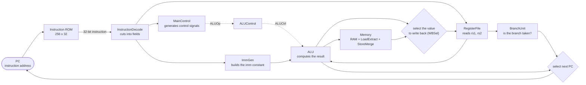

**How to read it.**  In each cycle the CPU does exactly one loop: fetch the instruction from ROM at PC, cut the instruction, read registers and build the constant, the ALU computes, (if needed) access RAM, select the value to write back into register `rd`, and select the next PC.  Dashed lines are control signals, solid lines are data.  The `main` CPU does this whole loop in **one** clock cycle; the `Pipeline` CPU splits the loop into 5 stages so that five instructions run overlapped.

---

## 1. InstructionDecode - cutting the instruction into fields

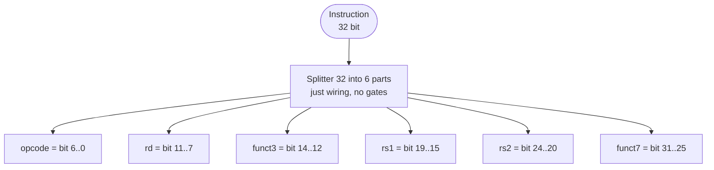

**Step-by-step explanation.**
1. The 32-bit instruction goes into a single splitter.
2. The splitter divides the bus into six wires at **fixed** bit positions: `opcode` (7 bits), `rd` (5), `funct3` (3), `rs1` (5), `rs2` (5), `funct7` (7).
3. There is no computation: this is just wiring, so it costs no time and there is nothing that can go wrong.

**Example:** instruction `00b50533` -> `opcode = 0x33` (R-type), `rd = 10`, `funct3 = 0`, `rs1 = 10`, `rs2 = 11`, `funct7 = 0` -> this is `add x10, x10, x11`.

**Special case:** U/J-type instructions have no real `rs1`/`rs2`/`funct3`; those bits are still cut out but the later blocks ignore them.  Because RISC-V always places `rs1` and `rs2` in the same spot, the registers can be read **while** the opcode is still being decoded.

---

## 2. MainControl - generating every control signal from the opcode

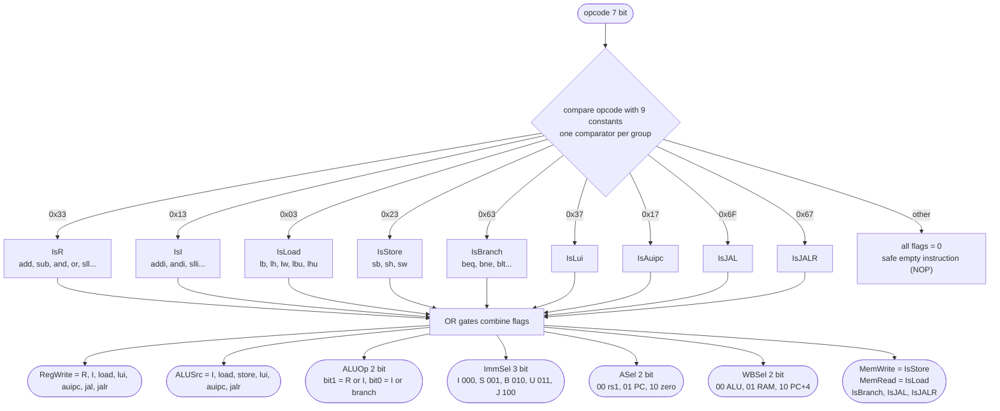

**Step-by-step explanation.**
1. Nine 7-bit comparators compare `opcode` with nine constants; only one reports "equal", producing the flag of that instruction group (`IsR`, `IsI`...).
2. OR gates (at most 3 inputs, so split into two halves) combine the flags into each signal: for example `RegWrite` is on for every group that **writes `rd`**; store and branch are not included, so they do not write registers.
3. Multi-bit signals (`ALUOp`, `ImmSel`, `ASel`, `WBSel`) are assembled from single bits with a splitter.
4. An unknown opcode makes every flag 0, so the instruction does nothing (NOP) without corrupting the state.

**Result table for some instructions** (checked with `tests/maincontrol.vec`):

| Instruction | RegWrite | ALUSrc | MemWrite | MemRead | ALUOp | ImmSel | ASel | WBSel |
|---|:-:|:-:|:-:|:-:|:-:|:-:|:-:|:-:|
| `add` (R) | 1 | 0 | 0 | 0 | 10 | - | 00 | 00 |
| `addi` (I) | 1 | 1 | 0 | 0 | 11 | 000 | 00 | 00 |
| `lw` | 1 | 1 | 0 | 1 | 00 | 000 | 00 | 01 |
| `sw` | 0 | 1 | 1 | 0 | 00 | 001 | 00 | - |
| `beq` | 0 | 0 | 0 | 0 | 01 | 010 | 00 | - |
| `lui` | 1 | 1 | 0 | 0 | 00 | 011 | 10 | 00 |
| `auipc` | 1 | 1 | 0 | 0 | 00 | 011 | 01 | 00 |
| `jal` | 1 | - | 0 | 0 | - | 100 | - | 10 |
| `jalr` | 1 | 1 | 0 | 0 | 00 | 000 | 00 | 10 |

---

## 3. ImmGen - building the immediate constant

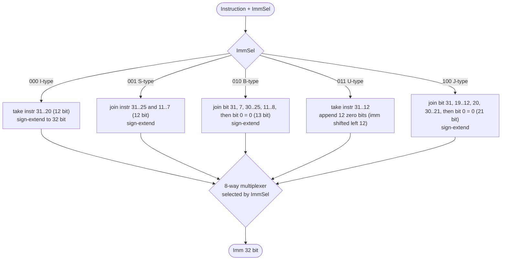

**Step-by-step explanation.**
1. All five ways of building the constant run **in parallel** from the same instruction (each is a few splitters plus a bit extender).
2. The multiplexer selects the result of exactly one way according to `ImmSel` (generated by `MainControl`).
3. **Sign extension** copies the highest bit of the constant into the upper bits, so negative numbers stay negative.  The U-type does not extend but inserts 12 zero bits (`lui`/`auipc` put the constant into the upper 20 bits).
4. Bit 0 of the B and J types is always 0 because instruction addresses are multiples of 2 (in practice 4); the instruction therefore does not store this bit.

**Example:** `fe059ce3` (`bnez x11, loop`, B-type): imm[12] = 1, imm[11] = 1, imm[10:5] = 111111, imm[4:1] = 1100, bit 0 = 0 -> 13 bits `1111111111000` -> sign-extended to **`0xFFFFFFF8` = -8**: jump back 8 bytes to the start of the loop.

---

## 4. RegisterFile - read two registers, write one register

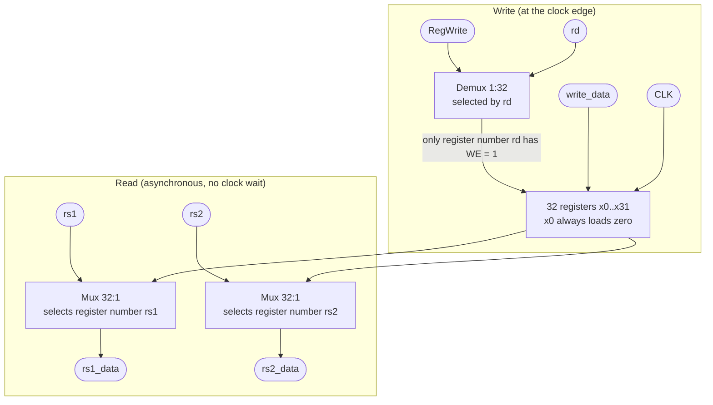

**Step-by-step explanation.**
1. **Read:** two 32-way multiplexers select the register by `rs1` and `rs2`; since there is no clock here, changing `rs1` changes `rs1_data` immediately (the single-cycle CPU needs the operands within the cycle).
2. **Write:** the demultiplexer sends `RegWrite` to **exactly one** register (number `rd`); that register loads `write_data` at the clock edge, the other registers keep their values.
3. `x0` has its input tied to 0 so it stays 0 forever, no matter what is written.

**Cases:** `RegWrite = 0` (store, branch) -> no register changes; `rd = 0` -> the write to x0 has no effect; reading and writing the same register in one cycle -> reads the old value (on the pipeline, this block writes at the **falling** edge so the instruction in ID sees the new value).

---

## 5. ALUControl - choosing the ALU operation

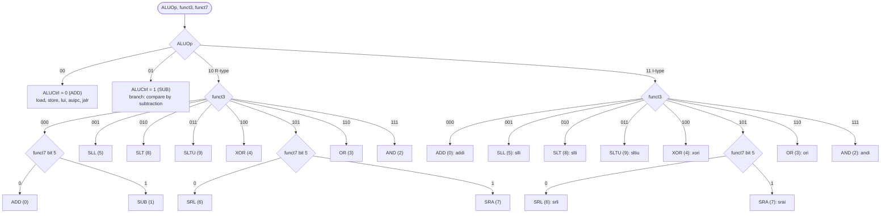

**Step-by-step explanation.**
1. `ALUOp`, supplied by `MainControl`, splits into four branches: 00 add, 01 subtract (no need to look at `funct`), 10 look up the R-type table, 11 look up the I-type table.
2. For R and I, `funct3` selects the operation (two 8-way multiplexers, one per table; each table row is a 4-bit constant).
3. `funct7[5]` (bit 30 of the instruction) does two things: in R-type it turns ADD into SUB and SRL into SRA; in I-type it only matters for shift instructions (`srai` differs from `srli`).  `addi` ignores this bit because it is part of the constant.

**Output codes:** 0 ADD, 1 SUB, 2 AND, 3 OR, 4 XOR, 5 SLL, 6 SRL, 7 SRA, 8 SLT, 9 SLTU.

---

## 6. ALU - compute in parallel, then select

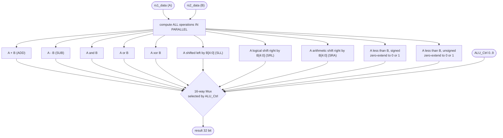

**Step-by-step explanation.**
1. Ten operations run at the same time from the same two operands; no operation "knows" which one is selected.
2. The 16-way multiplexer (using 10 inputs) takes exactly one result according to `ALU_Ctrl` (from `ALUControl`).
3. Shift instructions use only the low 5 bits of B (shift at most 31).  SRL inserts 0 bits at the top, SRA copies the sign bit.
4. SLT/SLTU produce a 1-bit result; **zero-extend** it to 32 bits to get exactly 0 or 1.  (A bug we hit: sign extension made SLTU return `0xFFFFFFFF`.)

**Example:** A = -1 (`0xFFFFFFFF`), B = 1: SLT gives 1 (since -1 < 1 signed), SLTU gives 0 (since 4294967295 is not less than 1).  Overflow in add/subtract is ignored: the result wraps around at 32 bits exactly as in RISC-V.

---

## 7. BranchUnit - is the branch taken

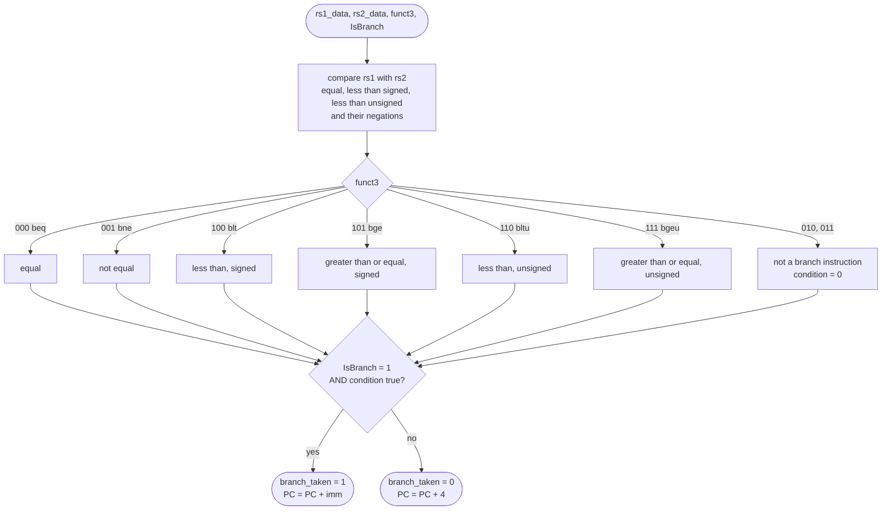

**Step-by-step explanation.**
1. One unsigned comparator and one signed comparator produce the "equal" and "less than" relations; three NOT gates produce the negations ("not equal", "greater than or equal").
2. An 8-way multiplexer driven by `funct3` selects the condition of exactly the branch instruction being executed.
3. The AND gate with `IsBranch` guarantees that other instructions (which also have a `funct3`) are **never** treated as taken branches.

**Example:** `bnez x11, loop` is `bne x11, x0`: when x11 = 9, 9 is not equal to 0 -> `branch_taken = 1`, PC returns to the start of the loop; when x11 = 0 they are equal -> `branch_taken = 0`, the loop ends.  `blt` and `bltu` differ only in which comparator is used (signed or unsigned): with -1 and 1, `blt` is taken, `bltu` is not.

---

## 8. LoadExtract - extracting the data of a load instruction

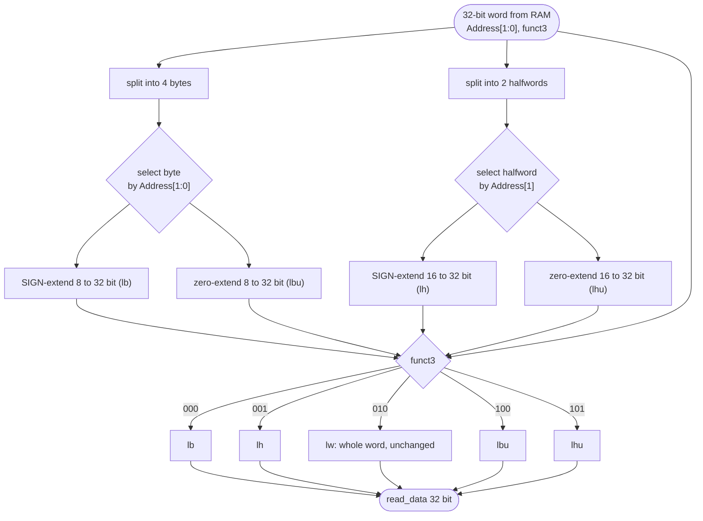

**Step-by-step explanation.**
1. RAM always reads the **entire 32-bit word**; cutting out a byte or halfword is the job of this block.
2. Two multiplexers select the byte (by `Address[1:0]`) and the halfword (by `Address[1]`).
3. Four bit extenders prepare all four results (signed and unsigned); the final multiplexer selects by `funct3` (000 lb, 001 lh, 010 lw, 100 lbu, 101 lhu).

**Example:** word `0x000000F0`, byte address 0: `lb` gives `0xFFFFFFF0` (0xF0 has sign bit = 1 so it is extended with all 1s), `lbu` gives `0x000000F0`, `lw` gives the whole `0x000000F0`.

---

## 9. StoreMerge - writing part of a word (read - modify - write)

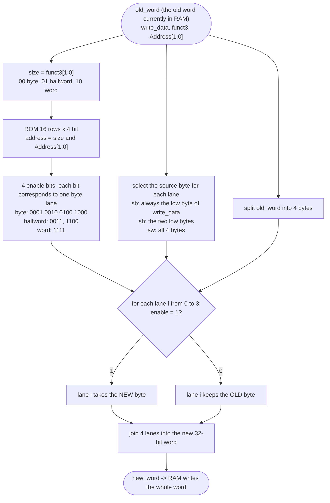

**Step-by-step explanation.**
1. RAM only writes a **whole word**, so when writing just one byte the other three bytes must be preserved.
2. The old word is read out (RAM reads asynchronously so it is available in the same cycle).
3. A small 16-row ROM converts `{size, Address[1:0]}` into 4 enable bits, each bit being one byte "lane".
4. For each lane: if enabled, take the new byte (from `write_data`), otherwise keep the old byte.  The four lanes are joined into the new word for RAM to write.

**Example:** old word `0x11223344`, `sb x1, 1(x0)` with x1 = `0xAA`: `size = 00` (byte), `Address[1:0] = 01` -> enable = `0010` (only lane 1) -> new word = `0x1122AA44`.

---

## 10. Memory - the data memory

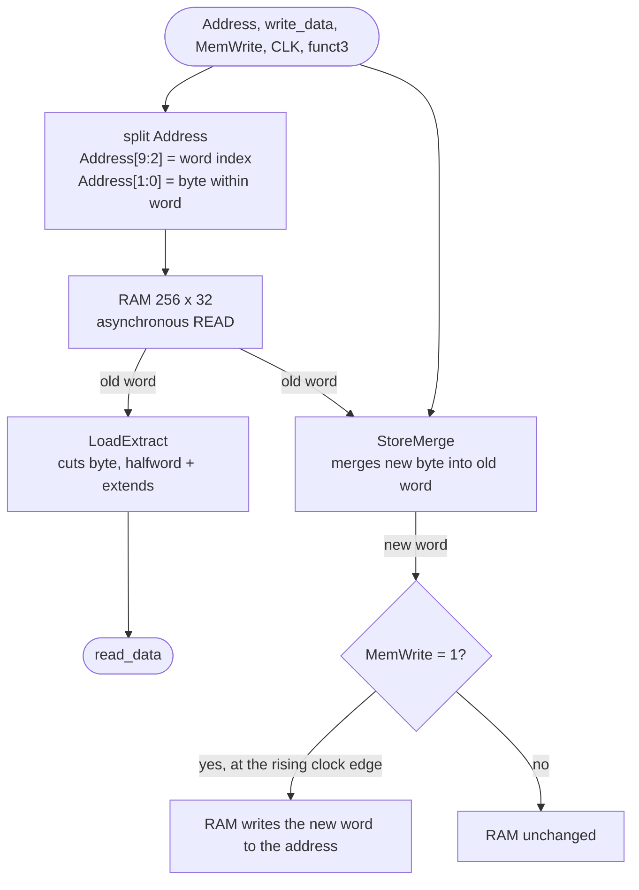

**Step-by-step explanation.**
1. The address is split: the word index (0..255) goes into RAM, the two low bits indicate the byte within the word.
2. RAM immediately returns the word at that address (asynchronous read).  `LoadExtract` turns this word into the value of the load instruction.
3. For a store instruction, `StoreMerge` builds the new word; only when `MemWrite = 1` does RAM write, at the rising clock edge.
4. Instructions that are not load/store have `MemWrite = 0` so RAM is unchanged; `read_data` still has a value but it is ignored at the write-back step.

**Why asynchronous read:** with a synchronous read the data would only appear after the next clock edge, and a load would return undefined data (a bug we hit and fixed).  Addresses of 1 KiB and above wrap around because only `Address[9:2]` is used.

---

## 11. `main` - single-cycle CPU: one instruction in one cycle

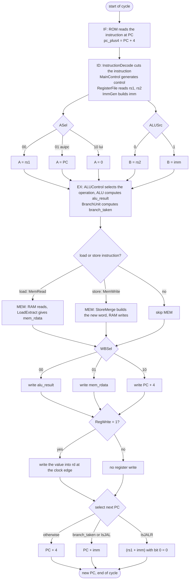

**Step-by-step explanation.**
1. **IF:** ROM receives `PC[9:2]` and returns the instruction; a separate adder computes `PC + 4`.
2. **ID:** the instruction is cut, control is generated, two registers are read, the constant is built; all four things happen in parallel.
3. **EX:** two multiplexers select operand A (`rs1`, `PC` or `0`) and B (`rs2` or `imm`); the ALU computes; `BranchUnit` decides the branch.
4. **MEM:** there is work only for load/store.
5. **WB:** the `WBSel` multiplexer selects the value to write (ALU, RAM or PC+4); if `RegWrite = 1` it is written into `rd`.
6. **Next PC:** `jalr` (target computed by the ALU, bit 0 cleared) has the highest priority; then a taken branch or `jal` (PC + imm); otherwise PC + 4.

**Why it is designed this way:** `lui`, `auipc`, `jal`, `jalr` reuse the same ALU and write-back path thanks to `ASel` and `WBSel`, with no extra dedicated hardware.

**Examples of each instruction group in `demo.s`:** see `DEMO_EXPLAIN.md` section 3 (add, addi, bnez, sw, lw, jal, ret, sub, slti) with the real values on each wire.

---

## 12. ForwardingUnit - choosing the newest source for the operand at EX

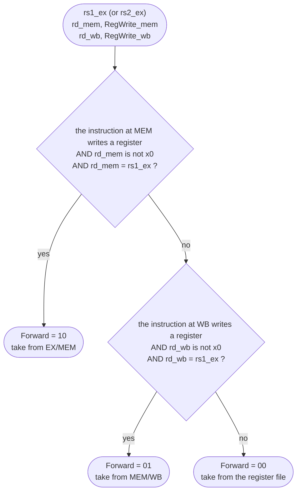

**Step-by-step explanation.**
1. The problem: the instruction at EX needs a register that an **earlier** instruction has not yet written into the register file (a RAW dependency: read after write).
2. Check the immediately preceding instruction (now at MEM) **first**: if it writes exactly the register needed, take its result from EX/MEM (`Forward = 10`).
3. If not, check the instruction one further back (now at WB): take from MEM/WB (`Forward = 01`).
4. If neither matches: use the value read from the register file (`00`).
5. This block runs twice: once for `rs1` (`ForwardA`), once for `rs2` (`ForwardB`).

**Why MEM has priority:** if both stages write that register, the instruction at MEM is newer so its value is the correct one.  **Why x0 is excluded:** x0 is always 0, and forwarding a "result" written to x0 would be wrong.  The value taken from EX/MEM is the ALU result, **except for `jal`/`jalr`, where it is PC + 4**.

**Example (`hazards_demo.s`):** `li x1,100` followed immediately by `sw x1,0(x0)`: when `sw` is at EX, `li` is at MEM, `rd_mem = 1 = rs2_ex` -> `ForwardB = 10`.

---

## 13. HazardUnit - detecting load-use and stalling the pipeline

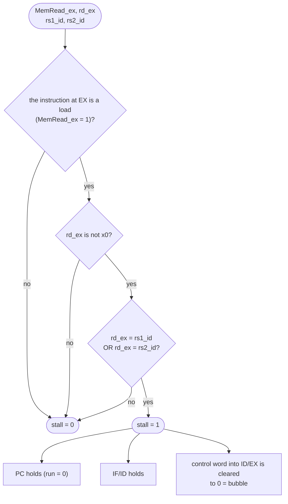

**Step-by-step explanation.**
1. A load instruction only has its data at the **end of the MEM stage**, too late for the next instruction to use at EX; forwarding cannot save it.
2. Stall condition: the instruction at EX is a load, its destination is not x0, and the instruction at ID uses exactly that register (`rs1` or `rs2`).
3. When `stall = 1`: PC and IF/ID hold for one cycle (the instruction at ID must wait), and ID/EX receives an empty instruction (bubble).  In the next cycle the load is at MEM/WB so forwarding can get the data.

**The cost is exactly 1 cycle.**  Load, one unrelated instruction, then the use: no stall.  **Example:** `lw x2,0(x0)` then `addi x3,x2,1`: at tick 4 `stall = 1`, at tick 5 PC stays at 0x10.

---

## 14. `Pipeline` - one cycle of the 5-stage CPU

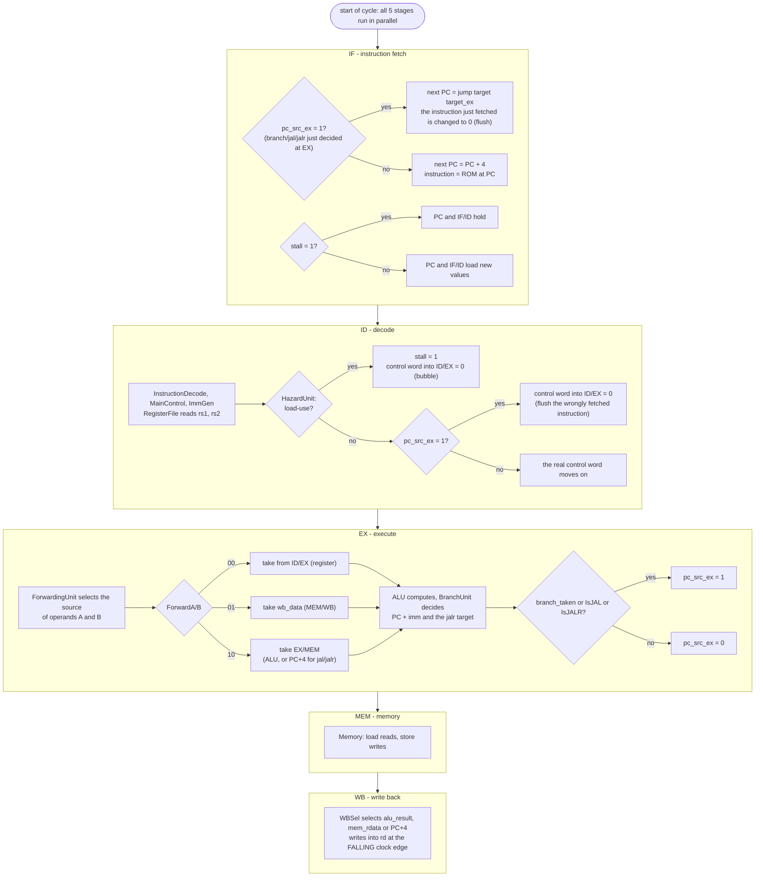

**Step-by-step explanation.**
1. In each cycle the five stages work on **five different instructions**; four pipeline registers (IF/ID, ID/EX, EX/MEM, MEM/WB) hold everything each instruction needs in the later stages, including the packed "control word" generated once at ID.
2. **Stall (load-use):** `HazardUnit` sees that the instruction at ID depends on the load at EX -> hold PC and IF/ID, insert a bubble into ID/EX.
3. **Forwarding:** at EX, if an operand is already available from an earlier instruction that has not finished writing, `ForwardingUnit` feeds it straight into the ALU.
4. **Flush (control hazard):** branch, `jal`, `jalr` are decided at EX; when `pc_src_ex = 1`, PC jumps to the target and the **two instructions already fetched behind are discarded** (turned into bubbles): this costs 2 cycles.  A branch not taken costs nothing.
5. **The register file writes at the falling edge** (`CLK_n`): the instruction at WB writes in the first half of the cycle, the instruction at ID reads in the second half and so sees the new value (no need to forward at a distance of 3 instructions).

**Cases (summary):**

| Situation | Sign on the probe | How it is resolved | Cost |
|---|---|---|---|
| uses an ALU value just computed | `ForwardA/B` = 10 or 01 | forwarding | 0 cycles |
| uses a value just loaded | `stall` = 1, PC holds for 1 tick | stall + forwarding | 1 cycle |
| branch/jal/jalr taken | `pc_src_ex` = 1, then `instr_id` = 0 | flush 2 instructions | 2 cycles |
| branch not taken | `pc_src_ex` = 0 | nothing | 0 cycles |

For the tick-by-tick details of `hazards_demo.s` see `DEMO_EXPLAIN.md` section 6.

---

## 15. Quick comparison table: what question each circuit answers

| Circuit | The question it answers | Main inputs | Main outputs |
|---|---|---|---|
| InstructionDecode | Which fields does the instruction consist of? | `Instruction` | `opcode rd funct3 rs1 rs2 funct7` |
| MainControl | Which signals must this instruction turn on? | `opcode` | `RegWrite ALUSrc MemWrite MemRead IsBranch ALUOp ImmSel ASel WBSel IsJAL IsJALR` |
| ImmGen | What is the constant in the instruction? | `Instruction`, `ImmSel` | `Imm` |
| RegisterFile | What are the values of the source registers, and where to write? | `rs1 rs2 rd write_data RegWrite` | `rs1_data rs2_data` |
| ALUControl | Which operation must the ALU perform? | `ALUOp funct3 funct7` | `ALUCtrl` |
| ALU | What is the result of the operation? | `rs1_data rs2_data ALU_Ctrl` | `result` |
| BranchUnit | Is the branch taken? | `rs1_data rs2_data funct3 IsBranch` | `branch_taken` |
| LoadExtract | What is the loaded value? | word from RAM, `Address[1:0]`, `funct3` | `read_data` |
| StoreMerge | What is the new word written to RAM? | old word, `write_data`, `funct3`, `Address[1:0]` | `new_word` |
| Memory | How are RAM reads/writes done? | `Address write_data MemWrite funct3` | `read_data` |
| `main` | How does one instruction run to completion? | clock | PC, registers, RAM |
| ForwardingUnit | Where to take the operand from to be correct? | `rs1_ex rs2_ex rd_mem rd_wb RegWrite_*` | `ForwardA ForwardB` |
| HazardUnit | Must the pipeline stall? | `MemRead_ex rd_ex rs1_id rs2_id` | `stall` |
| `Pipeline` | How do five instructions run overlapped? | clock | PC, registers, RAM |
