# Kiến trúc: component, bảng kê, nhật ký thiết kế, sơ đồ luồng

Từng loại component và lý do cấu hình, bảng kê vật tư của mọi circuit, nhật ký thiết kế, và sơ đồ luồng Mermaid của 14 circuit.

## Nội dung
- Components: cấu hình và lý do sử dụng
- Bảng kê vật liệu (Bill of materials)
- Nhật ký thiết kế
- Sơ đồ luồng (flowchart) của từng circuit

---

## Components: cấu hình và lý do sử dụng

Trang này giải thích từng **loại component của Logisim** được dùng trong dự án: nó là gì, **ta dùng những cài đặt nào và vì sao**, nó xuất hiện ở đâu, và những cái bẫy mà ta đã vấp phải.  Để xem cấu hình chính xác của từng component trong từng circuit, xem [BOM.md](KIEN_TRUC.md) (sinh ra từ file thật).
Để biết các khối phối hợp với nhau thế nào, xem [GUIDE.md](HUONG_DAN.md).

Trong file circuit, các cài đặt được lưu dưới dạng attribute (`<a name="width" val="32"/>`).  Các bảng dưới đây ghi cả **tên trong file** và **tên hiển thị trong bảng attribute của Logisim** (chọn component bằng công cụ mũi tên; các cài đặt hiện ở góc dưới bên trái).
Mọi giá trị "default" đều được đọc trực tiếp từ Logisim 4.1.0.

Mục lục: [0 Cài đặt toàn dự án](#0-cài-đặt-toàn-dự-án) - [1 Trạng thái](#1-trạng-thái-register-ram-rom) - [2 Chọn và định tuyến](#2-chọn-và-định-tuyến-multiplexer-demultiplexer-splitter) -
[3 Số học](#3-số-học-và-so-sánh-adder-subtractor-comparator-shifter-bit-extender) - [4 Cổng logic](#4-cổng-logic) - [5 Đi dây và I/O](#5-đi-dây-và-io-constant-pin-tunnel-probe-clock-text) -
[6 Sub-circuit](#6-sub-circuit) - [7 Quyết định thiết kế](#7-quyết-định-thiết-kế-vì-sao-chọn-cái-này-mà-không-phải-cái-kia) - [8 Công thức](#8-công-thức-tự-dựng-một-component-bằng-tay)

---

### 0. Cài đặt toàn dự án

| Cài đặt | Giá trị | Ở đâu | Vì sao |
|---|---|---|---|
| Phiên bản Logisim | 4.1.0 (Java 21+) | header của file `source="4.1.0"` | phiên bản cả nhóm đã cài |
| Đầu ra của cổng khi không xác định (`gateUndefined`) | `ignore` | Project > Options > Simulation | các đầu vào cổng không nối sẽ bị bỏ qua thay vì tạo ra giá trị lỗi |
| Giới hạn số vòng lặp (`simlimit`) | 1000 | như trên | số bước trước khi Logisim báo "oscillation"; các CPU ổn định với số bước ít hơn nhiều, nên một vòng lặp thật sẽ bị phát hiện nhanh |
| Nhiễu trên độ trễ component (`simrand`) | 0 (tắt) | như trên | mô phỏng phải mang tính xác định để các test lặp lại được |
| Lưới (Grid) | 10 px | cố định bởi Logisim | mọi component và dây phải nằm trên lưới; các phần tử lệch lưới bị *dịch chuyển* khi nạp file và khi đó dây sẽ lệch khỏi pin |
| Font | `Monospaced` | mọi text và label | theo yêu cầu cho tài liệu / demo; áp dụng bởi `tools/build/fonts.py` |
| Clock | một `Clock` cho mỗi CPU, high 1 tick / low 1 tick (mặc định) | `main`, `Pipeline` | một chu kỳ đầy đủ = 2 tick (cạnh lên + cạnh xuống); `Simulate > Manual Tick Full Cycle` (Ctrl+F9) thực hiện cả hai.  Clock được bước bằng tay nên tần số không quan trọng |
| Các thư viện được dùng | Wiring, Gates, Plexers, Arithmetic, Memory, Base | cây dự án | các thư viện khác trong file (I/O, TTL, FP, ...) chỉ là template mặc định của Logisim và không được dùng |
| Độ rộng dữ liệu | 32 bit ở mọi nơi trong datapath; 5 bit cho số hiệu register, 3 cho `funct3`, 7 cho `opcode` / `funct7` | | RV32I |
| Reset | pin `RESET` (mặc định 0) điều khiển đầu vào *clear* của register PC | `main`, `Pipeline` | đưa PC về 0 mà không reset toàn bộ mô phỏng |

---

### 1. Trạng thái: Register, RAM, ROM

#### Register
Một register lưu giá trị ở **cạnh lên của clock** khi enable bằng 1.

| Tên trong file | Tên trong GUI | Giá trị dùng | Default | Vì sao |
|---|---|---|---|---|
| `width` | Data Bits | 32 (PC, register file); 5, 3, 7, 13 cho các trường pipeline | 8 | mỗi trường một register, kích thước theo trường (5 = số hiệu register, 3 = `funct3`, 7 = `funct7`, 13 = control word) |
| `trigger` | Trigger | Rising Edge | rising | mọi thay đổi trạng thái diễn ra ở cạnh lên nên mọi thứ cập nhật "cùng lúc" |
| `appearance` | Appearance | `logisim_evolution` | như nhau | vẽ tên pin D, Q, WE, clk, R trên hộp: dễ đọc hơn hộp classic trơn |
| `label` | Label | `PC`, `x0`..`x31`, tên trong pipeline | không có | test runner tìm PC và các register theo label; các label trong pipeline đặt tên cho các register của từng stage |
| `labelvisible` | (hiển thị label) | true cho các register pipeline | false | hiển thị `pc_ex`, `alu_result_mem`, ... phía trên mỗi register trong hình Pipeline |

Các pin: **D** dữ liệu vào, **Q** dữ liệu ra, **WE** enable, **clk**, **R** clear bất đồng bộ.
* WE: nối với hằng số 1 khi register luôn nạp; nối với `run` (= not stall) cho PC và register IF/ID, những register phải *giữ nguyên* trong lúc stall load-use.
* R: chỉ PC dùng (`RESET`).  R không nối được coi là 0 (không clear).
* Register khởi động với giá trị 0.  Do đó các register pipeline bắt đầu là bubble (instruction 0 = NOP).
* Trong pipeline, pin clock của register file nhận **clock đảo** (`CLK_n`), nên các register của nó nạp ở cạnh *xuống* của `CLK`.

Được dùng: PC (1), register file (32 x 32 bit), các register pipeline (23).

#### RAM (data memory) - cài đặt tinh tế nhất
| Tên trong file | Tên trong GUI | Giá trị dùng | Default | Vì sao |
|---|---|---|---|---|
| `addrWidth` | Address Bit Width | 8 | 8 | 256 word |
| `dataWidth` | Data Bit Width | 32 | 8 | một word RV32 |
| `asyncread` | Asynchronous read | **true** | false | lệnh load phải trả dữ liệu ngay trong chu kỳ mà địa chỉ được đưa vào.  Với đọc mặc định (đồng bộ), dữ liệu chỉ xuất hiện sau cạnh clock kế tiếp, nên mọi lệnh load trong dự án gốc đều trả về dữ liệu không xác định |
| `enables` | Enables | **line** (Use line enables) | byte | chế độ line có một pin write-enable và một clock; chế độ byte cần một enable cho mỗi byte.  Việc store dưới một word được làm trong `StoreMerge`, đơn giản hơn và test được |
| `databus` | Data bus implementation | separate (mặc định, trong file gọi là `bibus`) | separate | pin data-in / data-out riêng biệt: không có bus hai chiều nên không có xung đột (contention) |
| `type` | Ram type | volatile | volatile | nội dung mất khi reset (ban đầu toàn 0) |
| `trigger` | Trigger | rising | rising | việc ghi diễn ra ở cạnh lên |
| `appearance` | Appearance | `classic` | `logisim_evolution` | ký hiệu classic có kích thước 240 x 154 px; kiểu kia cao 730 px (nó hiển thị nội dung) |

Các pin ở chế độ line: `addr`, `dout` (luôn được enable: chế độ này không có pin OE), `din`, `we`, `clk`.
Vì `dout` luôn bật nên `StoreMerge` có thể đọc word cũ trong khi chuẩn bị word mới.
Dùng một lần, trong `Memory`.

#### ROM (instruction memory và một bảng tra)
| Tên trong file | Tên trong GUI | Instruction ROM | Bảng byte-enable | Vì sao |
|---|---|---|---|---|
| `addrWidth` | Address Bit Width | 8 | 4 | 256 word, 16 hàng |
| `dataWidth` | Data Bit Width | 32 | 4 | instruction / bốn bit enable |
| `contents` | Contents | chương trình | `1 2 4 8 3 3 c c f f f f f f f f` | được nạp bởi bước build; thay đổi trong GUI bằng *Edit Contents* |
| `appearance` | Appearance | classic | classic | gọn |

Vì sao dùng ROM cho byte enable: 16 tổ hợp của `{size, address[1:0]}` là một bảng chân trị; ROM 16 hàng là cách ngắn nhất và đúng để viết ra, và nội dung đọc được
(`1 2 4 8` = từng byte đơn, `3 3 c c` = halfword, `f` = word).  Vì sao dùng ROM cho chương trình: instruction memory chỉ đọc và được đọc tổ hợp theo PC.

---

### 2. Chọn và định tuyến: Multiplexer, Demultiplexer, Splitter

#### Multiplexer
Một multiplexer sao chép một trong `2^select` đầu vào ra đầu ra.

| Tên trong file | Tên trong GUI | Default | Ghi chú |
|---|---|---|---|
| `select` | Select Bits | 1 | số bit select: số đầu vào = 2^select |
| `width` | Data Bits | 1 | độ rộng của mỗi đầu vào dữ liệu và của đầu ra |
| `enable` | Include Enable? | no | không bao giờ dùng |
| `facing`, `size`, `selloc`, `disabled` | Facing, Gate Size, Select Location, Disabled Output | east, 40, bottom-left, 0 | mặc định |

Pin select nằm ở cạnh dưới, các đầu vào dữ liệu ở bên trái, đánh số từ trên xuống (đầu vào 0 là đầu trên cùng).

| Ở đâu | select / width | Chọn |
|---|---|---|
| Kết quả ALU | 4 / 32 (16 đầu vào, dùng 10) | một trong 10 phép toán theo `ALUCtrl` |
| Cổng đọc của register file (2) | 5 / 32 | register `rs1` / `rs2` |
| Toán hạng A của ALU | 2 / 32 | `rs1`, PC, 0 (theo `ASel`) |
| Toán hạng B của ALU | 1 / 32 | `rs2` hoặc immediate (theo `ALUSrc`) |
| Write-back | 2 / 32 | ALU, memory, PC+4 (theo `WBSel`) |
| Next PC | 1 / 32 (hai cái nối tiếp) | `PC+4` / `pc_target` / `jalr_target` |
| ImmGen | 3 / 32 (8 đầu vào, dùng 5) | immediate I, S, B, U, J |
| ALUControl | 3 / 4 (nhiều cái) | giải mã `funct3` thành mã `ALUCtrl` |
| BranchUnit | 3 / 1 | phép so sánh được chọn theo `funct3` |
| LoadExtract | 2 / 8, 1 / 16, 3 / 32 | byte, halfword, kết quả cuối theo `funct3` |
| StoreMerge | 2 / 8 (3), 1 / 8 (4) | byte nguồn cho mỗi lane, byte cũ / mới cho mỗi lane |
| Pipeline | 2 / 32 (forwarding A và B), 1 / 32 (giá trị memory được forward, flush của instruction vừa fetch), 1 / 13 (bubble trong control word) | |

Cài đặt quan trọng: **width phải bằng độ rộng của các bus** được nối (sai khác hiện ra là dây màu cam); các đầu vào dữ liệu không dùng có thể để hở, vì chỉ đầu vào được chọn mới tới đầu ra.
Vì sao dùng mux mà không dùng bus tri-state: không xung đột, luồng dữ liệu nhìn thấy được, mô phỏng mang tính xác định.

#### Demultiplexer
Gửi đầu vào dữ liệu của nó tới **một** trong `2^select` đầu ra; các đầu ra còn lại xuất 0 (`Disabled Output` = 0, mặc định).

| Cài đặt | Giá trị | Vì sao |
|---|---|---|
| Select Bits | 5 | 32 đầu ra, mỗi register một đầu ra |
| Data Bits | 1 (mặc định) | đầu vào dữ liệu là `RegWrite`, một bit |
| Three-state | no | các đầu ra không được chọn bị kéo về 0, không thả nổi |

Dùng một lần: `RegisterFile`.  Đầu vào = `RegWrite`, select = `rd`, đầu ra *i* = write enable của register *i*.  Khi `RegWrite = 0` mọi write enable đều bằng 0.
Một decoder thường cũng dùng được nhưng sẽ cần thêm một cổng AND với `RegWrite` cho mỗi đầu ra.

#### Splitter
Cắt một bus rộng thành các phần hoặc gộp các phần thành một bus.

| Tên trong file | Tên trong GUI | Ghi chú |
|---|---|---|
| `incoming` | Bit Width In | độ rộng của bus đã gộp |
| `fanout` | Fan Out | số phần |
| `bitN` | Bit N | bit N đi tới phần nào (một cài đặt cho mỗi bit) |
| `facing` | Facing | **east**: bus ở bên trái, các phần ở bên phải (tách); **west**: bus ở bên phải, các phần ở bên trái (gộp) |
| `spacing` | Spacing | 3 trong mọi circuit được sinh ra = 30 px giữa các pin (mặc định 1 = 10 px) |

Công dụng: cắt một instruction thành các trường (`fanout 6`), `PC[9:2]` (`fanout 3`: bit 1:0 / 9:2 / 31:10), địa chỉ thành byte offset và word index, đóng gói và giải nén control word của pipeline
(`fanout 10`, rộng `13` bit), tạo bus 2 / 3 bit từ các tín hiệu đơn (`ALUOp`, `ImmSel`, `ASel`, `WBSel`), bốn byte lane của một word.
Vì sao `spacing 3`: với khoảng cách 10 px giữa các pin thì không còn chỗ để gắn một tunnel có label vào từng pin.

---

### 3. Số học và so sánh: Adder, Subtractor, Comparator, Shifter, Bit Extender

#### Adder
`Data Bits` = 32.  Đầu vào A, B, carry-in; đầu ra sum, carry-out.  Carry-in và carry-out **để hở**; carry-in không nối được tính là 0 (các test chứng minh điều đó).
Được dùng: `PC + 4`, `PC + imm` (địa chỉ đích branch / JAL), phép ADD của ALU.

#### Subtractor
`Data Bits` = 32; tính A - B (các pin borrow để hở).  Dùng một lần: phép SUB của ALU.  Vì sao dùng subtractor riêng thay vì "adder với B đảo": rõ ràng hơn và không tốn gì trong Logisim.

#### Comparator
Xuất ba bit: A > B, A = B, A < B.

| Tên trong file | Tên trong GUI | Giá trị | Ghi chú |
|---|---|---|---|
| `width` | Data Bits | 32, 7, 5 | 32 cho dữ liệu, 7 cho opcode, 5 cho số hiệu register |
| `mode` | Numeric Type | `unsigned` hoặc two's complement (mặc định) | **tính có dấu / không dấu rất quan trọng với dữ liệu 32 bit**: SLT và `blt` / `bge` dùng two's complement, SLTU và `bltu` / `bgeu` dùng unsigned.  Với so sánh opcode và số hiệu register thì không quan trọng; dùng unsigned |

Được dùng: 9 comparator opcode trong `MainControl`; ALU (SLT có dấu, SLTU không dấu); `BranchUnit` (mỗi loại một cái); so sánh số hiệu register trong `ForwardingUnit` và `HazardUnit`.

#### Shifter
| Tên trong file | Tên trong GUI | Giá trị | Vì sao |
|---|---|---|---|
| `width` | Data Bits | 32 | |
| `shift` | Shift Type | `ll` (logical left, mặc định), `lr` (logical right), `ar` (arithmetic right) | mỗi loại một shifter cho SLL, SRL, SRA |

Đầu vào shift amount rộng 5 bit (`B[4:0]`), đúng như RISC-V quy định.

#### Bit Extender
Mở rộng một bus.

| Tên trong file | Tên trong GUI | Giá trị | Dùng cho |
|---|---|---|---|
| `in_width` / `out_width` | Bit Width In / Out | 12, 13, 21 -> 32; 8, 16 -> 32; 1 -> 32 | immediate, byte / halfword được load, kết quả SLT |
| `type` | Extension Type | `sign` (mặc định) hoặc `zero` | **sign** cho immediate và cho `lb` / `lh`; **zero** cho `lbu` / `lhu` và cho kết quả SLT / SLTU 1 bit (kết quả so sánh là 0 hoặc 1, không bao giờ là -1) |

(Một trong các lỗi ban đầu: extender của SLTU là *sign* và trả về `0xFFFFFFFF` thay vì 1.)

---

### 4. Cổng logic

| Cổng | Cài đặt | Dùng |
|---|---|---|
| AND, OR, XOR | `width` (Data Bits): 32 tạo cổng theo từng bit cho ALU; `inputs` (Number Of Inputs): mặc định 2, 3 cho các cây OR của `MainControl` | AND / OR / XOR của ALU (32 bit); mặt nạ địa chỉ JALR (AND 32 bit với `0xFFFFFFFE`); các phương trình control; điều kiện hazard / forwarding |
| NOT | không có | clock đảo `CLK_n`; điều kiện `!=`, `>=`; "not stall" |

Vì sao dùng cây OR tối đa 3 đầu vào: cổng OR rộng có các pin đầu vào cách nhau chỉ 10 px, không còn chỗ cho label; hai cổng nhỏ dễ đọc hơn.  Kích thước cổng để mặc định.
Tùy chọn `gateUndefined = ignore` (mục 0) làm cho các đầu vào không dùng trở nên vô hại.

---

### 5. Đi dây và I/O: Constant, Pin, Tunnel, Probe, Clock, Text

#### Constant
| Tên trong file | Tên trong GUI | Default | Ghi chú |
|---|---|---|---|
| `value` | Value | **1** | **bẫy**: mặc định là 1, không phải 0, và Logisim không ghi giá trị mặc định vào file, nên một constant không có dòng `value` *chính là* số một (trong [BOM.md](KIEN_TRUC.md) các constant như vậy được đánh dấu).  Một constant "zero" không được đặt `value=0x0` đã làm `lui` tính ra `x+1` một lần |
| `width` | Data Bits | 1 | phải khớp với bus |

Được dùng: các constant opcode (7 bit, `MainControl`), các mã `ALUCtrl` (4 bit, 19 cái trong `ALUControl`), `0`, `4`, `0xFFFFFFFE` (32 bit), số hiệu register 0 (5 bit), 12 bit không của U-immediate, control word toàn 0.

#### Pin
Các pin input và output định nghĩa giao diện của một circuit.

| Tên trong file | Tên trong GUI | Giá trị | Vì sao |
|---|---|---|---|
| `type` | Type | input (mặc định) / `output` | |
| `width` | Data Bits | 1..32 | |
| `label` | Label | tên của tín hiệu | **trở thành tên pin trên hộp sub-circuit** |
| `radix` | Radix | 16 cho pin dữ liệu 32 bit (mặc định 2) | giá trị dễ đọc khi poke |
| `facing` | Facing | east cho input, west cho output (các khối vẽ tay còn dùng north / south) | |
| `appearance` | Appearance | classic | pin hình chữ nhật hiển thị giá trị |
| `initial` | Reset value | 0 (mặc định) | vì vậy `RESET` bắt đầu ở 0 |

**Thứ tự các pin** bên trong một circuit quyết định thứ tự của chúng trên hộp: input ở bên trái sắp xếp từ trên xuống dưới, output ở bên phải.  Các circuit được sinh ra đặt pin thành một cột theo đúng thứ tự mong muốn.

#### Tunnel
Một đầu dây có label; mọi tunnel cùng label trong một circuit đều được nối với nhau.

| Tên trong file | Tên trong GUI | Giá trị | Vì sao |
|---|---|---|---|
| `label` | Label | tên tín hiệu | phân biệt hoa thường |
| `width` | Data Bits | = độ rộng của net | **phải bằng độ rộng bus** (mặc định 1), nếu không dây sẽ màu cam |
| `facing` | Facing | west (hộp ở bên phải đầu dây) hoặc east (hộp ở bên trái) | hộp label kéo dài ra xa component |

Vì sao dùng tunnel thay vì dây: một CPU có hàng trăm kết nối; dây dài cắt nhau và trở nên không đọc được.  Tunnel là một *cái tên*, và tên là thứ mà báo cáo và guide nói đến.
Dự án có khoảng 900 tunnel.  Bộ sinh đặt một tunnel trên mọi pin cần kết nối.

#### Probe
`radix` = 16 (2 cho tín hiệu 1 bit) và `label` = tên net.  `main` có 15 probe, `Pipeline` có 27, xếp thành các hàng dưới mạch, mỗi probe có mô tả tiếng Việt.  Hiển thị một giá trị mà không là một phần của logic (hình oval màu vàng).  Không cần cho chức năng, hữu ích cho demo.  **Không** dùng radix 10 (`Ends` / Logisim bị treo): dùng 16.

#### Clock
`High Duration` = `Low Duration` = 1 tick, `Phase Offset` 0 (tất cả đều mặc định).  Mỗi CPU một cái; đầu ra của nó là tunnel `CLK` cấp cho PC, các register pipeline, RAM và (đảo) register file.

#### Text
Chỉ để chú thích (tiêu đề, giải thích, bảng).  Font `Monospaced`.  Dự án có khoảng 200 text; chúng không ảnh hưởng tới circuit.

---

### 6. Sub-circuit

Một circuit được dùng như một component.  Các cài đặt (trên circuit, trong file là `<a name="appearance" val="logisim_evolution"/>` v.v.):

| Cài đặt | Giá trị | Vì sao |
|---|---|---|
| Appearance | `logisim_evolution` (hộp có thanh tên màu đen) | kiểu chuẩn; các pin được đặt tự động theo thứ tự pin |
| `circuitnamedboxfixedsize` | true | kích thước hộp phụ thuộc số pin, không phụ thuộc tên |
| Vị trí pin | input bên trái, output bên phải (sắp xếp theo vị trí pin bên trong) | |
| Vị trí của một instance | vị trí của **pin output đầu tiên** của nó | Logisim neo hộp theo cách đó |

Các instance được liệt kê trong [BOM.md](KIEN_TRUC.md).

---

#### Từng khối một: mỗi circuit được tạo nên từ những gì

(Danh sách chính xác kèm số lượng: [BOM.md](KIEN_TRUC.md).)

| Circuit | Component và cài đặt | Vì sao |
|---|---|---|
| `InstructionDecode` | 1 splitter, 32 bit -> 6 phần (7, 5, 5, 3, 5, 7 bit) | các trường của instruction nằm ở vị trí bit cố định: chỉ là đi dây, không có logic |
| `MainControl` | 9 comparator (7 bit, unsigned) mỗi cái với một constant 7 bit; các cổng OR 3 đầu vào; bus 2 bit và 3 bit tạo bằng splitter | một comparator cho mỗi opcode là cách dễ đọc nhất để viết bảng opcode; các OR hiện thực các phương trình "những lớp lệnh nào set tín hiệu này" |
| `ImmGen` | 8 splitter (cắt các trường ra khỏi instruction và gộp lại theo đúng thứ tự), 4 bit extender có dấu (I, S, B, J: 12, 12, 13, 21 -> 32 bit), với loại U dùng constant 0 rộng 12 bit và một splitter gộp thay cho extender, hai constant 0 1 bit cho bit 0 luôn bằng 0 của B và J, một multiplexer 8:1 x 32 | các bit immediate bị xáo trộn được sắp xếp lại bằng splitter; multiplexer chọn định dạng theo `ImmSel` |
| `RegisterFile` | 32 register (32 bit, label `x0..x31`), 1 demultiplexer (select 5), 2 multiplexer (select 5, 32 bit), một constant 0 32 bit cho x0 | ghi: demux chuyển `RegWrite` tới register `rd`; đọc: multiplexer bất đồng bộ; x0 chỉ có thể nạp 0 |
| `ALUControl` | 5 multiplexer 4 bit: hai cái 8:1 (bảng R-type và bảng I-type, chọn theo `funct3`), hai cái 2:1 (ADD / SUB và SRL / SRA, chọn theo bit 5 của `funct7`), một cái 4:1 (chọn theo `ALUOp`: ép add, ép sub, bảng R, bảng I); 19 constant 4 bit (các mã `ALUCtrl`) | một bảng mã là một constant cho mỗi mục được chọn bởi một multiplexer: mỗi hàng của bảng control là một constant nhìn thấy được |
| `ALU` | adder, subtractor, các cổng AND / OR / XOR 32 bit, 3 shifter (`ll`, `lr`, `ar`), comparator có dấu và không dấu + extender 1 -> 32 zero, một multiplexer 16:1 x 32 | mọi phép toán được tính song song, multiplexer chọn một theo `ALUCtrl` (đơn giản; tốc độ không quan trọng trong Logisim) |
| `BranchUnit` | comparator 32 bit unsigned + signed, 3 cổng NOT, một multiplexer 8:1 x 1, một cổng AND | sáu điều kiện branch là ba phép so sánh và phủ định của chúng |
| `LoadExtract` | splitter (4 byte, 2 half), multiplexer 4:1 x 8 và 2:1 x 16, 4 bit extender (sign / zero, 8 / 16 -> 32), một multiplexer 8:1 x 32 | chọn phần của word, mở rộng theo yêu cầu của instruction |
| `StoreMerge` | 6 splitter (word cũ, write data, size, địa chỉ byte-enable, byte enable, word mới), 3 multiplexer byte (byte nguồn cho mỗi lane), một ROM 16 x 4, 4 multiplexer byte hai đường | read-modify-write một word |
| `Memory` | RAM (256 x 32, đọc async, line enables), `LoadExtract`, `StoreMerge`, 1 splitter địa chỉ (byte offset / word index) | xem mục 1 |
| `ForwardingUnit` | 6 comparator (5 bit, unsigned), các cổng AND / NOT, 2 splitter tạo select 2 bit | so sánh số hiệu register, một quy tắc cho mỗi nguồn |
| `HazardUnit` | 3 comparator (5 bit), OR, NOT, AND 3 đầu vào | điều kiện load-use |
| `main` | register PC, ROM, 2 adder (PC+4, PC+imm), một AND 32 bit với mặt nạ 0xFFFFFFFE, một cổng OR, 5 multiplexer (A, B, write-back, hai cái cho next PC), 8 sub-circuit | datapath ở mục 4 của guide |
| `Pipeline` | 24 register (PC + 23 register pipeline), 8 splitter (các bit PC, đóng gói / giải nén control word), 10 sub-circuit, các multiplexer forwarding và flush, một cổng NOT cho `CLK_n` | phiên bản 5 stage |

### 7. Quyết định thiết kế: vì sao chọn cái này mà không phải cái kia

| Quyết định | Phương án thay thế | Vì sao ta chọn như vậy |
|---|---|---|
| Instruction ROM và data RAM tách biệt (Harvard) | một memory dùng chung | không có structural hazard trong pipeline (fetch và truy cập dữ liệu trong cùng chu kỳ); đơn giản |
| Register file làm từ 32 `Register` + mux + demux | RAM làm register file (dual RAM) | nhìn thấy được: mỗi register là một hộp có label để đọc; `x0` có thể nối cứng về 0; pipeline ghi ở cạnh xuống, điều này rất đơn giản với register |
| Register file đọc bất đồng bộ | đọc theo clock | CPU single-cycle cần toán hạng ngay trong cùng chu kỳ |
| RAM đọc bất đồng bộ, line enables | đọc đồng bộ / byte enables | dữ liệu load phải đến trong cùng chu kỳ; byte enables sẽ cần bốn strobe ghi |
| Store dưới một word = read-modify-write trong `StoreMerge` | RAM có byte-enable, 4 RAM 8 bit | một RAM, dễ test bằng test vector |
| Control hai tầng (`MainControl` -> `ALUOp` -> `ALUControl`) | một decoder lớn | các bảng nhỏ, mỗi bảng test riêng; cấu trúc kinh điển trong giáo trình |
| Control word sinh một lần ở ID và đóng gói | giải mã lại ở mỗi stage | một nguồn sự thật duy nhất; đóng gói làm số register pipeline ít và sơ đồ ngắn |
| Register file ghi ở cạnh xuống (pipeline) | forwarding từ WB sang ID | không cần thêm mux / comparator; mẹo trong giáo trình |
| Branch được giải quyết ở EX, luôn "not taken" | giải quyết ở ID, bộ dự đoán | nhỏ hơn và hiển nhiên đúng; tốn 2 chu kỳ cho mỗi branch được thực hiện (có thể cải thiện, xem báo cáo) |
| Adder riêng cho `PC + imm`; ALU dùng cho địa chỉ đích `JALR` | ALU cho mọi thứ | branch và JAL cần kết quả ALU ở chỗ khác; cách này tránh xung đột |
| Bộ chọn `ASel` và `WBSel` | thêm các đường riêng cho từng instruction | `lui`, `auipc`, `jal`, `jalr` dùng lại đường ALU và write-back |
| Tunnel cho mọi kết nối dài | vẽ dây | dễ đọc, sinh tự động, dễ kiểm tra theo tên |
| Circuit được sinh từ netlist (`tools/build`) | vẽ tay | chính xác, lặp lại được, kiểm chứng tự động; `main` vẽ tay ban đầu có các dây dài cắt nhau và đầu hở |
| Tránh pin pitch 10 px (`spacing 3`, fan-out routing) | để label chồng lên nhau | mọi label đều đọc được |

---

### 8. Công thức: tự dựng một component bằng tay

Dùng các công thức này nếu bạn muốn thay đổi một khối trong Logisim thay vì trong bộ sinh.

**Cổng đọc register 32-to-1** - Plexers > Multiplexer: Select Bits 5, Data Bits 32, Include Enable no; nối 32 đầu ra register vào các đầu vào 0..31 (x0 = đầu vào 0), `rs1` vào select.

**Decoder write-enable** - Plexers > Demultiplexer: Select Bits 5, Data Bits 1; đầu vào dữ liệu = `RegWrite`, select = `rd`; đầu ra *i* nối tới pin WE của register *i*.

**PC** - Memory > Register: Data Bits 32, Trigger Rising Edge, Label `PC`; D = `next_pc`, clk = `CLK`, WE = 1 (hoặc `run`), R = `RESET`.

**Data RAM** - Memory > RAM: Address Bit Width 8, Data Bit Width 32, Enables = Use line enables, Asynchronous read = yes, Data bus = separate, Appearance classic.

**Bộ mở rộng sign / zero** - Wiring > Bit Extender: Bit Width In 8 (hoặc 12, 16 ...), Bit Width Out 32, Extension Type sign hoặc zero.

**Comparator có dấu / không dấu** - Arithmetic > Comparator: Data Bits 32, Numeric Type two's complement (signed) hoặc unsigned.

**Bus 3 bit từ ba tín hiệu** - Wiring > Splitter facing west: Fan Out 3, Bit Width In 3; bit 0 -> phần 0, bit 1 -> phần 1, bit 2 -> phần 2; nối ba tín hiệu ở bên trái.

**Hằng số 0 rộng 32 bit** - Wiring > Constant: Data Bits 32, Value 0x0 (nhớ rằng mặc định là 1).

**Nạp chương trình** - nhấp chuột phải vào ROM > Load Image... và chọn một file bắt đầu bằng `v2.0 raw` (Edit Contents... mở một hex editor).

---

## Bảng kê vật liệu (Bill of materials)

Được sinh bởi `python tools/bom.py` từ `RiscVComputer.circ`; không sửa tay.  Các thành phần `Tunnel`, `Text` và `Probe`
chỉ được đếm, không được liệt kê.  Các thiết lập của thành phần và lý do của chúng được giải thích trong [COMPONENTS.md](KIEN_TRUC.md).

### main

26 components, 102 tunnels, 29 texts, 1 input pins, 0 output pins.

| Số lượng | Thành phần | Cấu hình |
|---:|---|---|
| 1 | `AND Gate` | width=32 |
| 2 | `Adder` | width=32 |
| 1 | `Clock` | default |
| 1 | `Constant` | value=0x0, width=32 |
| 1 | `Constant` | value=0x1 (Logisim does not store the default), width=1 (default) |
| 1 | `Constant` | value=0x4, width=32 |
| 1 | `Constant` | value=0xfffffffe, width=32 |
| 3 | `Multiplexer` | select=1, width=32 |
| 2 | `Multiplexer` | select=2, width=32 |
| 1 | `OR Gate` | default |
| 1 | `ROM` | addrWidth=8, dataWidth=32 |
| 1 | `Register` | showInTab=true, width=32 |
| 1 | `Splitter` | fanout=3, incoming=32 |
| 1 | `ALU` (sub-circuit) | default |
| 1 | `ALUControl` (sub-circuit) | default |
| 1 | `BranchUnit` (sub-circuit) | default |
| 1 | `ImmGen` (sub-circuit) | default |
| 1 | `InstructionDecode` (sub-circuit) | default |
| 1 | `MainControl` (sub-circuit) | default |
| 1 | `Memory` (sub-circuit) | default |
| 1 | `RegisterFile` (sub-circuit) | default |

### Pipeline

71 components, 285 tunnels, 51 texts, 1 input pins, 0 output pins.

| Số lượng | Thành phần | Cấu hình |
|---:|---|---|
| 1 | `AND Gate` | width=32 |
| 3 | `Adder` | width=32 |
| 1 | `Clock` | default |
| 1 | `Constant` | value=0x0, width=13 |
| 3 | `Constant` | value=0x0, width=32 |
| 1 | `Constant` | value=0x1 (Logisim does not store the default), width=1 (default) |
| 2 | `Constant` | value=0x4, width=32 |
| 1 | `Constant` | value=0xfffffffe, width=32 |
| 1 | `Multiplexer` | select=1, width=13 |
| 5 | `Multiplexer` | select=1, width=32 |
| 4 | `Multiplexer` | select=2, width=32 |
| 2 | `NOT Gate` | default |
| 1 | `OR Gate` | default |
| 1 | `OR Gate` | inputs=3 |
| 1 | `ROM` | addrWidth=8, dataWidth=32 |
| 1 | `Register` | showInTab=true, width=32 |
| 1 | `Register` | width=13 |
| 3 | `Register` | width=3 |
| 12 | `Register` | width=32 |
| 6 | `Register` | width=5 |
| 1 | `Register` | width=7 |
| 1 | `Splitter` | facing=east, fanout=10, incoming=13 |
| 1 | `Splitter` | facing=east, fanout=2, incoming=2 |
| 1 | `Splitter` | facing=east, fanout=2, incoming=3 |
| 1 | `Splitter` | facing=east, fanout=4, incoming=5 |
| 1 | `Splitter` | facing=west, fanout=10, incoming=13 |
| 1 | `Splitter` | facing=west, fanout=2, incoming=3 |
| 1 | `Splitter` | facing=west, fanout=4, incoming=5 |
| 1 | `Splitter` | fanout=3, incoming=32 |
| 1 | `ALU` (sub-circuit) | default |
| 1 | `ALUControl` (sub-circuit) | default |
| 1 | `BranchUnit` (sub-circuit) | default |
| 1 | `ForwardingUnit` (sub-circuit) | default |
| 1 | `HazardUnit` (sub-circuit) | default |
| 1 | `ImmGen` (sub-circuit) | default |
| 1 | `InstructionDecode` (sub-circuit) | default |
| 1 | `MainControl` (sub-circuit) | default |
| 1 | `Memory` (sub-circuit) | default |
| 1 | `RegisterFile` (sub-circuit) | default |

### InstructionDecode

8 components, 0 tunnels, 9 texts, 1 input pins, 6 output pins.

| Số lượng | Thành phần | Cấu hình |
|---:|---|---|
| 1 | `Splitter` | facing=south, fanout=6, incoming=32 |

### MainControl

45 components, 83 tunnels, 17 texts, 1 input pins, 11 output pins.

| Số lượng | Thành phần | Cấu hình |
|---:|---|---|
| 9 | `Comparator` | mode=unsigned, width=7 |
| 1 | `Constant` | value=0x03, width=7 |
| 1 | `Constant` | value=0x13, width=7 |
| 1 | `Constant` | value=0x17, width=7 |
| 1 | `Constant` | value=0x23, width=7 |
| 1 | `Constant` | value=0x33, width=7 |
| 1 | `Constant` | value=0x37, width=7 |
| 1 | `Constant` | value=0x63, width=7 |
| 1 | `Constant` | value=0x67, width=7 |
| 1 | `Constant` | value=0x6f, width=7 |
| 3 | `OR Gate` | default |
| 1 | `OR Gate` | inputs=2 |
| 7 | `OR Gate` | inputs=3 |
| 3 | `Splitter` | facing=west, fanout=2, incoming=2 |
| 1 | `Splitter` | facing=west, fanout=3, incoming=3 |

### ImmGen

20 components, 0 tunnels, 16 texts, 2 input pins, 1 output pins.

| Số lượng | Thành phần | Cấu hình |
|---:|---|---|
| 2 | `Bit Extender` | in_width=12, out_width=32 |
| 1 | `Bit Extender` | in_width=13, out_width=32 |
| 1 | `Bit Extender` | in_width=21, out_width=32 |
| 2 | `Constant` | value=0x0, width=1 (default) |
| 1 | `Constant` | value=0x0, width=12 |
| 1 | `Multiplexer` | select=3, width=32 |
| 1 | `Splitter` | facing=west, fanout=2, incoming=32 |
| 1 | `Splitter` | facing=west, fanout=5, incoming=13 |
| 1 | `Splitter` | facing=west, fanout=5, incoming=21 |
| 1 | `Splitter` | facing=west, incoming=12 |
| 1 | `Splitter` | fanout=4, incoming=32 |
| 1 | `Splitter` | fanout=5, incoming=32 |
| 1 | `Splitter` | fanout=6, incoming=32 |
| 2 | `Splitter` | incoming=32 |

### RegisterFile

44 components, 175 tunnels, 7 texts, 6 input pins, 2 output pins.

| Số lượng | Thành phần | Cấu hình |
|---:|---|---|
| 1 | `Constant` | value=0x0, width=32 |
| 1 | `Demultiplexer` | select=5 |
| 2 | `Multiplexer` | select=5, width=32 |
| 32 | `Register` | showInTab=true, width=32 |

### ALUControl

29 components, 0 tunnels, 21 texts, 3 input pins, 1 output pins.

| Số lượng | Thành phần | Cấu hình |
|---:|---|---|
| 3 | `Constant` | value=0x0, width=4 |
| 2 | `Constant` | value=0x2, width=4 |
| 2 | `Constant` | value=0x3, width=4 |
| 2 | `Constant` | value=0x4, width=4 |
| 2 | `Constant` | value=0x5, width=4 |
| 1 | `Constant` | value=0x6, width=4 |
| 1 | `Constant` | value=0x7, width=4 |
| 2 | `Constant` | value=0x8, width=4 |
| 2 | `Constant` | value=0x9, width=4 |
| 2 | `Constant` | width=4, value=0x1 (Logisim does not store the default) |
| 1 | `Multiplexer` | select=2, width=4 |
| 2 | `Multiplexer` | select=3, width=4 |
| 2 | `Multiplexer` | width=4 |
| 1 | `Splitter` | fanout=3, incoming=7 |

### ALU

18 components, 0 tunnels, 19 texts, 3 input pins, 1 output pins.

| Số lượng | Thành phần | Cấu hình |
|---:|---|---|
| 1 | `AND Gate` | width=32 |
| 1 | `Adder` | width=32 |
| 2 | `Bit Extender` | in_width=1, out_width=32, type=zero |
| 1 | `Comparator` | mode=unsigned, width=32 |
| 1 | `Comparator` | width=32 |
| 1 | `Multiplexer` | select=4, width=32 |
| 1 | `OR Gate` | width=32 |
| 1 | `Shifter` | shift=ar, width=32 |
| 1 | `Shifter` | shift=lr, width=32 |
| 1 | `Shifter` | width=32 |
| 1 | `Splitter` | incoming=32 |
| 1 | `Subtractor` | width=32 |
| 1 | `XOR Gate` | width=32 |

### BranchUnit

13 components, 32 tunnels, 5 texts, 4 input pins, 1 output pins.

| Số lượng | Thành phần | Cấu hình |
|---:|---|---|
| 1 | `AND Gate` | default |
| 1 | `Comparator` | mode=unsigned, width=32 |
| 1 | `Comparator` | width=32 |
| 1 | `Constant` | value=0x0, width=1 |
| 1 | `Multiplexer` | select=3, width=1 |
| 3 | `NOT Gate` | default |

### Memory

10 components, 23 tunnels, 6 texts, 5 input pins, 1 output pins.

| Số lượng | Thành phần | Cấu hình |
|---:|---|---|
| 1 | `RAM` | addrWidth=8, asyncread=true, dataWidth=32, enables=line |
| 1 | `Splitter` | fanout=3, incoming=32 |
| 1 | `LoadExtract` (sub-circuit) | default |
| 1 | `StoreMerge` (sub-circuit) | default |

### LoadExtract

14 components, 42 tunnels, 5 texts, 3 input pins, 1 output pins.

| Số lượng | Thành phần | Cấu hình |
|---:|---|---|
| 1 | `Bit Extender` | in_width=16, out_width=32, type=sign |
| 1 | `Bit Extender` | in_width=16, out_width=32, type=zero |
| 1 | `Bit Extender` | in_width=8, out_width=32, type=sign |
| 1 | `Bit Extender` | in_width=8, out_width=32, type=zero |
| 1 | `Multiplexer` | select=1, width=16 |
| 1 | `Multiplexer` | select=2, width=8 |
| 1 | `Multiplexer` | select=3, width=32 |
| 1 | `Splitter` | fanout=2, incoming=2 |
| 1 | `Splitter` | fanout=2, incoming=32 |
| 1 | `Splitter` | fanout=4, incoming=32 |

### StoreMerge

19 components, 66 tunnels, 7 texts, 4 input pins, 1 output pins.

| Số lượng | Thành phần | Cấu hình |
|---:|---|---|
| 4 | `Multiplexer` | select=1, width=8 |
| 3 | `Multiplexer` | select=2, width=8 |
| 1 | `ROM` | addrWidth=4, dataWidth=4 |
| 1 | `Splitter` | facing=west, fanout=2, incoming=4 |
| 1 | `Splitter` | facing=west, fanout=4, incoming=32 |
| 1 | `Splitter` | fanout=2, incoming=3 |
| 2 | `Splitter` | fanout=4, incoming=32 |
| 1 | `Splitter` | fanout=4, incoming=4 |

### ForwardingUnit

29 components, 65 tunnels, 6 texts, 6 input pins, 2 output pins.

| Số lượng | Thành phần | Cấu hình |
|---:|---|---|
| 8 | `AND Gate` | inputs=2 |
| 6 | `Comparator` | mode=unsigned, width=5 |
| 1 | `Constant` | value=0x0, width=5 |
| 4 | `NOT Gate` | default |
| 2 | `Splitter` | facing=west, fanout=2, incoming=2 |

### HazardUnit

12 components, 24 tunnels, 4 texts, 4 input pins, 1 output pins.

| Số lượng | Thành phần | Cấu hình |
|---:|---|---|
| 1 | `AND Gate` | inputs=3 |
| 3 | `Comparator` | mode=unsigned, width=5 |
| 1 | `Constant` | value=0x0, width=5 |
| 1 | `NOT Gate` | default |
| 1 | `OR Gate` | default |

### Tổng cộng trên toàn project

| Thành phần | Số lượng |
|---|---:|
| Register | 57 |
| Constant | 47 |
| Splitter | 37 |
| Multiplexer | 35 |
| Comparator | 22 |
| OR Gate | 16 |
| AND Gate | 13 |
| Bit Extender | 10 |
| NOT Gate | 10 |
| Adder | 6 |
| ROM | 3 |
| Shifter | 3 |
| Clock | 2 |
| Demultiplexer | 1 |
| RAM | 1 |
| Subtractor | 1 |
| XOR Gate | 1 |

(Số đếm cộng nội dung của mỗi mạch một lần; CPU đơn chu kỳ và pipeline mỗi bên chứa các bản sao *instance* mạch con của riêng nó.)

---

## Nhật ký thiết kế

Được cô đọng từ `RV32I_Logisim_Evolution_Full_Session.pdf` (một phiên chat đã lưu, bằng tiếng Việt) và
cập nhật cho khớp với `RiscVComputer.circ` hiện tại. PDF dừng ở ImmGen; mọi thứ sau đó
(khối điều khiển, ALUControl, BranchUnit, Memory, register file đủ 32 thanh ghi) được xây sau và được mô tả
trong [../README.md](../README.md) và [REPORT.md](BAO_CAO.md).

### Lộ trình đã đi theo

`ADDI/ADD/SUB` -> ALU đầy đủ -> `LW/SW` -> `BEQ/BNE` -> `JAL/JALR/LUI/AUIPC`.
Tất cả các bước đã xong, gồm `JAL/JALR/LUI/AUIPC`, các lệnh load / store tùy chọn và `BLT/BGE/BLTU/BGEU`.
Multi-cycle đã bỏ qua; pipeline 5 tầng (forwarding, stall load-use, flush khi rẽ nhánh / nhảy) đã xong.
Dự đoán rẽ nhánh và cache (tùy chọn) chưa làm.  Xem [REPORT.md](BAO_CAO.md) để biết thiết kế cuối cùng.

Các quy ước chốt từ đầu: datapath 32 bit, địa chỉ thanh ghi 5 bit, opcode 7 bit, funct3 3 bit,
`ALUCtrl` 4 bit. Dùng tunnel cho các tín hiệu dài (`pc`, `instr`, `rs1_data`, `rs2_data`, `imm`, `wb_data`).

### Fetch

* `PC` là thanh ghi 32 bit, kích hoạt sườn lên. `PC + 4` đến từ một bộ cộng 32 bit với hằng số 4.
* ROM là 256 x 32, địa chỉ 8 bit. PC là địa chỉ byte, nên địa chỉ ROM là `PC[9:2]`
  (splitter: fan-out 3 = `PC[1:0]`, `PC[9:2]`, `PC[31:10]`).
* Gỡ lỗi bằng *Manual Tick Full Cycle*: mỗi lần nhấp một sườn lên, nên PC tiến một lần.
* Reset: chân `R` của thanh ghi. Đã thêm vào `main` dưới dạng đầu vào `RESET` (trước đó chưa được nối).

### Decode

`InstructionDecode` chỉ là một splitter:

```
opcode = instr[6:0]    rd  = instr[11:7]    funct3 = instr[14:12]
rs1    = instr[19:15]  rs2 = instr[24:20]   funct7 = instr[31:25]
```

Với lệnh kiểu I, các bit `[24:20]` là một phần của immediate, không phải `rs2`. Bộ giải mã luôn cắt
cùng các trường; khối điều khiển quyết định trường nào quan trọng.

### Register file

* 32 thanh ghi thật (`x0` nạp hằng số 0 nên luôn đọc ra 0), hai bộ ghép kênh 32:1 cho các
  cổng đọc, một bộ phân kênh 1-ra-32 (`data = RegWrite`, `select = rd`) cho các tín hiệu cho phép ghi.
* Các tunnel `x0..x31`, `WE0..WE31`, `CLK`, `wb_data` giúp mạch không thành mớ dây rối.
* Demux so với decoder: decoder chỉ cho one-hot; demux còn chuyển tiếp `RegWrite`, nên khi
  `RegWrite = 0` mọi tín hiệu cho phép ghi đều bằng 0.

### ALU

Mười phép toán được tính song song, sau đó một bộ ghép kênh 16:1 chọn theo `ALUCtrl`:

| ALUCtrl | op | | ALUCtrl | op |
|---|---|---|---|---|
| 0000 | ADD | | 0101 | SLL |
| 0001 | SUB | | 0110 | SRL |
| 0010 | AND | | 0111 | SRA |
| 0011 | OR | | 1000 | SLT (có dấu) |
| 0100 | XOR | | 1001 | SLTU (không dấu) |

Các phép dịch dùng `B[4:0]`. Giá trị test đã dùng: `5 + 7 = 0xC`, `5 - 7 = 0xFFFFFFFE`, `0x80000000 >>> 1 = 0xC0000000`,
`0xFFFFFFFF <s 1 = 1`, `0xFFFFFFFF <u 1 = 0`.
Được bao phủ bởi `tests/alu.vec` (15 hàng). Một lỗi khiến SLTU trả về `0xFFFFFFFF` (kết quả 1 bit bị mở rộng dấu) đã được tìm ra và sửa nhờ test này.

### ImmGen

`ImmSel`: 0 I, 1 S, 2 B, 3 U, 4 J. Các splitter dựng lại từng định dạng, một Bit Extender mở rộng dấu (kiểu U thì thay vào đó nối thêm 12 bit
0 bằng splitter), một bộ ghép kênh với select 3 bit chọn kết quả. Được bao phủ bởi `tests/immgen.vec`.

| Kiểu | imm | Ví dụ | Kết quả |
|---|---|---|---|
| I | `instr[31:20]` | `00500093` `addi x1,x0,5` | `00000005` |
| S | `instr[31:25]`, `instr[11:7]` | `0020A623` `sw x2,12(x1)` | `0000000C` |
| B | `[31]`, `[7]`, `[30:25]`, `[11:8]`, 0 | `00208463` `beq x1,x2,8` | `00000008` |
| U | `instr[31:12] << 12` | `123452B7` `lui x5,0x12345` | `12345000` |
| J | `[31]`, `[19:12]`, `[20]`, `[30:21]`, 0 | `008000EF` `jal x1,8` | `00000008` |

### Ghi chú gỡ lỗi (các cạm bẫy của Logisim gặp phải khi xây dựng)

* **Độ rộng không tương thích:** kiểm tra Data Bits trên Register, Adder, Constant, Pin, Tunnel, Mux. Con số nhỏ
  cạnh một dây là độ rộng của nó, không phải giá trị.
* **Bus đỏ / `E`:** hai nguồn cùng điều khiển một net (ví dụ một Input Pin và một Constant), hoặc một chân có
  hướng sai. Đầu ra bộ ghép kênh màu đỏ dù thuộc tính đúng thường là một Input Pin ở chỗ lẽ ra phải là
  Output Pin.
* **Poke đúng instance:** một mạch con mở từ cây project có trạng thái riêng. Để đổi
  các thanh ghi mà `main` thực sự dùng, đi theo *Main -> kính lúp trên instance*. Nếu một popup nói chân
  được gắn với mạch cha, chọn *Cancel* và chỉ poke các thanh ghi bên trong.
* **Probe:** một tunnel không hiển thị giá trị. Gắn một Probe (hex cho bus 32 bit, thập phân cho `rs1/rs2/rd`).
* Vị trí thành phần phải nằm trên lưới 10 px; các chân của mạch con nằm ở mép hộp, nên hãy chọn
  vị trí theo hàng chân, không theo góc hộp.

### Ghi chú về công cụ

* Logisim Evolution 4.1.0 cần Java 21 (Java 17 lỗi với `UnsupportedClassVersionError`, class file 65).
* Test headless một mạch con:
  `java -jar logisim-evolution-4.1.0-all.jar --test-vector <circuit> <file.vec> RiscVComputer.circ`.
  Dòng đầu của `.vec` liệt kê nhãn các chân (`name[width]`), giá trị là hex `0x..` hoặc nhị phân.

### Công việc về sau (sau PDF)

Ghi chú theo thứ tự thời gian, giữ lại vì nhiều bài học trong đó không hiển nhiên.

#### Dọn bố cục và các test đầu tiên
* `main` được sắp xếp lại bố cục theo thứ tự các tầng với các tunnel có tên; các mạch con được thêm tiêu đề và văn bản.
* Các test vector (`--test-vector`) cho từng module đã tìm ra lỗi trong các khối dựng tay: ALU `SLTU` (mở rộng dấu thay vì mở rộng 0),
  `ALUControl` `SLL` (hằng số 6 thay vì 5), `MainControl` (chọn immediate cho JALR / LUI / JALR), `ImmGen` (dịch kiểu U, bit 0 kiểu J).
* Một mô phỏng tham chiếu + trình chạy headless cho thấy khối `Memory` ban đầu không bao giờ trả về dữ liệu (RAM đọc đồng bộ).

#### RV32I đầy đủ và pipeline
* Các tín hiệu điều khiển mới: `ASel` (A = rs1 / PC / 0) và `WBSel` (ALU / bộ nhớ / PC+4); logic PC kế tiếp cho JAL, JALR (xóa bit 0) và rẽ nhánh.
* `BranchUnit` với các comparator có dấu / không dấu; `Memory` được xây lại quanh một RAM đọc bất đồng bộ, với `LoadExtract` và `StoreMerge`
  (store dưới một từ là read-modify-write một từ, byte enable lấy từ một ROM 16 hàng).
* Pipeline: các tín hiệu điều khiển được sinh ở ID và mang theo trong một control word được đóng gói; register file ghi ở sườn xuống;
  `ForwardingUnit` (EX/MEM trước MEM/WB; JAL / JALR forward PC+4), `HazardUnit` (stall load-use), flush theo `pc_src_ex`.

#### Sinh mạch từ netlist
Các mạch mới được mô tả dưới dạng thành phần + net có tên và được ghi bởi `tools/build`:
bộ sinh lấy vị trí chân từ chính Logisim, thêm stub và tunnel, tránh va chạm và xác minh kết quả.  Các cạm bẫy đã gặp:

| Cạm bẫy | Hậu quả |
|---|---|
| một dây chỉ đi ngang qua đầu mút của dây khác thì **không được nối** (chỗ nối chữ T) | net bị hở mà không báo; điểm lấy `instr` và các chỗ khác bị hở trong `main` sinh ra đầu tiên |
| thành phần hoặc dây không nằm trên lưới 10 px bị snap | các chân không còn chạm vào dây |
| hai stub kết thúc tại cùng một vị trí tunnel | hai net bị chập - bộ sinh nay định tuyến có kiểm tra va chạm |
| giá trị mặc định của `Constant` là 1 | hằng số "zero" lại bằng 1: `lui` cho ra `x + 1` |
| mặc định của RAM: đọc đồng bộ, byte enable | load trả về rác; cần `asyncread = true`, `enables = line` |
| các chân của splitter cách nhau 10 px | không có chỗ cho tunnel: dùng thuộc tính `spacing` |
| một mạch tên `__x__` bị đổi tên khi nạp | dùng tên thường |
| `java *` khai triển `*` thành tên tệp trên Windows | dùng một từ như `ALL` |
| các hàng test-vector không giữ nội dung RAM giữa các hàng | kiểm thử bộ nhớ qua các chương trình hoàn chỉnh (`Run.java`) |

Một nhận định trước đó rằng `main` đã sắp xếp lại bố cục có "30 trên 30 net giống hệt" đến từ một trình kiểm tra giả định sai các kết nối chữ T;
trình kiểm tra nghiêm ngặt tìm ra 7 net hỏng, đã được sửa trước khi xây thêm bất cứ thứ gì lên trên.

---

## Sơ đồ luồng (flowchart) của từng circuit

Tài liệu này vẽ **sơ đồ luồng cho cả 14 circuit** của dự án, kèm giải thích chi tiết từng bước, ví dụ với giá trị thật và các trường hợp đặc biệt.  Sơ đồ viết bằng **Mermaid**, nên tự hiện thành hình khi mở trên GitHub, trong VS Code (có phần mở rộng Markdown Mermaid) hoặc trong Overleaf/Obsidian.  Nếu chỗ bạn xem không hiện hình, dán đoạn mã vào https://mermaid.live.

**Cách đọc ký hiệu**

| Ký hiệu | Ý nghĩa |
|---|---|
| hình chữ nhật | một bước xử lý hoặc một khối mạch |
| hình thoi | một phép **chọn** (multiplexer) hoặc một điều kiện |
| hình bầu dục | đầu vào hoặc đầu ra của circuit |
| mũi tên có chữ | điều kiện hoặc giá trị tín hiệu chọn nhánh đó |

Mục lục: 0 Tổng quan - 1 InstructionDecode - 2 MainControl - 3 ImmGen - 4 RegisterFile - 5 ALUControl - 6 ALU - 7 BranchUnit - 8 LoadExtract - 9 StoreMerge - 10 Memory - 11 `main` (single-cycle) - 12 ForwardingUnit - 13 HazardUnit - 14 `Pipeline` - 15 Bảng so sánh nhanh

---

### 0. Tổng quan: cả máy tính nhìn từ xa

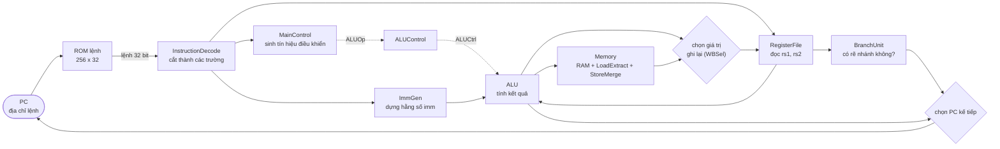

**Cách đọc.**  Mỗi chu kỳ CPU làm đúng một vòng: lấy lệnh từ ROM tại PC, cắt lệnh, đọc thanh ghi và dựng hằng số, ALU tính, (nếu cần) đụng RAM, chọn giá trị ghi lại vào thanh ghi `rd`, và chọn PC kế tiếp.  Nét đứt là tín hiệu điều khiển, nét liền là dữ liệu.  CPU `main` làm hết vòng này trong **một** chu kỳ xung nhịp; CPU `Pipeline` chia vòng thành 5 tầng để năm lệnh chạy chồng nhau.

---

### 1. InstructionDecode - cắt lệnh thành các trường

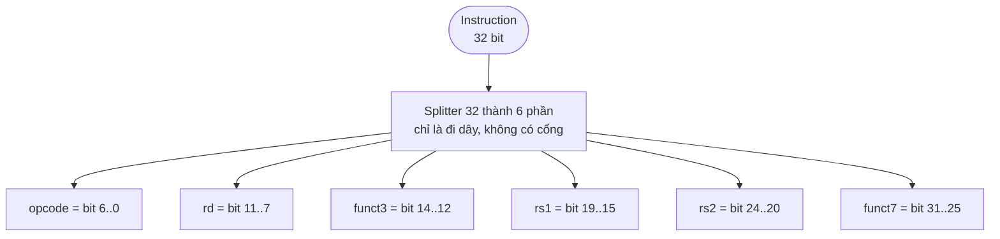

**Giải thích từng bước.**
1. Lệnh 32 bit đi vào một splitter duy nhất.
2. Splitter chia bus thành sáu dây theo vị trí bit **cố định**: `opcode` (7 bit), `rd` (5), `funct3` (3), `rs1` (5), `rs2` (5), `funct7` (7).
3. Không có phép tính nào: đây chỉ là đi dây, nên không tốn thời gian và không có gì để sai.

**Ví dụ:** lệnh `00b50533` -> `opcode = 0x33` (kiểu R), `rd = 10`, `funct3 = 0`, `rs1 = 10`, `rs2 = 11`, `funct7 = 0` -> đây là `add x10, x10, x11`.

**Trường hợp đặc biệt:** lệnh kiểu U/J không có `rs1`/`rs2`/`funct3` thật; các bit đó vẫn được cắt ra nhưng các khối sau bỏ qua.  Vì RISC-V đặt `rs1`, `rs2` luôn ở cùng chỗ, thanh ghi có thể được đọc **trong khi** opcode còn đang được giải mã.

---

### 2. MainControl - từ opcode sinh mọi tín hiệu điều khiển

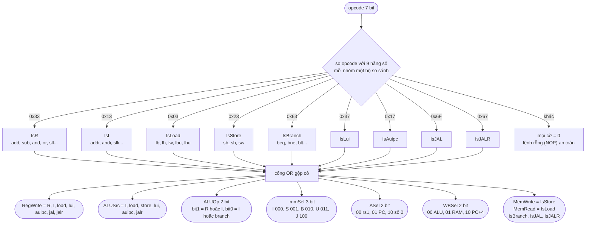

**Giải thích từng bước.**
1. Chín bộ so sánh 7 bit so `opcode` với chín hằng số; chỉ một bộ báo "bằng", cho ra cờ của nhóm lệnh đó (`IsR`, `IsI`...).
2. Cổng OR (tối đa 3 ngõ vào, nên chia hai nửa) gộp các cờ thành từng tín hiệu: ví dụ `RegWrite` bật cho mọi nhóm **có ghi `rd`**; store và branch không có mặt nên không ghi thanh ghi.
3. Các tín hiệu nhiều bit (`ALUOp`, `ImmSel`, `ASel`, `WBSel`) được ghép từ bit đơn bằng splitter.
4. Opcode lạ làm mọi cờ bằng 0, nên lệnh không làm gì (NOP) mà không phá trạng thái.

**Bảng kết quả cho vài lệnh** (đã kiểm bằng `tests/maincontrol.vec`):

| Lệnh | RegWrite | ALUSrc | MemWrite | MemRead | ALUOp | ImmSel | ASel | WBSel |
|---|:-:|:-:|:-:|:-:|:-:|:-:|:-:|:-:|
| `add` (R) | 1 | 0 | 0 | 0 | 10 | - | 00 | 00 |
| `addi` (I) | 1 | 1 | 0 | 0 | 11 | 000 | 00 | 00 |
| `lw` | 1 | 1 | 0 | 1 | 00 | 000 | 00 | 01 |
| `sw` | 0 | 1 | 1 | 0 | 00 | 001 | 00 | - |
| `beq` | 0 | 0 | 0 | 0 | 01 | 010 | 00 | - |
| `lui` | 1 | 1 | 0 | 0 | 00 | 011 | 10 | 00 |
| `auipc` | 1 | 1 | 0 | 0 | 00 | 011 | 01 | 00 |
| `jal` | 1 | - | 0 | 0 | - | 100 | - | 10 |
| `jalr` | 1 | 1 | 0 | 0 | 00 | 000 | 00 | 10 |

---

### 3. ImmGen - dựng hằng số tức thời

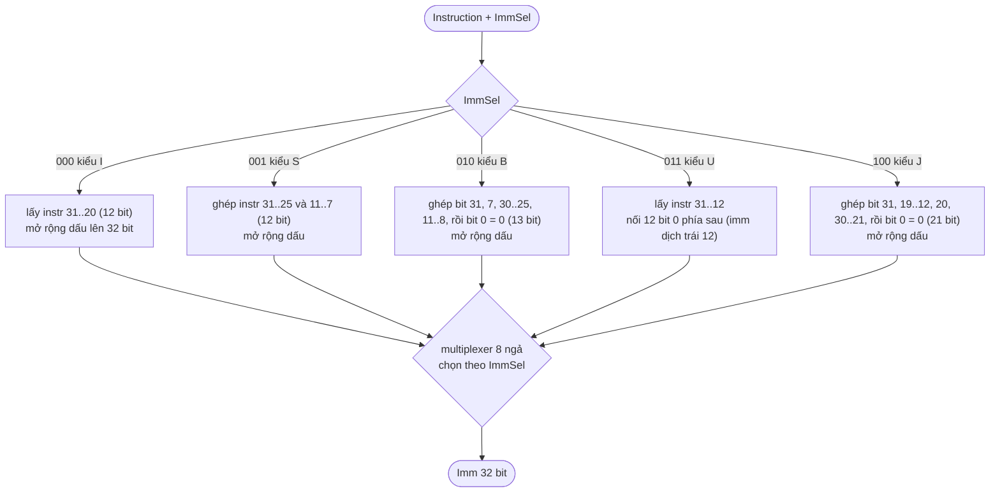

**Giải thích từng bước.**
1. Cả năm cách dựng hằng số chạy **song song** từ cùng một lệnh (mỗi cách là vài splitter + một bộ mở rộng bit).
2. Multiplexer chọn kết quả của đúng một cách theo `ImmSel` (do `MainControl` sinh).
3. **Mở rộng dấu** chép bit cao nhất của hằng số vào các bit phía trên, nên số âm vẫn âm.  Kiểu U thì không mở rộng mà chèn 12 bit 0 (lệnh `lui`/`auipc` đặt hằng số vào 20 bit cao).
4. Bit 0 của kiểu B và J luôn bằng 0 vì địa chỉ lệnh là bội của 2 (thực tế là 4); lệnh vì thế không cất bit này.

**Ví dụ:** `fe059ce3` (`bnez x11, loop`, kiểu B): imm[12] = 1, imm[11] = 1, imm[10:5] = 111111, imm[4:1] = 1100, bit 0 = 0 -> 13 bit `1111111111000` -> mở rộng dấu thành **`0xFFFFFFF8` = -8**: nhảy lùi 8 byte về đầu vòng lặp.

---

### 4. RegisterFile - đọc hai thanh ghi, ghi một thanh ghi

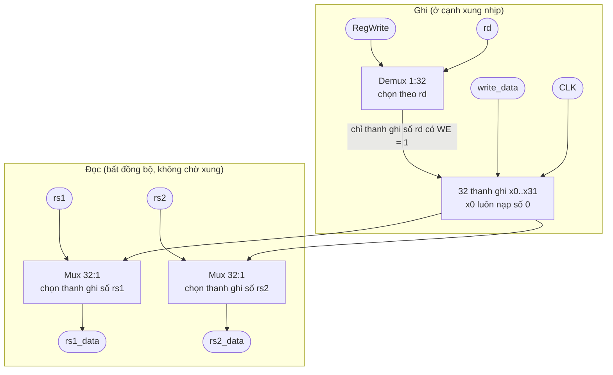

**Giải thích từng bước.**
1. **Đọc:** hai multiplexer 32 ngả chọn thanh ghi theo `rs1` và `rs2`; vì không có xung nhịp ở đây nên đổi `rs1` là `rs1_data` đổi ngay (CPU single-cycle cần toán hạng ngay trong chu kỳ).
2. **Ghi:** demultiplexer đưa `RegWrite` tới **đúng một** thanh ghi (số `rd`); thanh ghi đó nạp `write_data` ở cạnh xung nhịp, các thanh ghi khác giữ nguyên.
3. `x0` có đầu vào cố định bằng 0 nên mãi bằng 0, bất kể ghi gì.

**Các trường hợp:** `RegWrite = 0` (store, branch) -> không thanh ghi nào đổi; `rd = 0` -> ghi vào x0 vô hiệu; đọc và ghi cùng thanh ghi trong một chu kỳ -> đọc giá trị cũ (trên pipeline, khối này ghi ở cạnh **xuống** nên lệnh ở ID thấy giá trị mới).

---

### 5. ALUControl - chọn phép tính của ALU

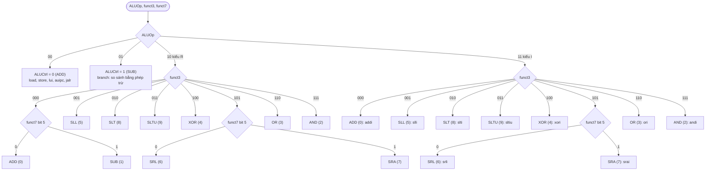

**Giải thích từng bước.**
1. `ALUOp` do `MainControl` đưa vào chia thành bốn nhánh: 00 cộng, 01 trừ (không cần xem `funct`), 10 tra bảng kiểu R, 11 tra bảng kiểu I.
2. Với R và I, `funct3` chọn phép tính (hai multiplexer 8 ngả, mỗi bảng một cái; mỗi dòng bảng là một hằng số 4 bit).
3. `funct7[5]` (bit 30 của lệnh) làm hai việc: ở kiểu R biến ADD thành SUB và SRL thành SRA; ở kiểu I chỉ có ý nghĩa với lệnh dịch (`srai` khác `srli`).  `addi` bỏ qua bit này vì bit đó là một phần của hằng số.

**Mã đầu ra:** 0 ADD, 1 SUB, 2 AND, 3 OR, 4 XOR, 5 SLL, 6 SRL, 7 SRA, 8 SLT, 9 SLTU.

---

### 6. ALU - tính song song rồi chọn

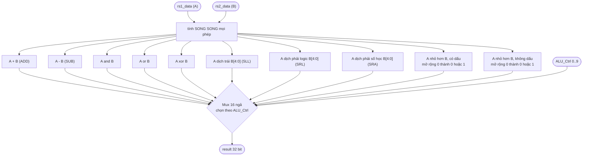

**Giải thích từng bước.**
1. Mười phép tính chạy cùng lúc từ cùng hai toán hạng; không phép nào "biết" phép nào được chọn.
2. Multiplexer 16 ngả (dùng 10 ngõ) lấy đúng một kết quả theo `ALU_Ctrl` (từ `ALUControl`).
3. Lệnh dịch chỉ dùng 5 bit thấp của B (dịch tối đa 31).  SRL chèn bit 0 phía trên, SRA chép bit dấu.
4. SLT/SLTU cho kết quả 1 bit; **mở rộng 0** thành 32 bit để ra đúng 0 hoặc 1.  (Lỗi từng gặp: mở rộng dấu làm SLTU trả `0xFFFFFFFF`.)

**Ví dụ:** A = -1 (`0xFFFFFFFF`), B = 1: SLT cho 1 (vì -1 < 1 có dấu), SLTU cho 0 (vì 4294967295 không nhỏ hơn 1).  Tràn số khi cộng/trừ bị bỏ qua: kết quả quấn vòng 32 bit đúng như RISC-V.

---

### 7. BranchUnit - branch có được rẽ không

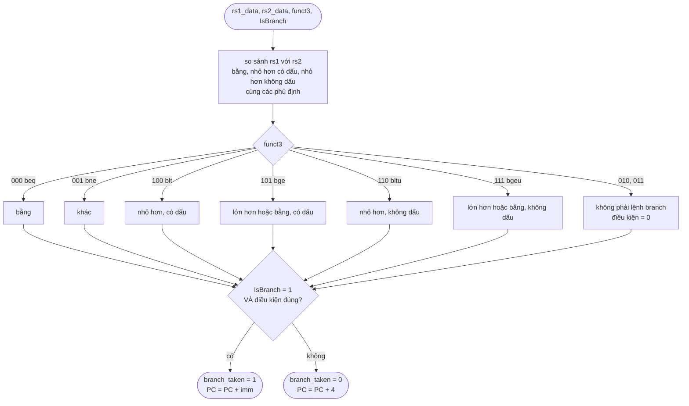

**Giải thích từng bước.**
1. Một bộ so sánh không dấu và một bộ có dấu cho ra các quan hệ "bằng" và "nhỏ hơn"; ba cổng NOT cho ra các phủ định ("khác", "lớn hơn hoặc bằng").
2. Một multiplexer 8 ngả theo `funct3` chọn điều kiện của đúng lệnh branch đang chạy.
3. Cổng AND với `IsBranch` bảo đảm các lệnh khác (cũng có `funct3`) **không bao giờ** bị coi là rẽ nhánh.

**Ví dụ:** `bnez x11, loop` là `bne x11, x0`: khi x11 = 9 thì 9 khác 0 -> `branch_taken = 1`, PC quay về đầu vòng lặp; khi x11 = 0 thì bằng nhau -> `branch_taken = 0`, vòng lặp kết thúc.  `blt` và `bltu` chỉ khác ở bộ so sánh dùng (có dấu hay không dấu): với -1 và 1, `blt` rẽ, `bltu` không rẽ.

---

### 8. LoadExtract - lấy dữ liệu của lệnh load

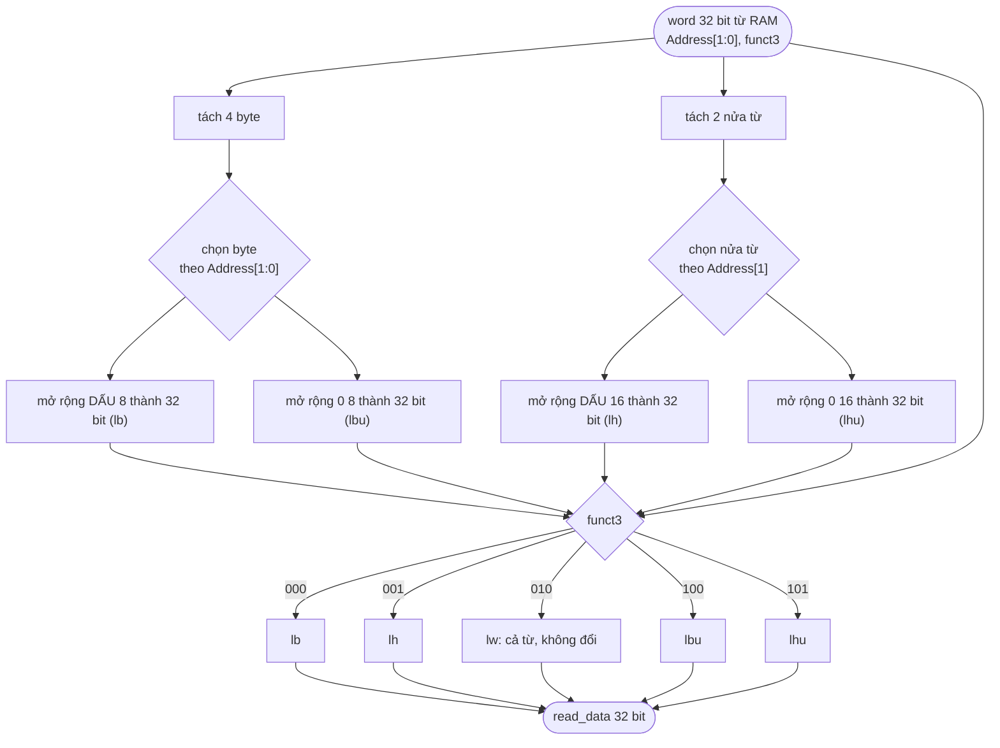

**Giải thích từng bước.**
1. RAM luôn đọc **nguyên từ 32 bit**; việc cắt byte hay nửa từ là của khối này.
2. Hai multiplexer chọn byte (theo `Address[1:0]`) và nửa từ (theo `Address[1]`).
3. Bốn bộ mở rộng bit chuẩn bị cả bốn kết quả (có dấu và không dấu); multiplexer cuối chọn theo `funct3` (000 lb, 001 lh, 010 lw, 100 lbu, 101 lhu).

**Ví dụ:** từ `0x000000F0`, địa chỉ byte 0: `lb` cho `0xFFFFFFF0` (0xF0 có bit dấu = 1 nên mở rộng toàn 1), `lbu` cho `0x000000F0`, `lw` cho nguyên `0x000000F0`.

---

### 9. StoreMerge - ghi một phần của từ (đọc - sửa - ghi)

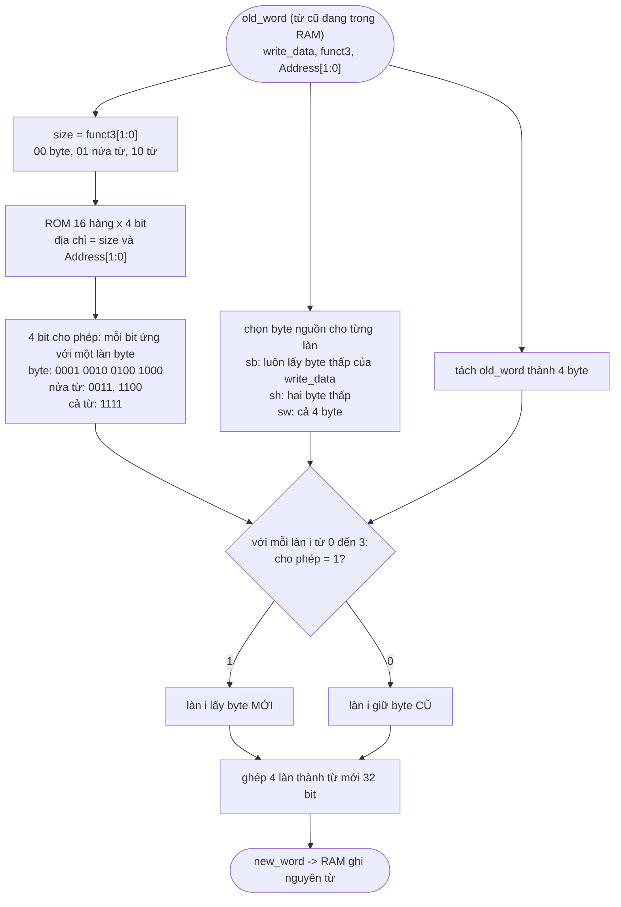

**Giải thích từng bước.**
1. RAM chỉ ghi **nguyên từ**, nên khi chỉ ghi một byte phải giữ nguyên ba byte kia.
2. Từ cũ được đọc ra (RAM đọc bất đồng bộ nên có sẵn trong cùng chu kỳ).
3. ROM nhỏ 16 hàng đổi `{size, Address[1:0]}` thành 4 bit cho phép, mỗi bit là một "làn" byte.
4. Với mỗi làn: nếu được phép thì lấy byte mới (từ `write_data`), không thì giữ byte cũ.  Ghép bốn làn thành từ mới để RAM ghi.

**Ví dụ:** từ cũ `0x11223344`, `sb x1, 1(x0)` với x1 = `0xAA`: `size = 00` (byte), `Address[1:0] = 01` -> cho phép = `0010` (chỉ làn 1) -> từ mới = `0x1122AA44`.

---

### 10. Memory - bộ nhớ dữ liệu

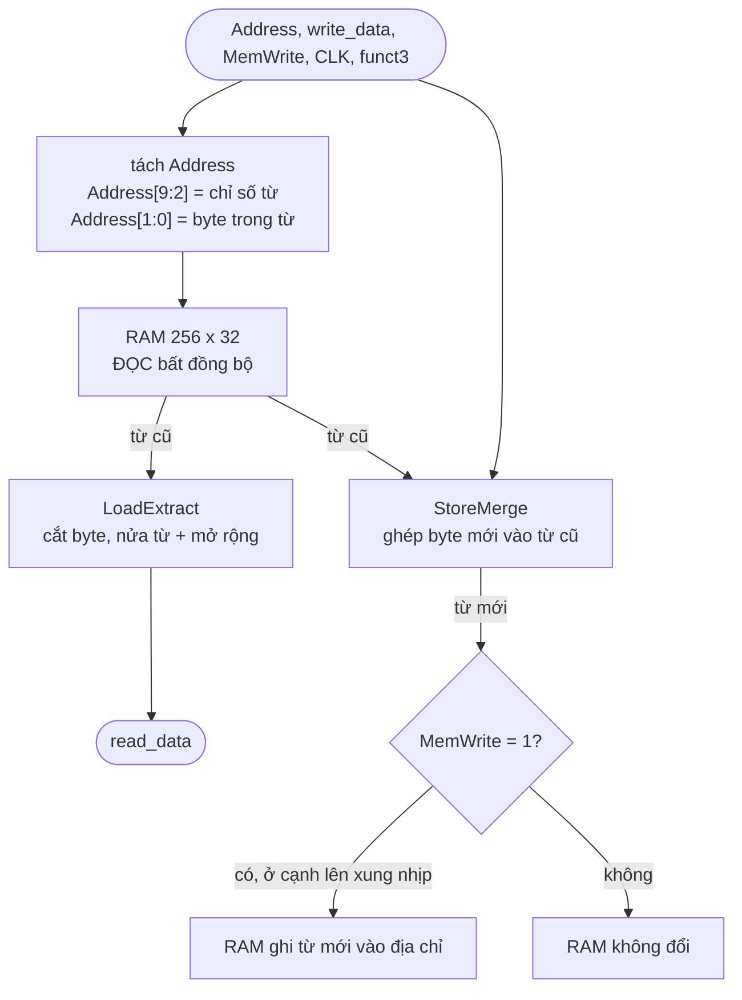

**Giải thích từng bước.**
1. Địa chỉ được tách: chỉ số từ (0..255) đi vào RAM, hai bit thấp chỉ byte trong từ.
2. RAM trả ngay từ ở địa chỉ đó (đọc bất đồng bộ).  `LoadExtract` biến từ này thành giá trị của lệnh load.
3. Khi là lệnh store, `StoreMerge` dựng từ mới; chỉ khi `MemWrite = 1` thì RAM mới ghi, ở cạnh lên của xung nhịp.
4. Lệnh không phải load/store có `MemWrite = 0` nên RAM không đổi; `read_data` vẫn có giá trị nhưng bị bỏ qua ở bước write-back.

**Vì sao đọc bất đồng bộ:** nếu đọc đồng bộ thì dữ liệu chỉ xuất hiện sau cạnh xung kế tiếp, lệnh load trả dữ liệu không xác định (lỗi đã gặp và sửa).  Địa chỉ từ 1 KiB trở lên quấn vòng vì chỉ dùng `Address[9:2]`.

---

### 11. `main` - CPU single-cycle: một lệnh trong một chu kỳ

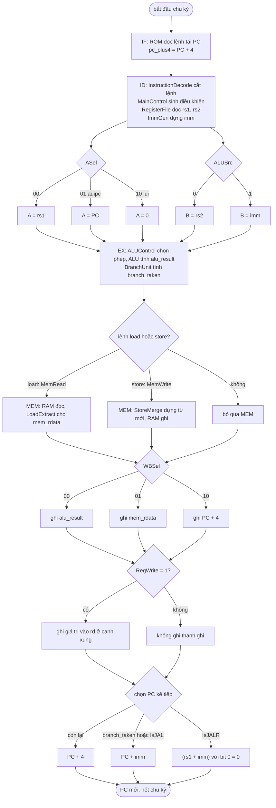

**Giải thích từng bước.**
1. **IF:** ROM nhận `PC[9:2]`, trả lệnh; bộ cộng riêng tính `PC + 4`.
2. **ID:** lệnh được cắt, điều khiển được sinh, hai thanh ghi được đọc, hằng số được dựng; cả bốn việc diễn ra song song.
3. **EX:** hai multiplexer chọn toán hạng A (`rs1`, `PC` hay `0`) và B (`rs2` hay `imm`); ALU tính; `BranchUnit` quyết định branch.
4. **MEM:** chỉ có việc khi là load/store.
5. **WB:** multiplexer `WBSel` chọn giá trị ghi (ALU, RAM hay PC+4); nếu `RegWrite = 1` thì ghi vào `rd`.
6. **PC kế tiếp:** `jalr` (đích tính bằng ALU, xóa bit 0) ưu tiên cao nhất; rồi tới branch được rẽ hoặc `jal` (PC + imm); còn lại PC + 4.

**Vì sao thiết kế thế:** `lui`, `auipc`, `jal`, `jalr` dùng lại đúng ALU và đường write-back nhờ `ASel` và `WBSel`, không thêm phần cứng riêng.

**Ví dụ mỗi nhóm lệnh trong `demo.s`:** xem `docs/vi/DEMO_EXPLAIN.md` mục 3 (add, addi, bnez, sw, lw, jal, ret, sub, slti) với giá trị thật trên từng dây.

---

### 12. ForwardingUnit - chọn nguồn mới nhất cho toán hạng ở EX

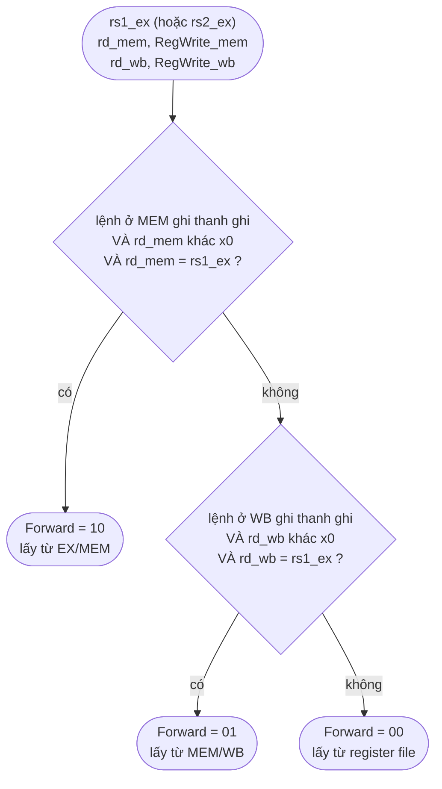

**Giải thích từng bước.**
1. Vấn đề: lệnh ở EX cần thanh ghi mà một lệnh **trước đó** chưa kịp ghi vào register file (phụ thuộc RAW: đọc sau ghi).
2. Kiểm tra lệnh ngay trước (đang ở MEM) **trước**: nếu nó ghi đúng thanh ghi cần thì lấy kết quả của nó từ EX/MEM (`Forward = 10`).
3. Nếu không, kiểm tra lệnh cách một (đang ở WB): lấy từ MEM/WB (`Forward = 01`).
4. Cả hai đều không khớp: dùng giá trị đọc từ register file (`00`).
5. Khối này chạy hai lần: một cho `rs1` (`ForwardA`), một cho `rs2` (`ForwardB`).

**Vì sao ưu tiên MEM:** nếu cả hai tầng cùng ghi thanh ghi đó thì lệnh ở MEM mới hơn nên giá trị của nó là đúng.  **Vì sao loại x0:** x0 luôn bằng 0, forward một "kết quả" ghi vào x0 sẽ sai.  Giá trị lấy từ EX/MEM là kết quả ALU, **riêng `jal`/`jalr` là PC + 4**.

**Ví dụ (`hazards_demo.s`):** `li x1,100` rồi ngay sau là `sw x1,0(x0)`: khi `sw` ở EX thì `li` ở MEM, `rd_mem = 1 = rs2_ex` -> `ForwardB = 10`.

---

### 13. HazardUnit - phát hiện load-use và dừng pipeline

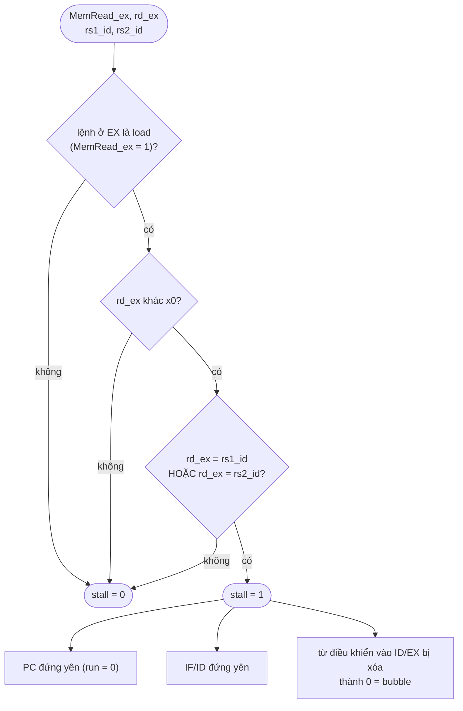

**Giải thích từng bước.**
1. Lệnh load chỉ có dữ liệu ở **cuối tầng MEM**, quá muộn để lệnh ngay sau dùng ở EX; forwarding không cứu được.
2. Điều kiện stall: lệnh ở EX là load, đích khác x0, và lệnh đang ở ID dùng đúng thanh ghi đó (`rs1` hoặc `rs2`).
3. Khi `stall = 1`: PC và IF/ID đứng yên một chu kỳ (lệnh ở ID phải chờ), còn ID/EX nhận lệnh rỗng (bubble).  Chu kỳ sau load đã ở MEM/WB nên forwarding lấy được dữ liệu.

**Chi phí đúng 1 chu kỳ.**  Load, một lệnh không liên quan rồi mới dùng: không stall.  **Ví dụ:** `lw x2,0(x0)` rồi `addi x3,x2,1`: tại tick 4 `stall = 1`, tick 5 PC đứng ở 0x10.

---

### 14. `Pipeline` - một chu kỳ của CPU 5 tầng

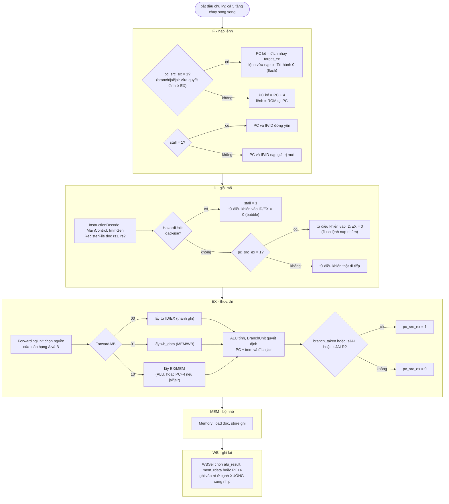

**Giải thích từng bước.**
1. Trong mỗi chu kỳ năm tầng làm việc trên **năm lệnh khác nhau**; bốn thanh ghi pipeline (IF/ID, ID/EX, EX/MEM, MEM/WB) giữ mọi thứ mà mỗi lệnh cần ở tầng sau, gồm cả "từ điều khiển" đóng gói sinh một lần ở ID.
2. **Stall (load-use):** `HazardUnit` thấy lệnh ở ID phụ thuộc lệnh load ở EX -> giữ PC và IF/ID, chèn bubble vào ID/EX.
3. **Forwarding:** ở EX, nếu một toán hạng đã có ở lệnh phía trước chưa ghi xong, `ForwardingUnit` đưa nó thẳng vào ALU.
4. **Flush (control hazard):** branch, `jal`, `jalr` quyết định ở EX; khi `pc_src_ex = 1`, PC nhảy tới đích và **hai lệnh đã nạp phía sau bị hủy** (thành bubble): mất 2 chu kỳ.  Branch không rẽ không mất gì.
5. **Register file ghi ở cạnh xuống** (`CLK_n`): lệnh ở WB ghi nửa đầu chu kỳ, lệnh ở ID đọc nửa sau nên thấy giá trị mới (không cần forward khoảng cách 3 lệnh).

**Các trường hợp (tóm tắt):**

| Tình huống | Dấu hiệu trên probe | Cách giải quyết | Chi phí |
|---|---|---|---|
| dùng giá trị ALU vừa tính | `ForwardA/B` = 10 hoặc 01 | forwarding | 0 chu kỳ |
| dùng giá trị vừa load | `stall` = 1, PC đứng yên 1 tick | stall + forwarding | 1 chu kỳ |
| branch/jal/jalr được rẽ | `pc_src_ex` = 1, sau đó `instr_id` = 0 | flush 2 lệnh | 2 chu kỳ |
| branch không rẽ | `pc_src_ex` = 0 | không làm gì | 0 chu kỳ |

Chi tiết từng tick của `hazards_demo.s` xem `docs/vi/DEMO_EXPLAIN.md` mục 6.

---

### 15. Bảng so sánh nhanh: mỗi circuit trả lời câu hỏi gì

| Circuit | Câu hỏi nó trả lời | Đầu vào chính | Đầu ra chính |
|---|---|---|---|
| InstructionDecode | Lệnh gồm những trường nào? | `Instruction` | `opcode rd funct3 rs1 rs2 funct7` |
| MainControl | Lệnh này cần bật những tín hiệu nào? | `opcode` | `RegWrite ALUSrc MemWrite MemRead IsBranch ALUOp ImmSel ASel WBSel IsJAL IsJALR` |
| ImmGen | Hằng số trong lệnh là bao nhiêu? | `Instruction`, `ImmSel` | `Imm` |
| RegisterFile | Giá trị các thanh ghi nguồn, và ghi vào đâu? | `rs1 rs2 rd write_data RegWrite` | `rs1_data rs2_data` |
| ALUControl | ALU phải làm phép gì? | `ALUOp funct3 funct7` | `ALUCtrl` |
| ALU | Kết quả phép tính là gì? | `rs1_data rs2_data ALU_Ctrl` | `result` |
| BranchUnit | Có rẽ nhánh không? | `rs1_data rs2_data funct3 IsBranch` | `branch_taken` |
| LoadExtract | Giá trị load là gì? | từ RAM, `Address[1:0]`, `funct3` | `read_data` |
| StoreMerge | Từ mới ghi vào RAM là gì? | từ cũ, `write_data`, `funct3`, `Address[1:0]` | `new_word` |
| Memory | Đọc/ghi RAM thế nào? | `Address write_data MemWrite funct3` | `read_data` |
| `main` | Một lệnh chạy trọn vẹn thế nào? | xung nhịp | PC, thanh ghi, RAM |
| ForwardingUnit | Lấy toán hạng từ đâu cho đúng? | `rs1_ex rs2_ex rd_mem rd_wb RegWrite_*` | `ForwardA ForwardB` |
| HazardUnit | Có phải dừng pipeline không? | `MemRead_ex rd_ex rs1_id rs2_id` | `stall` |
| `Pipeline` | Năm lệnh chạy chồng thế nào? | xung nhịp | PC, thanh ghi, RAM |
