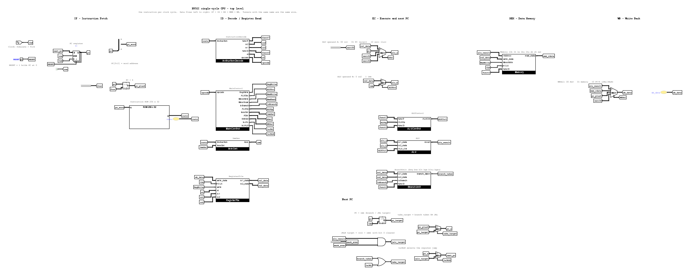
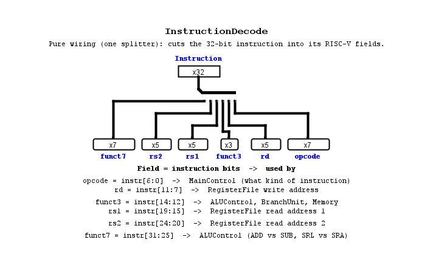
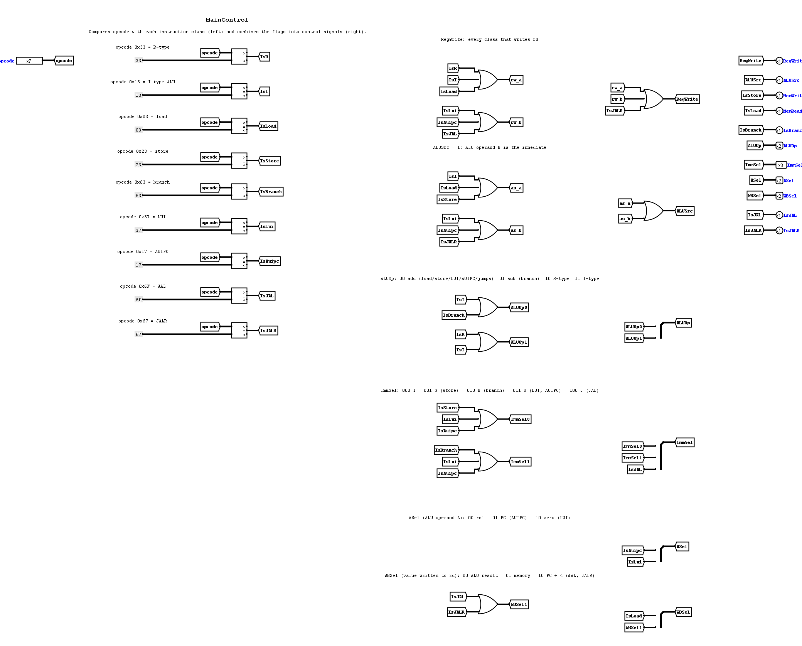
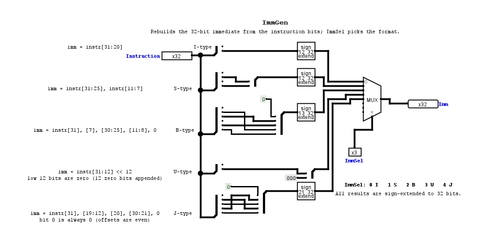
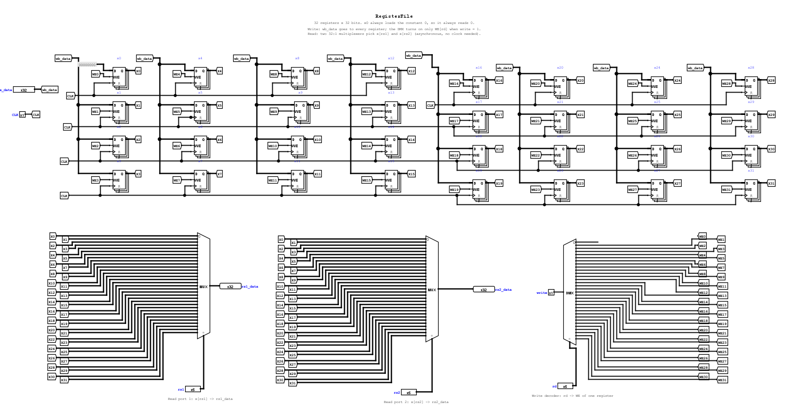
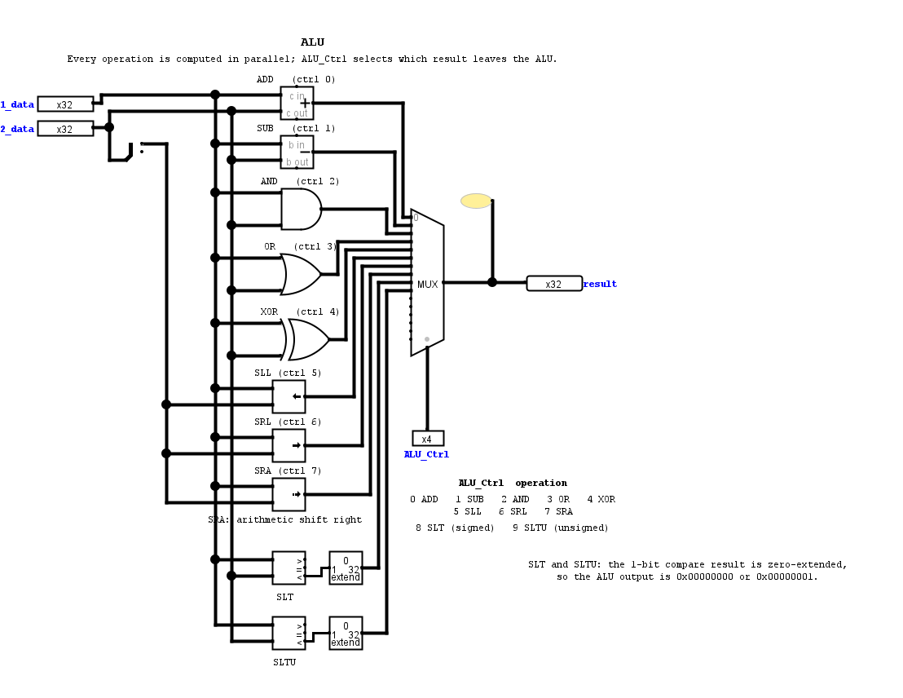
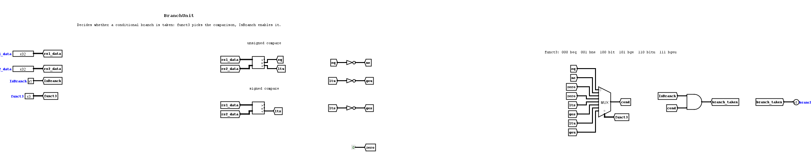
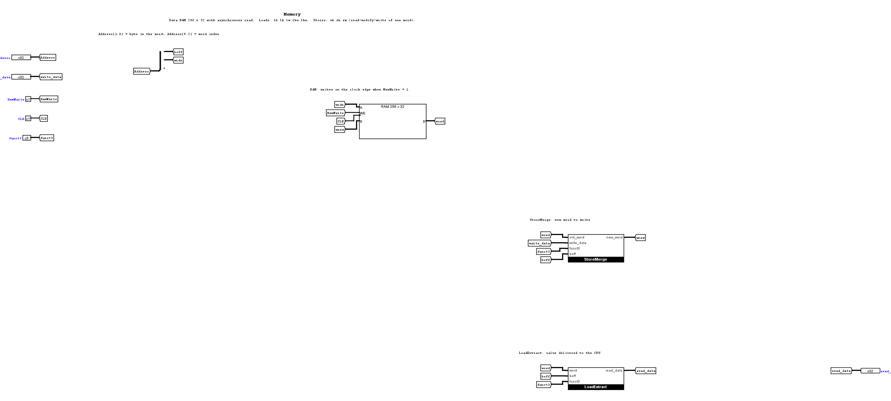
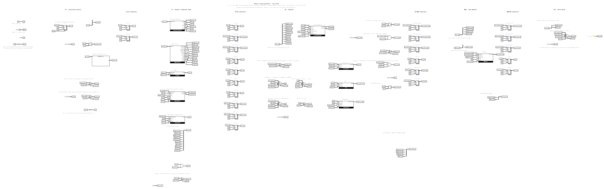

# Technical report - 32-bit RISC-V (RV32I) computer in Logisim Evolution

Course project "Design of a 32-bit RISC-V computer".  Tool: Logisim Evolution 4.1.0.  This report follows the structure
asked for in the assignment: architecture, design of every module, the pipeline, hazard handling, tests, results and
extensions.  All numbers in it were measured on the project in this repository.

Contents: 1 Goals - 2 Architecture - 3 Building blocks - 4 Single-cycle CPU - 5 Pipelined CPU - 6 Programs and tools -
7 Verification - 8 Results - 9 Problems found and fixed - 10 Extensions and future work - A Instruction encodings

---

## 1. Goals and result

Assignment: design, simulate and test a 32-bit computer with the RISC-V RV32I instruction set, with CPU, instruction memory,
data memory and control; a single-cycle version and a 5-stage pipelined version (IF, ID, EX, MEM, WB) that handles the basic data
and control hazards; run programs loaded into the instruction memory; provide tests for each module and for the whole CPU.

| Requirement | Status |
|---|---|
| 32-bit data, 32-bit instructions, 32 x 32-bit registers, 32-bit PC, RV32I | done |
| Arithmetic / logic: ADD SUB AND OR XOR SLT SLTU SLL SRL SRA | done |
| Immediate: ADDI ANDI ORI XORI SLTI SLTIU SLLI SRLI SRAI | done |
| Memory: LW SW (+ optional LB LH LBU LHU SB SH) | done, including all optional ones |
| Branch: BEQ BNE JAL JALR (+ optional BLT BGE BLTU BGEU) | done, including all optional ones |
| LUI, AUIPC (rest of RV32I) | done |
| Single-cycle CPU | done (`main`) |
| 5-stage pipeline, data and control hazards | done (`Pipeline`): forwarding, load-use stall, branch / jump flush |
| Programs loaded through the instruction memory | done: ROM image from an assembler, never poking registers |
| Assembler (nice to have) | done: `tools/rv.py` |
| Tests per module and for the whole CPU | done: 9 module test files, 7 programs, random fuzzer |
| Optional advanced features (prediction, cache, M extension, interrupts, GPIO / UART, FP) | not done |

## 2. Architecture

### 2.1 Overview

Harvard organisation: a read-only instruction memory (ROM, 256 words) and a separate data memory (RAM, 256 words).
Word addresses are `byte address / 4`; the low 2 bits select the byte.  The PC is a 32-bit register; only `PC[9:2]` addresses
the ROM.  The data address wraps modulo 1 KiB (`Address[9:2]`).



Every signal that travels between blocks has a name, and **tunnels with the same name are the same wire**.  The names follow the
RISC-V specification (`rs1`, `rs2`, `rd`, `funct3`, `imm`, ...) and the usual textbook control names.

### 2.2 Instruction formats

```
R  funct7[31:25] rs2[24:20] rs1[19:15] funct3[14:12] rd[11:7]  opcode[6:0]
I  imm[11:0][31:20]         rs1        funct3        rd        opcode
S  imm[11:5][31:25] rs2     rs1        funct3        imm[4:0][11:7] opcode
B  imm[12|10:5][31:25] rs2  rs1        funct3        imm[4:1|11][11:7] opcode
U  imm[31:12]                                         rd        opcode
J  imm[20|10:1|11|19:12][31:12]                       rd        opcode
```

Opcodes used: `0x33` R, `0x13` I-ALU, `0x03` load, `0x23` store, `0x63` branch, `0x37` LUI, `0x17` AUIPC, `0x6F` JAL, `0x67` JALR.

### 2.3 Control signals

| Signal | Meaning |
|---|---|
| `RegWrite` | write `rd` in the register file |
| `ALUSrc` | ALU operand B: 0 = `rs2`, 1 = immediate |
| `ASel` (2 bits) | ALU operand A: 00 = `rs1`, 01 = PC (AUIPC), 10 = 0 (LUI) |
| `ALUOp` (2 bits) | 00 add, 01 subtract, 10 R-type (use funct3 / funct7), 11 I-type (use funct3 / funct7) |
| `ImmSel` (3 bits) | 0 I, 1 S, 2 B, 3 U, 4 J |
| `MemWrite`, `MemRead` | store, load |
| `WBSel` (2 bits) | value written to `rd`: 00 ALU result, 01 memory, 10 PC + 4 |
| `IsBranch`, `IsJAL`, `IsJALR` | control transfer |

## 3. Building blocks

Each block is a circuit of the project; the pictures are in `docs/img/`.  "Test" names the file in `tests/` that checks it.

### 3.1 InstructionDecode
Pure wiring: one splitter cuts `instr` into `opcode = [6:0]`, `rd = [11:7]`, `funct3 = [14:12]`, `rs1 = [19:15]`, `rs2 = [24:20]`,
`funct7 = [31:25]`.  

### 3.2 MainControl
Nine 7-bit comparators compare `opcode` with the nine constants of section 2.2.  The result flags are combined with OR gates into the
control signals; the multi-bit signals (`ALUOp`, `ImmSel`, `ASel`, `WBSel`) are built with splitters:
`ALUOp = {IsR|IsI, IsI|IsBranch}`, `ImmSel = {IsJAL, IsBranch|IsLui|IsAuipc, IsStore|IsLui|IsAuipc}`, `ASel = {IsLui, IsAuipc}`,
`WBSel = {IsJAL|IsJALR, IsLoad}`.  Test: `maincontrol.vec` (every opcode plus an unknown one).  

### 3.3 ImmGen
A splitter per format rebuilds the immediate, a bit extender sign-extends it (U-type instead appends 12 zero bits), an 8-input
multiplexer (5 inputs used) selects by `ImmSel`.  Test: `immgen.vec` (examples from the design notes: `addi`, `sw`, `beq`, `lui`, `jal`).  

### 3.4 RegisterFile
32 registers of 32 bits (`x0` always loads the constant 0), a 1-to-32 demultiplexer routes `RegWrite` to the write enable of register
`rd`, two 32-to-1 multiplexers are the read ports (asynchronous).  Registers are labelled `x0..x31`.  

### 3.5 ALU and ALUControl
The ALU computes ADD, SUB, AND, OR, XOR, SLL, SRL, SRA, SLT, SLTU in parallel and a 16-to-1 multiplexer selects by the 4-bit `ALUCtrl`
(0 ADD, 1 SUB, 2 AND, 3 OR, 4 XOR, 5 SLL, 6 SRL, 7 SRA, 8 SLT, 9 SLTU).  Shifts use `B[4:0]`.  `ALUControl` maps
`ALUOp / funct3 / funct7` to `ALUCtrl`: for R-type `funct7[5]` separates ADD / SUB and SRL / SRA; for I-type only the shift
instructions look at it.  Tests: `alu.vec`, `alucontrol.vec` (all 10 R-type and 9 I-type operations).  

### 3.6 BranchUnit
An unsigned and a signed comparator give `==`, `<u`, `<s`; NOT gates give `!=`, `>=u`, `>=s`; an 8-to-1 one-bit multiplexer selected by
`funct3` picks the condition (000 beq, 001 bne, 100 blt, 101 bge, 110 bltu, 111 bgeu; 010 / 011 give 0); `branch_taken = IsBranch AND
condition`.  Test: `branchunit.vec`.  

### 3.7 Memory (RAM + LoadExtract + StoreMerge)
The RAM is a 256 x 32 Logisim RAM with *asynchronous read* and a single write enable (write on the rising clock edge).  The RAM can only
write whole words, so sub-word stores are a read-modify-write of one word:

* `LoadExtract` picks the byte (`Address[1:0]`) or halfword (`Address[1]`) out of the word and sign- or zero-extends it; a multiplexer
  selected by `funct3` returns `lb / lh / lw / lbu / lhu`.  Test: `loadextract.vec`.
* `StoreMerge` builds the new word from the old word and `write_data`: a small 16-row ROM turns `{size, Address[1:0]}` into four byte
  enables (byte `0001 0010 0100 1000`, half `0011 0011 1100 1100`, word `1111`) and four 8-bit multiplexers choose, per byte lane,
  the new or the old byte.  Test: `storemerge.vec`.



### 3.8 ForwardingUnit and HazardUnit (pipeline)
See section 5.  Tests: `forwardingunit.vec`, `hazardunit.vec`.

## 4. Single-cycle CPU (`main`)

### 4.1 Datapath
* **IF**: `pc` register, `PC + 4` adder, instruction ROM addressed by `PC[9:2]`.
* **ID**: `InstructionDecode`, `MainControl`, `ImmGen`, `RegisterFile` read.
* **EX**: ALU operand A = `mux(ASel: rs1, PC, 0)`, operand B = `mux(ALUSrc: rs2, imm)`; `ALUControl` and `ALU`; `BranchUnit`.
* **MEM**: `Memory` with address = ALU result, data = `rs2`.
* **WB**: `mux(WBSel: ALU, memory, PC+4)` into the register file.

### 4.2 Next PC
```
pc_target   = PC + imm                          (adder)
jalr_target = (rs1 + imm) & 0xFFFFFFFE          (ALU result with bit 0 cleared)
take_target = branch_taken OR IsJAL
next_pc     = IsJALR ? jalr_target : take_target ? pc_target : PC + 4
```

### 4.3 How each instruction class uses the datapath

| Class | A | B | ALU op | Memory | Write-back | Next PC |
|---|---|---|---|---|---|---|
| R-type | rs1 | rs2 | by funct | - | ALU | PC+4 |
| I-type ALU | rs1 | imm | by funct | - | ALU | PC+4 |
| load | rs1 | imm | add | read | memory | PC+4 |
| store | rs1 | imm | add | write rs2 | - | PC+4 |
| branch | - | - | - | - | - | `PC+imm` if taken |
| LUI | 0 | imm | add | - | ALU | PC+4 |
| AUIPC | PC | imm | add | - | ALU | PC+4 |
| JAL | - | - | - | - | PC+4 | `PC+imm` |
| JALR | rs1 | imm | add | - | PC+4 | `(rs1+imm)&~1` |

Clocking: PC, register file and RAM all update on the rising edge; everything else is combinational.  A `RESET` input holds the PC at 0.

## 5. Pipelined CPU (`Pipeline`)



### 5.1 Stages and registers
Same blocks as the single-cycle CPU, cut into five stages by four pipeline registers.  Values carry the suffix of their stage
(`_id`, `_ex`, `_mem`, `_wb`).

| Register | Holds |
|---|---|
| IF/ID | `pc_id`, `instr_id` |
| ID/EX | `pc_ex`, `rs1_data_ex`, `rs2_data_ex`, `imm_ex`, `rs1_ex`, `rs2_ex`, `rd_ex`, `funct3_ex`, `funct7_ex`, control word `ctrl_ex` (13 bits: `RegWrite ALUSrc MemWrite MemRead IsBranch ALUOp ASel WBSel IsJAL IsJALR`) |
| EX/MEM | `alu_result_mem`, `store_data_mem`, `pc_plus4_mem`, `rd_mem`, `funct3_mem`, control `RegWrite MemWrite MemRead WBSel` |
| MEM/WB | `alu_result_wb`, `mem_rdata_wb`, `pc_plus4_wb`, `rd_wb`, control `RegWrite WBSel` |

The control signals are generated once, in ID, and travel with the instruction in a packed "control word"; each stage unpacks only what it uses.

### 5.2 Register file timing
The register file writes on the **falling** clock edge (its clock is `CLK_n`).  An instruction in WB therefore writes in the first half of the
cycle and an instruction in ID reads the new value in the second half: no forwarding is needed for the register-file distance of 3.

### 5.3 Data hazards: forwarding
`ForwardingUnit` compares `rs1_ex` / `rs2_ex` with the destination registers of the instructions in MEM and WB:

```
forwardA = 10   if RegWrite_mem and rd_mem != 0 and rd_mem == rs1_ex          (value from EX/MEM)
         = 01   else if RegWrite_wb and rd_wb != 0 and rd_wb == rs1_ex         (value from MEM/WB = wb_data)
         = 00   otherwise                                                      (register file)
```
(same for `forwardB` with `rs2_ex`).  EX/MEM has priority because it holds the newer value.  Two details that are easy to miss:

* the value forwarded from EX/MEM is the ALU result, **except for JAL / JALR where it is PC + 4** (a 2-to-1 multiplexer `fwd_mem_val` on `WBSel[1]`);
* the forwarded operand B is also the data written by a store (`store_data`), and operand A / B feed the `BranchUnit`.

Example (`add x2,x1,x1` followed by `sub x3,x2,x1`, then `or x4,x3,x2`):
```
              1   2   3   4   5   6   7
add x2,x1,x1  IF  ID  EX  ME  WB
sub x3,x2,x1      IF  ID  EX  ME  WB        x2 forwarded from EX/MEM
or  x4,x3,x2          IF  ID  EX  ME  WB    x3 from EX/MEM, x2 from MEM/WB
```

### 5.4 Data hazard that forwarding cannot solve: load-use
A load has its data only at the end of MEM.  If the next instruction needs it in EX, one bubble is needed.  `HazardUnit` detects
`MemRead_ex and rd_ex != 0 and (rd_ex == rs1_id or rd_ex == rs2_id)` and then
* stops the PC and IF/ID (`run = 0`: their write enables are 0),
* replaces the control word entering ID/EX by 0 (a bubble).

```
              1   2   3   4   5   6   7
lw  x9,16(x0) IF  ID  EX  ME  WB
add x10,x9,x9     IF  ID  --  EX  ME  WB   stall in ID, x9 then forwarded from MEM/WB
```

### 5.5 Control hazards: branch, JAL, JALR
All control transfers are resolved in EX (the branch comparison uses forwarded operands).  When `pc_src_ex = branch_taken or IsJAL or IsJALR`:
the next PC is the target, the instruction fetched in the same cycle is replaced by a bubble (`instr_in = 0`) and the control word entering ID/EX is
zeroed, so the two instructions behind the branch are cancelled.  Penalty: 2 cycles per taken branch / jump; not-taken branches cost nothing
(static prediction "not taken").

```
              1   2   3   4   5   6
beq (taken)   IF  ID  EX  ME  WB
i+1               IF  ID  xx              flushed
i+2                   IF  xx              flushed
target                    IF  ID  EX ...
```
An all-zero instruction word is harmless: opcode 0 matches no class, so every control signal is 0.

### 5.6 Why no hazard remains
Read-after-write distances: 1 or 2 instructions apart - forwarding; 3 apart - register file writes before the read; load followed
immediately by a use - one stall, afterwards forwarding; stores read their data after forwarding; branches read forwarded operands.
Write-after-write and write-after-read cannot happen because instructions complete in order.

## 6. Programs and tools

| Tool | Purpose |
|---|---|
| `tools/rv.py asm` | RV32I assembler (labels, `.word`, pseudo instructions, `chk` self-check macro) producing the Logisim ROM image (`v2.0 raw` hex) |
| `tools/rv.py sim` | **reference simulator** with the same 256-word data memory: the independent oracle for all tests |
| `tools/java/Run.java` | runs a program on a circuit headless: loads the ROM, toggles the clock, reads `PC`, `x0..x31` and the RAM |
| `tools/build/` | generates the circuits from netlists and verifies the result |
| `logisim-mcp/` | MCP server that lets an AI assistant inspect and test the circuits |

Loading a program: *Edit Contents > Open > file.hex* on the ROM, or `python tools/rv.py asm prog.s -o prog.hex`.

## 7. Verification

Three levels, all automatic:

1. **Module tests** (`tests/run_tests.ps1`): 106 test-vector rows over 9 modules, run by Logisim itself (`--test-vector`).
2. **Programs** (`tests/run_cpu_tests.py`): 6 test programs + the demo, run on both CPUs.  After the run all 32 registers and every non-zero data
   word must equal the result of the reference simulator, and self-checking programs must end with `x31 = 0x600D`.
   The test programs are written to hit one feature each: `alu`, `mem`, `branch`, `jump`, `fib`, `hazard` (back-to-back dependencies, dependencies
   3 apart, load-use, load then store of the loaded value, load as address, branch on a loaded value, taken branch skipping instructions, `jal` link used
   immediately, `jalr` through a fresh register, `x0` as destination, same register written twice).
3. **Random programs** (`tests/fuzz.py`): random 60-80 instruction programs with only 7 registers (so almost every instruction depends on a recent one), loads and
   stores of all sizes, forward branches and jumps.  30 programs (60 runs on the two CPUs) were run on the final project, and 12 more on an earlier build; all matched.

The reference simulator is itself checked with the encodings of the design notes (`addi x1,x0,5 = 00500093`, `add x3,x1,x2 = 002081B3`, ...) and
by the self-checking programs, whose expected values were computed by hand.

## 8. Results

Cycles until the PC reaches the final `halt: j halt` (so pipeline fill is included):

| program | instructions | single-cycle | pipeline | pipeline CPI | why |
|---|---|---|---|---|---|
| alu | 92 | 91 | 91 | 0.99 | no taken branches, forwarding hides all dependencies |
| mem | 70 | 69 | 70 | 1.00 | |
| hazard | 68 | 67 | 79 | 1.16 | load-use stalls, 4 taken branches / jumps |
| jump | 28 | 27 | 35 | 1.25 | 4 jumps |
| branch | 70 | 69 | 101 | 1.44 | many taken branches |
| fib | 124 | 123 | 178 | 1.44 | loops: 1 taken branch per 4 instructions |
| demo | 40 | 39 | 61 | 1.52 | 10-iteration loop + call |

Penalties of the pipeline, measured with tiny programs (extra cycles compared with the same program without the hazard):

| Situation | Extra cycles |
|---|---|
| dependent instruction right after an ALU instruction (forwarding) | 0 |
| use of a loaded value in the next instruction (load-use) | 1 |
| load, one unrelated instruction, then the use | 0 |
| branch not taken | 0 |
| branch taken / `jal` / `jalr` | 2 |

In cycles the pipeline is not faster than the single-cycle CPU here - the benefit of pipelining is a shorter clock period (the longest path
shrinks from "fetch + decode + ALU + memory + write back" to one stage), which Logisim's zero-delay simulation does not show.  What the pipeline
costs is the 2-cycle branch penalty; branch prediction or earlier resolution (in ID) would remove most of it.

Size (components that are not tunnels or text): `main` has 28 (8 sub-circuit blocks, the PC register, 3 multiplexers, 3 adders / gates ...); `Pipeline` has 72, of which 24 are registers (PC + 23 pipeline registers) and 10 are sub-circuit blocks.

## 9. Problems found and fixed

The original blocks were tested for the first time with test vectors and whole programs; this found real bugs.

| Where | Bug | Fix |
|---|---|---|
| ALU | `SLTU` returned `FFFFFFFF` instead of 1 (1-bit result was sign-extended) | zero-extend |
| ALUControl | R-type `SLL` selected the `SRL` code (constant `6` instead of `5`) | constant |
| MainControl | JALR compared with the JAL opcode `0x6F`; LUI selected the B-type immediate; JALR the J-type immediate | decoding rewritten |
| ImmGen | U-type missing `<< 12`; J-type bit 0 was 1 | fixed |
| Memory | loads returned undefined data (the RAM was configured with synchronous read, which a single-cycle CPU cannot use) | asynchronous read, block rebuilt |
| Datapath | JAL, JALR, LUI, AUIPC and several other instructions had no datapath | added (`ASel`, `WBSel`, next-PC logic) |

Tooling lessons (they cost time, so they are recorded): Logisim connects wires only at their end points, not at T-junctions, so generated files
must split wires; every location must be on the 10-pixel grid; a `Constant` defaults to 1, not 0; the RAM defaults to synchronous read, which a
single-cycle CPU cannot use; a circuit named with a leading underscore is silently renamed.  The generator now checks all of these and verifies the nets of
every circuit after writing it.

## 10. Extensions and future work

Not implemented (optional in the assignment): branch prediction, caches, multiplier / divider (M extension), interrupts, GPIO / UART, floating point.
Natural next steps, cheapest first: resolve `JAL` in ID (1-cycle penalty instead of 2); a one-bit or two-bit branch predictor with a small branch-target
buffer; a UART memory-mapped at a fixed address so programs can print; an `M` extension with a multi-cycle divider and a stall signal that reuses `HazardUnit`.

## A. Instruction encodings

| Instruction | opcode | funct3 | funct7 / imm |
|---|---|---|---|
| add / sub | 0110011 | 000 | 0000000 / 0100000 |
| sll | 0110011 | 001 | 0000000 |
| slt / sltu | 0110011 | 010 / 011 | 0000000 |
| xor | 0110011 | 100 | 0000000 |
| srl / sra | 0110011 | 101 | 0000000 / 0100000 |
| or / and | 0110011 | 110 / 111 | 0000000 |
| addi slti sltiu xori ori andi | 0010011 | 000 010 011 100 110 111 | imm[11:0] |
| slli / srli / srai | 0010011 | 001 / 101 / 101 | 0000000 / 0000000 / 0100000 |
| lb lh lw lbu lhu | 0000011 | 000 001 010 100 101 | imm[11:0] |
| sb sh sw | 0100011 | 000 001 010 | imm[11:5], imm[4:0] |
| beq bne blt bge bltu bgeu | 1100011 | 000 001 100 101 110 111 | B immediate |
| jal | 1101111 | - | J immediate |
| jalr | 1100111 | 000 | imm[11:0] |
| lui / auipc | 0110111 / 0010111 | - | imm[31:12] |
