# Sơ đồ luồng (flowchart) của từng circuit

> Bản tiếng Việt của docs/FLOWCHARTS.md.

Tài liệu này vẽ **sơ đồ luồng cho cả 14 circuit** của dự án, kèm giải thích chi tiết từng bước, ví dụ với giá trị thật và các trường hợp đặc biệt.  Sơ đồ viết bằng **Mermaid**, nên tự hiện thành hình khi mở trên GitHub, trong VS Code (có phần mở rộng Markdown Mermaid) hoặc trong Overleaf/Obsidian.  Nếu chỗ bạn xem không hiện hình, dán đoạn mã vào https://mermaid.live.

**Cách đọc ký hiệu**

| Ký hiệu | Ý nghĩa |
|---|---|
| hình chữ nhật | một bước xử lý hoặc một khối mạch |
| hình thoi | một phép **chọn** (multiplexer) hoặc một điều kiện |
| hình bầu dục | đầu vào hoặc đầu ra của circuit |
| mũi tên có chữ | điều kiện hoặc giá trị tín hiệu chọn nhánh đó |

Mục lục: 0 Tổng quan - 1 InstructionDecode - 2 MainControl - 3 ImmGen - 4 RegisterFile - 5 ALUControl - 6 ALU - 7 BranchUnit - 8 LoadExtract - 9 StoreMerge - 10 Memory - 11 `main` (single-cycle) - 12 ForwardingUnit - 13 HazardUnit - 14 `Pipeline` - 15 Bảng so sánh nhanh

---

## 0. Tổng quan: cả máy tính nhìn từ xa

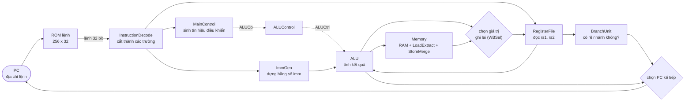

**Cách đọc.**  Mỗi chu kỳ CPU làm đúng một vòng: lấy lệnh từ ROM tại PC, cắt lệnh, đọc thanh ghi và dựng hằng số, ALU tính, (nếu cần) đụng RAM, chọn giá trị ghi lại vào thanh ghi `rd`, và chọn PC kế tiếp.  Nét đứt là tín hiệu điều khiển, nét liền là dữ liệu.  CPU `main` làm hết vòng này trong **một** chu kỳ xung nhịp; CPU `Pipeline` chia vòng thành 5 tầng để năm lệnh chạy chồng nhau.

---

## 1. InstructionDecode - cắt lệnh thành các trường

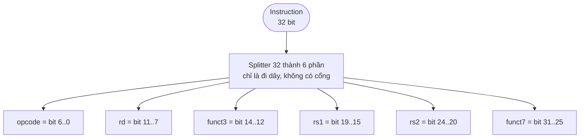

**Giải thích từng bước.**
1. Lệnh 32 bit đi vào một splitter duy nhất.
2. Splitter chia bus thành sáu dây theo vị trí bit **cố định**: `opcode` (7 bit), `rd` (5), `funct3` (3), `rs1` (5), `rs2` (5), `funct7` (7).
3. Không có phép tính nào: đây chỉ là đi dây, nên không tốn thời gian và không có gì để sai.

**Ví dụ:** lệnh `00b50533` -> `opcode = 0x33` (kiểu R), `rd = 10`, `funct3 = 0`, `rs1 = 10`, `rs2 = 11`, `funct7 = 0` -> đây là `add x10, x10, x11`.

**Trường hợp đặc biệt:** lệnh kiểu U/J không có `rs1`/`rs2`/`funct3` thật; các bit đó vẫn được cắt ra nhưng các khối sau bỏ qua.  Vì RISC-V đặt `rs1`, `rs2` luôn ở cùng chỗ, thanh ghi có thể được đọc **trong khi** opcode còn đang được giải mã.

---

## 2. MainControl - từ opcode sinh mọi tín hiệu điều khiển

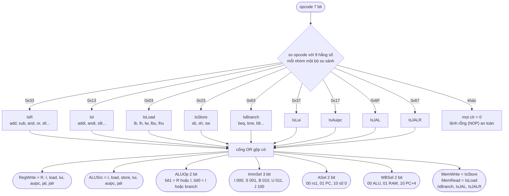

**Giải thích từng bước.**
1. Chín bộ so sánh 7 bit so `opcode` với chín hằng số; chỉ một bộ báo "bằng", cho ra cờ của nhóm lệnh đó (`IsR`, `IsI`...).
2. Cổng OR (tối đa 3 ngõ vào, nên chia hai nửa) gộp các cờ thành từng tín hiệu: ví dụ `RegWrite` bật cho mọi nhóm **có ghi `rd`**; store và branch không có mặt nên không ghi thanh ghi.
3. Các tín hiệu nhiều bit (`ALUOp`, `ImmSel`, `ASel`, `WBSel`) được ghép từ bit đơn bằng splitter.
4. Opcode lạ làm mọi cờ bằng 0, nên lệnh không làm gì (NOP) mà không phá trạng thái.

**Bảng kết quả cho vài lệnh** (đã kiểm bằng `tests/maincontrol.vec`):

| Lệnh | RegWrite | ALUSrc | MemWrite | MemRead | ALUOp | ImmSel | ASel | WBSel |
|---|:-:|:-:|:-:|:-:|:-:|:-:|:-:|:-:|
| `add` (R) | 1 | 0 | 0 | 0 | 10 | - | 00 | 00 |
| `addi` (I) | 1 | 1 | 0 | 0 | 11 | 000 | 00 | 00 |
| `lw` | 1 | 1 | 0 | 1 | 00 | 000 | 00 | 01 |
| `sw` | 0 | 1 | 1 | 0 | 00 | 001 | 00 | - |
| `beq` | 0 | 0 | 0 | 0 | 01 | 010 | 00 | - |
| `lui` | 1 | 1 | 0 | 0 | 00 | 011 | 10 | 00 |
| `auipc` | 1 | 1 | 0 | 0 | 00 | 011 | 01 | 00 |
| `jal` | 1 | - | 0 | 0 | - | 100 | - | 10 |
| `jalr` | 1 | 1 | 0 | 0 | 00 | 000 | 00 | 10 |

---

## 3. ImmGen - dựng hằng số tức thời

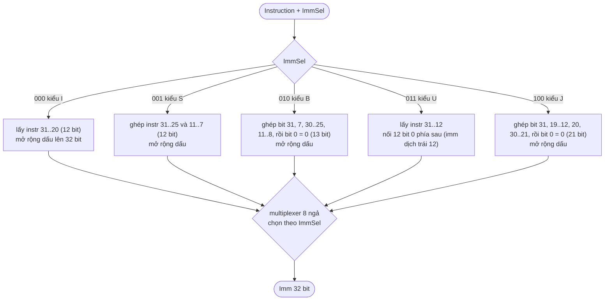

**Giải thích từng bước.**
1. Cả năm cách dựng hằng số chạy **song song** từ cùng một lệnh (mỗi cách là vài splitter + một bộ mở rộng bit).
2. Multiplexer chọn kết quả của đúng một cách theo `ImmSel` (do `MainControl` sinh).
3. **Mở rộng dấu** chép bit cao nhất của hằng số vào các bit phía trên, nên số âm vẫn âm.  Kiểu U thì không mở rộng mà chèn 12 bit 0 (lệnh `lui`/`auipc` đặt hằng số vào 20 bit cao).
4. Bit 0 của kiểu B và J luôn bằng 0 vì địa chỉ lệnh là bội của 2 (thực tế là 4); lệnh vì thế không cất bit này.

**Ví dụ:** `fe059ce3` (`bnez x11, loop`, kiểu B): imm[12] = 1, imm[11] = 1, imm[10:5] = 111111, imm[4:1] = 1100, bit 0 = 0 -> 13 bit `1111111111000` -> mở rộng dấu thành **`0xFFFFFFF8` = -8**: nhảy lùi 8 byte về đầu vòng lặp.

---

## 4. RegisterFile - đọc hai thanh ghi, ghi một thanh ghi

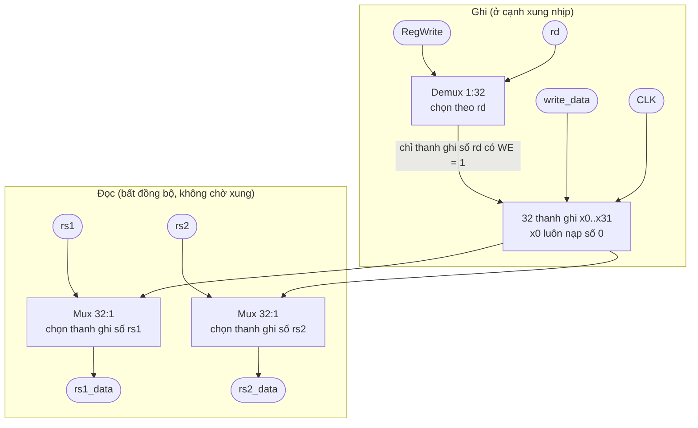

**Giải thích từng bước.**
1. **Đọc:** hai multiplexer 32 ngả chọn thanh ghi theo `rs1` và `rs2`; vì không có xung nhịp ở đây nên đổi `rs1` là `rs1_data` đổi ngay (CPU single-cycle cần toán hạng ngay trong chu kỳ).
2. **Ghi:** demultiplexer đưa `RegWrite` tới **đúng một** thanh ghi (số `rd`); thanh ghi đó nạp `write_data` ở cạnh xung nhịp, các thanh ghi khác giữ nguyên.
3. `x0` có đầu vào cố định bằng 0 nên mãi bằng 0, bất kể ghi gì.

**Các trường hợp:** `RegWrite = 0` (store, branch) -> không thanh ghi nào đổi; `rd = 0` -> ghi vào x0 vô hiệu; đọc và ghi cùng thanh ghi trong một chu kỳ -> đọc giá trị cũ (trên pipeline, khối này ghi ở cạnh **xuống** nên lệnh ở ID thấy giá trị mới).

---

## 5. ALUControl - chọn phép tính của ALU

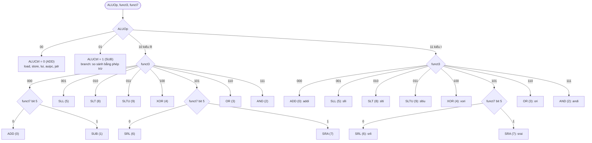

**Giải thích từng bước.**
1. `ALUOp` do `MainControl` đưa vào chia thành bốn nhánh: 00 cộng, 01 trừ (không cần xem `funct`), 10 tra bảng kiểu R, 11 tra bảng kiểu I.
2. Với R và I, `funct3` chọn phép tính (hai multiplexer 8 ngả, mỗi bảng một cái; mỗi dòng bảng là một hằng số 4 bit).
3. `funct7[5]` (bit 30 của lệnh) làm hai việc: ở kiểu R biến ADD thành SUB và SRL thành SRA; ở kiểu I chỉ có ý nghĩa với lệnh dịch (`srai` khác `srli`).  `addi` bỏ qua bit này vì bit đó là một phần của hằng số.

**Mã đầu ra:** 0 ADD, 1 SUB, 2 AND, 3 OR, 4 XOR, 5 SLL, 6 SRL, 7 SRA, 8 SLT, 9 SLTU.

---

## 6. ALU - tính song song rồi chọn

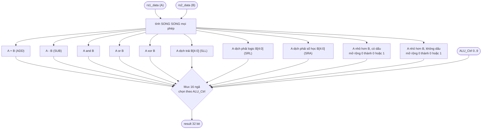

**Giải thích từng bước.**
1. Mười phép tính chạy cùng lúc từ cùng hai toán hạng; không phép nào "biết" phép nào được chọn.
2. Multiplexer 16 ngả (dùng 10 ngõ) lấy đúng một kết quả theo `ALU_Ctrl` (từ `ALUControl`).
3. Lệnh dịch chỉ dùng 5 bit thấp của B (dịch tối đa 31).  SRL chèn bit 0 phía trên, SRA chép bit dấu.
4. SLT/SLTU cho kết quả 1 bit; **mở rộng 0** thành 32 bit để ra đúng 0 hoặc 1.  (Lỗi từng gặp: mở rộng dấu làm SLTU trả `0xFFFFFFFF`.)

**Ví dụ:** A = -1 (`0xFFFFFFFF`), B = 1: SLT cho 1 (vì -1 < 1 có dấu), SLTU cho 0 (vì 4294967295 không nhỏ hơn 1).  Tràn số khi cộng/trừ bị bỏ qua: kết quả quấn vòng 32 bit đúng như RISC-V.

---

## 7. BranchUnit - branch có được rẽ không

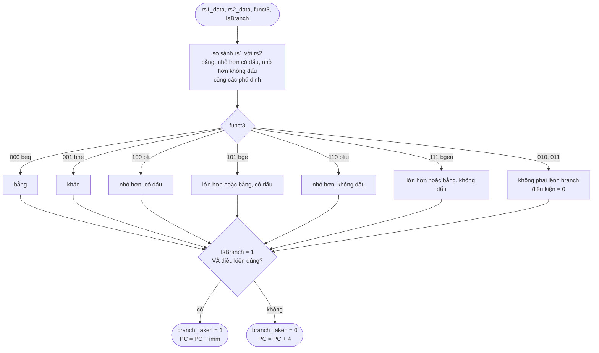

**Giải thích từng bước.**
1. Một bộ so sánh không dấu và một bộ có dấu cho ra các quan hệ "bằng" và "nhỏ hơn"; ba cổng NOT cho ra các phủ định ("khác", "lớn hơn hoặc bằng").
2. Một multiplexer 8 ngả theo `funct3` chọn điều kiện của đúng lệnh branch đang chạy.
3. Cổng AND với `IsBranch` bảo đảm các lệnh khác (cũng có `funct3`) **không bao giờ** bị coi là rẽ nhánh.

**Ví dụ:** `bnez x11, loop` là `bne x11, x0`: khi x11 = 9 thì 9 khác 0 -> `branch_taken = 1`, PC quay về đầu vòng lặp; khi x11 = 0 thì bằng nhau -> `branch_taken = 0`, vòng lặp kết thúc.  `blt` và `bltu` chỉ khác ở bộ so sánh dùng (có dấu hay không dấu): với -1 và 1, `blt` rẽ, `bltu` không rẽ.

---

## 8. LoadExtract - lấy dữ liệu của lệnh load

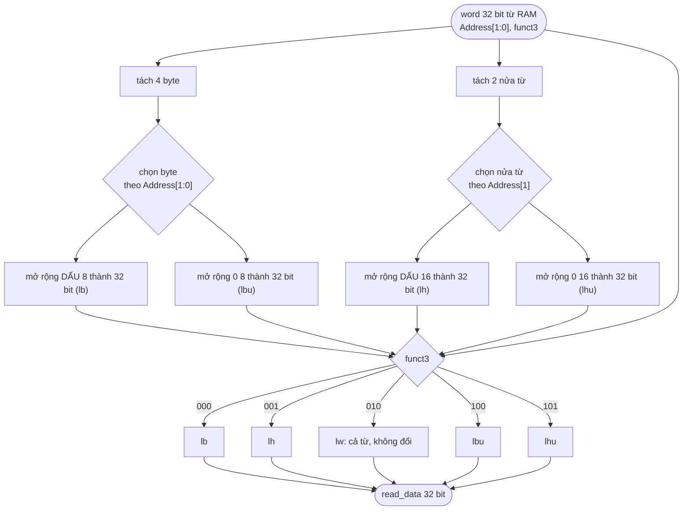

**Giải thích từng bước.**
1. RAM luôn đọc **nguyên từ 32 bit**; việc cắt byte hay nửa từ là của khối này.
2. Hai multiplexer chọn byte (theo `Address[1:0]`) và nửa từ (theo `Address[1]`).
3. Bốn bộ mở rộng bit chuẩn bị cả bốn kết quả (có dấu và không dấu); multiplexer cuối chọn theo `funct3` (000 lb, 001 lh, 010 lw, 100 lbu, 101 lhu).

**Ví dụ:** từ `0x000000F0`, địa chỉ byte 0: `lb` cho `0xFFFFFFF0` (0xF0 có bit dấu = 1 nên mở rộng toàn 1), `lbu` cho `0x000000F0`, `lw` cho nguyên `0x000000F0`.

---

## 9. StoreMerge - ghi một phần của từ (đọc - sửa - ghi)

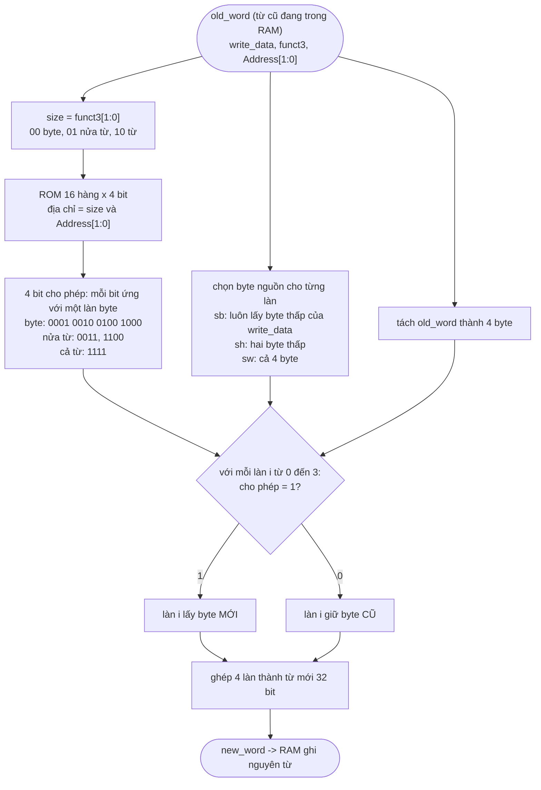

**Giải thích từng bước.**
1. RAM chỉ ghi **nguyên từ**, nên khi chỉ ghi một byte phải giữ nguyên ba byte kia.
2. Từ cũ được đọc ra (RAM đọc bất đồng bộ nên có sẵn trong cùng chu kỳ).
3. ROM nhỏ 16 hàng đổi `{size, Address[1:0]}` thành 4 bit cho phép, mỗi bit là một "làn" byte.
4. Với mỗi làn: nếu được phép thì lấy byte mới (từ `write_data`), không thì giữ byte cũ.  Ghép bốn làn thành từ mới để RAM ghi.

**Ví dụ:** từ cũ `0x11223344`, `sb x1, 1(x0)` với x1 = `0xAA`: `size = 00` (byte), `Address[1:0] = 01` -> cho phép = `0010` (chỉ làn 1) -> từ mới = `0x1122AA44`.

---

## 10. Memory - bộ nhớ dữ liệu

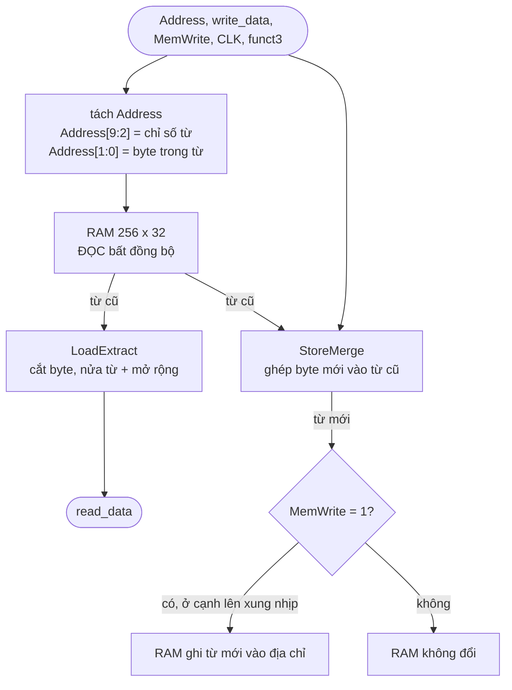

**Giải thích từng bước.**
1. Địa chỉ được tách: chỉ số từ (0..255) đi vào RAM, hai bit thấp chỉ byte trong từ.
2. RAM trả ngay từ ở địa chỉ đó (đọc bất đồng bộ).  `LoadExtract` biến từ này thành giá trị của lệnh load.
3. Khi là lệnh store, `StoreMerge` dựng từ mới; chỉ khi `MemWrite = 1` thì RAM mới ghi, ở cạnh lên của xung nhịp.
4. Lệnh không phải load/store có `MemWrite = 0` nên RAM không đổi; `read_data` vẫn có giá trị nhưng bị bỏ qua ở bước write-back.

**Vì sao đọc bất đồng bộ:** nếu đọc đồng bộ thì dữ liệu chỉ xuất hiện sau cạnh xung kế tiếp, lệnh load trả dữ liệu không xác định (lỗi đã gặp và sửa).  Địa chỉ từ 1 KiB trở lên quấn vòng vì chỉ dùng `Address[9:2]`.

---

## 11. `main` - CPU single-cycle: một lệnh trong một chu kỳ

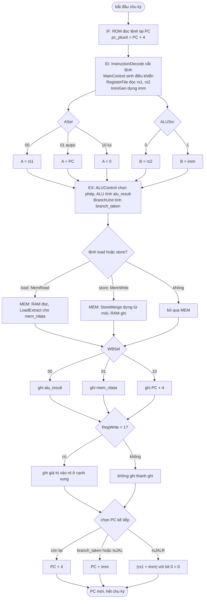

**Giải thích từng bước.**
1. **IF:** ROM nhận `PC[9:2]`, trả lệnh; bộ cộng riêng tính `PC + 4`.
2. **ID:** lệnh được cắt, điều khiển được sinh, hai thanh ghi được đọc, hằng số được dựng; cả bốn việc diễn ra song song.
3. **EX:** hai multiplexer chọn toán hạng A (`rs1`, `PC` hay `0`) và B (`rs2` hay `imm`); ALU tính; `BranchUnit` quyết định branch.
4. **MEM:** chỉ có việc khi là load/store.
5. **WB:** multiplexer `WBSel` chọn giá trị ghi (ALU, RAM hay PC+4); nếu `RegWrite = 1` thì ghi vào `rd`.
6. **PC kế tiếp:** `jalr` (đích tính bằng ALU, xóa bit 0) ưu tiên cao nhất; rồi tới branch được rẽ hoặc `jal` (PC + imm); còn lại PC + 4.

**Vì sao thiết kế thế:** `lui`, `auipc`, `jal`, `jalr` dùng lại đúng ALU và đường write-back nhờ `ASel` và `WBSel`, không thêm phần cứng riêng.

**Ví dụ mỗi nhóm lệnh trong `demo.s`:** xem `docs/vi/DEMO_EXPLAIN.md` mục 3 (add, addi, bnez, sw, lw, jal, ret, sub, slti) với giá trị thật trên từng dây.

---

## 12. ForwardingUnit - chọn nguồn mới nhất cho toán hạng ở EX

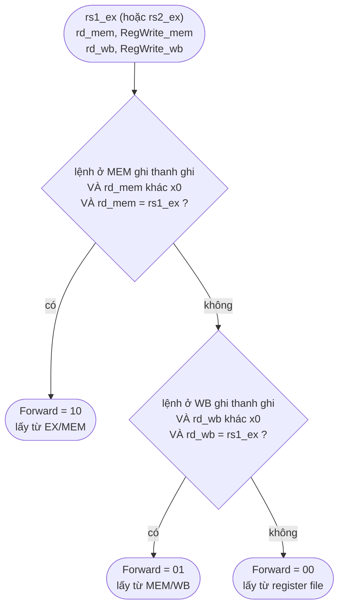

**Giải thích từng bước.**
1. Vấn đề: lệnh ở EX cần thanh ghi mà một lệnh **trước đó** chưa kịp ghi vào register file (phụ thuộc RAW: đọc sau ghi).
2. Kiểm tra lệnh ngay trước (đang ở MEM) **trước**: nếu nó ghi đúng thanh ghi cần thì lấy kết quả của nó từ EX/MEM (`Forward = 10`).
3. Nếu không, kiểm tra lệnh cách một (đang ở WB): lấy từ MEM/WB (`Forward = 01`).
4. Cả hai đều không khớp: dùng giá trị đọc từ register file (`00`).
5. Khối này chạy hai lần: một cho `rs1` (`ForwardA`), một cho `rs2` (`ForwardB`).

**Vì sao ưu tiên MEM:** nếu cả hai tầng cùng ghi thanh ghi đó thì lệnh ở MEM mới hơn nên giá trị của nó là đúng.  **Vì sao loại x0:** x0 luôn bằng 0, forward một "kết quả" ghi vào x0 sẽ sai.  Giá trị lấy từ EX/MEM là kết quả ALU, **riêng `jal`/`jalr` là PC + 4**.

**Ví dụ (`hazards_demo.s`):** `li x1,100` rồi ngay sau là `sw x1,0(x0)`: khi `sw` ở EX thì `li` ở MEM, `rd_mem = 1 = rs2_ex` -> `ForwardB = 10`.

---

## 13. HazardUnit - phát hiện load-use và dừng pipeline

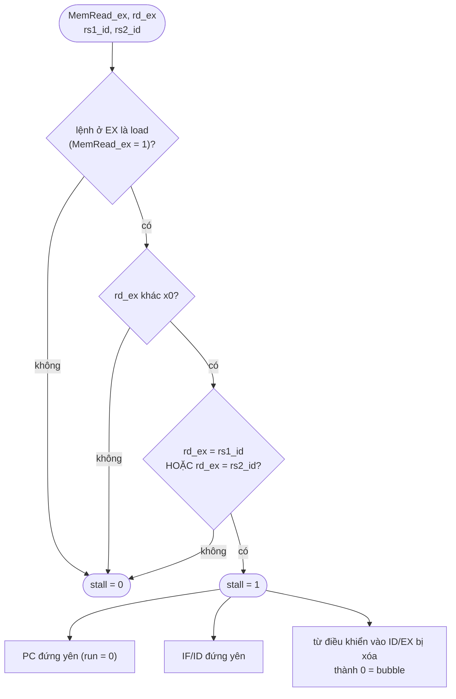

**Giải thích từng bước.**
1. Lệnh load chỉ có dữ liệu ở **cuối tầng MEM**, quá muộn để lệnh ngay sau dùng ở EX; forwarding không cứu được.
2. Điều kiện stall: lệnh ở EX là load, đích khác x0, và lệnh đang ở ID dùng đúng thanh ghi đó (`rs1` hoặc `rs2`).
3. Khi `stall = 1`: PC và IF/ID đứng yên một chu kỳ (lệnh ở ID phải chờ), còn ID/EX nhận lệnh rỗng (bubble).  Chu kỳ sau load đã ở MEM/WB nên forwarding lấy được dữ liệu.

**Chi phí đúng 1 chu kỳ.**  Load, một lệnh không liên quan rồi mới dùng: không stall.  **Ví dụ:** `lw x2,0(x0)` rồi `addi x3,x2,1`: tại tick 4 `stall = 1`, tick 5 PC đứng ở 0x10.

---

## 14. `Pipeline` - một chu kỳ của CPU 5 tầng

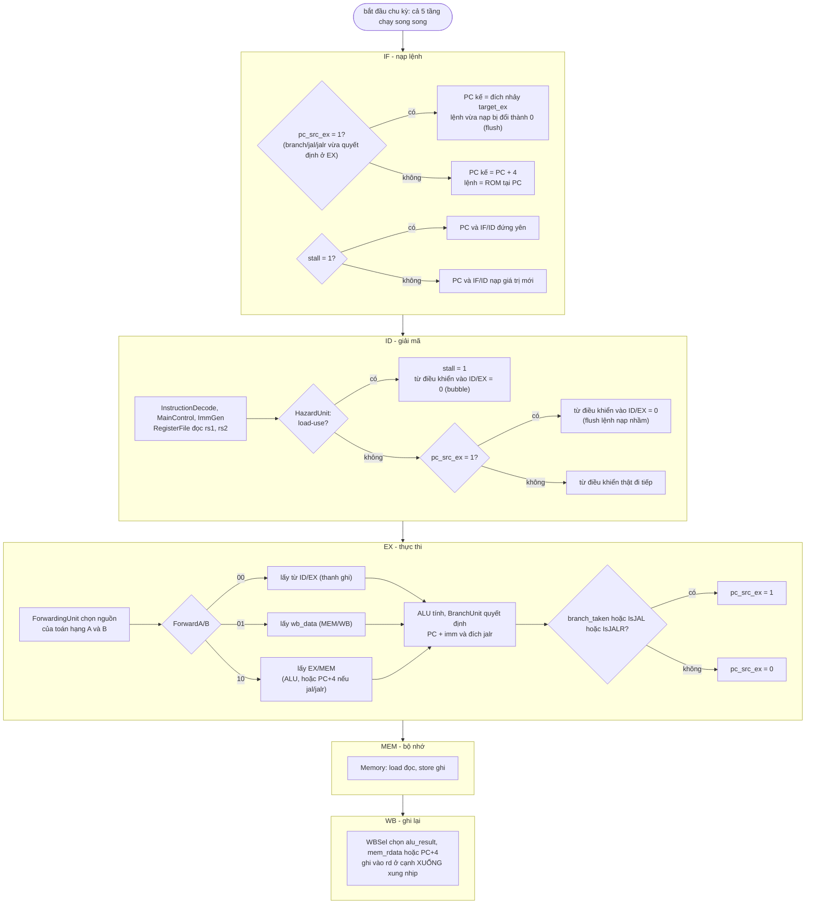

**Giải thích từng bước.**
1. Trong mỗi chu kỳ năm tầng làm việc trên **năm lệnh khác nhau**; bốn thanh ghi pipeline (IF/ID, ID/EX, EX/MEM, MEM/WB) giữ mọi thứ mà mỗi lệnh cần ở tầng sau, gồm cả "từ điều khiển" đóng gói sinh một lần ở ID.
2. **Stall (load-use):** `HazardUnit` thấy lệnh ở ID phụ thuộc lệnh load ở EX -> giữ PC và IF/ID, chèn bubble vào ID/EX.
3. **Forwarding:** ở EX, nếu một toán hạng đã có ở lệnh phía trước chưa ghi xong, `ForwardingUnit` đưa nó thẳng vào ALU.
4. **Flush (control hazard):** branch, `jal`, `jalr` quyết định ở EX; khi `pc_src_ex = 1`, PC nhảy tới đích và **hai lệnh đã nạp phía sau bị hủy** (thành bubble): mất 2 chu kỳ.  Branch không rẽ không mất gì.
5. **Register file ghi ở cạnh xuống** (`CLK_n`): lệnh ở WB ghi nửa đầu chu kỳ, lệnh ở ID đọc nửa sau nên thấy giá trị mới (không cần forward khoảng cách 3 lệnh).

**Các trường hợp (tóm tắt):**

| Tình huống | Dấu hiệu trên probe | Cách giải quyết | Chi phí |
|---|---|---|---|
| dùng giá trị ALU vừa tính | `ForwardA/B` = 10 hoặc 01 | forwarding | 0 chu kỳ |
| dùng giá trị vừa load | `stall` = 1, PC đứng yên 1 tick | stall + forwarding | 1 chu kỳ |
| branch/jal/jalr được rẽ | `pc_src_ex` = 1, sau đó `instr_id` = 0 | flush 2 lệnh | 2 chu kỳ |
| branch không rẽ | `pc_src_ex` = 0 | không làm gì | 0 chu kỳ |

Chi tiết từng tick của `hazards_demo.s` xem `docs/vi/DEMO_EXPLAIN.md` mục 6.

---

## 15. Bảng so sánh nhanh: mỗi circuit trả lời câu hỏi gì

| Circuit | Câu hỏi nó trả lời | Đầu vào chính | Đầu ra chính |
|---|---|---|---|
| InstructionDecode | Lệnh gồm những trường nào? | `Instruction` | `opcode rd funct3 rs1 rs2 funct7` |
| MainControl | Lệnh này cần bật những tín hiệu nào? | `opcode` | `RegWrite ALUSrc MemWrite MemRead IsBranch ALUOp ImmSel ASel WBSel IsJAL IsJALR` |
| ImmGen | Hằng số trong lệnh là bao nhiêu? | `Instruction`, `ImmSel` | `Imm` |
| RegisterFile | Giá trị các thanh ghi nguồn, và ghi vào đâu? | `rs1 rs2 rd write_data RegWrite` | `rs1_data rs2_data` |
| ALUControl | ALU phải làm phép gì? | `ALUOp funct3 funct7` | `ALUCtrl` |
| ALU | Kết quả phép tính là gì? | `rs1_data rs2_data ALU_Ctrl` | `result` |
| BranchUnit | Có rẽ nhánh không? | `rs1_data rs2_data funct3 IsBranch` | `branch_taken` |
| LoadExtract | Giá trị load là gì? | từ RAM, `Address[1:0]`, `funct3` | `read_data` |
| StoreMerge | Từ mới ghi vào RAM là gì? | từ cũ, `write_data`, `funct3`, `Address[1:0]` | `new_word` |
| Memory | Đọc/ghi RAM thế nào? | `Address write_data MemWrite funct3` | `read_data` |
| `main` | Một lệnh chạy trọn vẹn thế nào? | xung nhịp | PC, thanh ghi, RAM |
| ForwardingUnit | Lấy toán hạng từ đâu cho đúng? | `rs1_ex rs2_ex rd_mem rd_wb RegWrite_*` | `ForwardA ForwardB` |
| HazardUnit | Có phải dừng pipeline không? | `MemRead_ex rd_ex rs1_id rs2_id` | `stall` |
| `Pipeline` | Năm lệnh chạy chồng thế nào? | xung nhịp | PC, thanh ghi, RAM |
