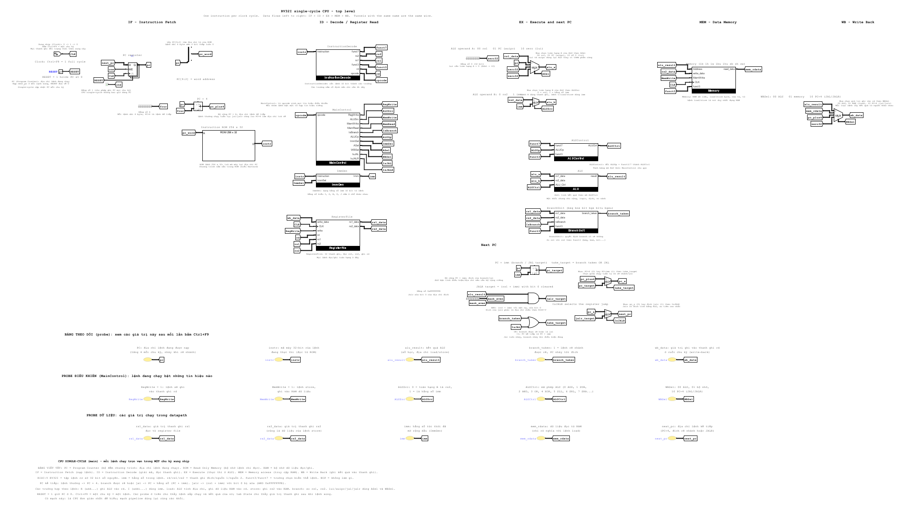

# Máy tính RV32I trong Logisim Evolution

> Bản tiếng Việt của README.md.

Một máy tính RISC-V (RV32I) 32-bit được xây dựng trong **Logisim Evolution 4.1.0** cho đồ án môn học
(đề bài: [docs/REQUIREMENTS.md](REQUIREMENTS.md)).  Dự án gồm **hai CPU** dùng chung các
khối xây dựng và chạy cùng các chương trình:

| Circuit | Đó là gì |
|---|---|
| `main` | **CPU single-cycle** (một lệnh mỗi chu kỳ clock) |
| `Pipeline` | **pipeline 5 tầng** IF > ID > EX > MEM > WB với forwarding, load-use stall và flush khi rẽ nhánh / nhảy |

Cả hai đều cài đặt toàn bộ tập lệnh số nguyên cơ sở RV32I trừ `fence`, `ecall`, `ebreak` (chúng thực thi như no-op).
Mọi thứ đều được kiểm thử: 9 file test module, 7 chương trình test toàn CPU và một fuzzer chương trình ngẫu nhiên, tất cả được so sánh với một
bộ mô phỏng tham chiếu độc lập.  Báo cáo kỹ thuật: [docs/REPORT.md](REPORT.md).



## Bắt đầu nhanh

Yêu cầu: Java 21 trở lên (Logisim Evolution 4.1.0 không khởi động được trên Java 17), Python 3.10+.

```powershell
cd D:\hust\logisim
java -jar .\logisim-evolution-4.1.0-all.jar .\RiscVComputer.circ
```

1. Trong cây dự án, mở `main` (single-cycle) hoặc `Pipeline`.
2. **Nạp chương trình** vào ROM lệnh: nhấp phải vào ROM > **Load Image...**, gõ đường dẫn của một
   file `.hex` (định dạng "v2.0 raw" của Logisim) rồi nhấn Enter. (*Edit Contents...* thì mở trình soạn hex.) Tạo file từ assembly:
   ```powershell
   python tools\rv.py asm programs\demo.s -o programs\demo.hex -l
   ```
   ROM đã chứa sẵn `programs/demo.s` (tổng 1..10, store/load, một lệnh gọi hàm).
3. Chỉnh `RESET` lên 1 rồi về lại 0 (đặt PC về 0).
4. Chạy từng bước: `Simulate > Manual Tick Full Cycle` (**Ctrl+F9**) mỗi lần một chu kỳ clock (`Auto-Tick Enabled`, Ctrl+K, chạy tự do; `Reset Simulation` là Ctrl+R).
5. Xem các register trực tiếp ở tab **State** (góc dưới bên trái, cạnh *Properties*): tab này liệt kê `PC` và `x0`..`x31` và cập nhật sau mỗi tick.
   `instr` và `wb_data` được hiển thị bằng các probe màu vàng trong circuit.

Kết quả mong đợi của chương trình demo: `x10 = 55`, `x12 = 110`, `x13 = 55`, `x14 = 1`; CPU single-cycle xong sau 39 chu kỳ, pipeline sau 64.
Xem [docs/DEMO.md](DEMO.md) để có kịch bản demo.

## Các file

| Đường dẫn | Nội dung |
|---|---|
| `RiscVComputer.circ` | dự án (cả hai CPU và mọi khối) |
| `programs/` | `demo.s` (nạp sẵn trong ROM), `hazards_demo.s` (minh họa stall / forwarding / flush), kèm các ảnh `.hex` |
| `tools/rv.py` | assembler (`asm`) và bộ mô phỏng tham chiếu (`sim`) |
| `tools/java/`, `tools/bin/` | các helper Java: bộ chạy headless `Run`, bộ vẽ `Render`, bộ dump chân `Ends` (`tools\compile.ps1` biên dịch chúng) |
| `tools/build/` | các bộ sinh circuit (`build_all.py`), xem [Dựng lại các mạch](#dựng-lại-các-mạch) |
| `tests/` | test vector của module, chương trình test, bộ chạy test |
| `docs/` | tài liệu, xem mục lục bên dưới |
| `backup/` | các phiên bản trước của `.circ` |
| `logisim-mcp/` | MCP server để Claude Code đọc / test circuit (xem `commands.txt`) |

## Tài liệu

| Tài liệu | Đọc để ... |
|---|---|
| [docs/GUIDE.md](GUIDE.md) | **hiểu mọi thứ**: CPU làm gì, từng khối, giá trị tín hiệu thực tế, pipeline, test, xử lý sự cố, bảng thuật ngữ |
| [docs/REPORT.md](REPORT.md) | báo cáo kỹ thuật chính thức (kiến trúc, module, pipeline, hazard, test, kết quả) |
| [docs/COMPONENTS.md](COMPONENTS.md), [docs/BOM.md](BOM.md) | **cấu hình của từng component và lý do** (thiết lập, tên trong GUI, các bẫy, quyết định thiết kế), và bảng danh mục vật tư (BOM) được sinh tự động |
| [docs/TOOLS.md](TOOLS.md) | assembler, bộ mô phỏng, bộ chạy, bộ sinh và test hoạt động bên trong như thế nào |
| [docs/DESIGN_LOG.md](DESIGN_LOG.md) | lịch sử, các quyết định thiết kế, các cạm bẫy đã gặp |
| [docs/DEMO.md](DEMO.md) | kịch bản cho video demo |
| [docs/REQUIREMENTS.md](REQUIREMENTS.md) | đề bài (tiếng Việt) kèm trạng thái từng mục |
| [docs/INDEX.md](INDEX.md) | bản đồ toàn bộ tài liệu và thứ tự đọc gợi ý |

## Tập lệnh

Toàn bộ RV32I: `add sub sll slt sltu xor srl sra or and`, `addi slti sltiu xori ori andi slli srli srai`,
`lb lh lw lbu lhu sb sh sw`, `beq bne blt bge bltu bgeu`, `jal jalr`, `lui auipc`.
Các lệnh giả trong assembler: `nop li mv not neg j jr ret call beqz bnez bltz bgez blez bgtz bgt ble bgtu bleu seqz snez`.
Bộ nhớ: ROM lệnh 256 từ, RAM dữ liệu 256 từ (địa chỉ quay vòng theo modulo 1 KiB), tổ chức Harvard.
Load / store cần căn chỉnh tự nhiên (truy cập không căn chỉnh sẽ dùng từ / halfword đã căn chỉnh).

## Kiến trúc trong một trang

Các khối (mỗi khối là một circuit trong dự án, có hình trong `docs/img`):

| Khối | Vai trò |
|---|---|
| `InstructionDecode` | tách `instr` thành `opcode rd funct3 rs1 rs2 funct7` |
| `MainControl` | opcode > `RegWrite ALUSrc MemWrite MemRead IsBranch ALUOp ImmSel ASel WBSel IsJAL IsJALR` |
| `ImmGen` | các immediate I / S / B / U / J |
| `RegisterFile` | x0..x31, 2 cổng đọc, 1 cổng ghi |
| `ALUControl`, `ALU` | 10 phép toán, `ALUCtrl` 0..9 |
| `BranchUnit` | `beq bne blt bge bltu bgeu` |
| `Memory` = `LoadExtract` + `StoreMerge` + RAM | `lb lh lw lbu lhu sb sh sw` |
| `ForwardingUnit`, `HazardUnit` | chỉ dùng cho pipeline |

Tín hiệu điều khiển (được kiểm tra bởi `tests/maincontrol.vec`):

| opcode | loại | RegWrite | ALUSrc | MemW | MemR | Branch | ALUOp | ImmSel | ASel | WBSel |
|---|---|---|---|---|---|---|---|---|---|---|
| `0x33` | R-type | 1 | 0 | 0 | 0 | 0 | 10 | - | rs1 | ALU |
| `0x13` | I-type ALU | 1 | 1 | 0 | 0 | 0 | 11 | I | rs1 | ALU |
| `0x03` | load | 1 | 1 | 0 | 1 | 0 | 00 | I | rs1 | MEM |
| `0x23` | store | 0 | 1 | 1 | 0 | 0 | 00 | S | rs1 | - |
| `0x63` | branch | 0 | 0 | 0 | 0 | 1 | 01 | B | rs1 | - |
| `0x37` | lui | 1 | 1 | 0 | 0 | 0 | 00 | U | zero | ALU |
| `0x17` | auipc | 1 | 1 | 0 | 0 | 0 | 00 | U | PC | ALU |
| `0x6F` | jal | 1 | 0 | 0 | 0 | 0 | 00 | J | - | PC+4 |
| `0x67` | jalr | 1 | 1 | 0 | 0 | 0 | 00 | I | rs1 | PC+4 |

`ALUCtrl`: 0 ADD, 1 SUB, 2 AND, 3 OR, 4 XOR, 5 SLL, 6 SRL, 7 SRA, 8 SLT, 9 SLTU.
`ImmSel`: 0 I, 1 S, 2 B, 3 U, 4 J.  `ASel`: 00 rs1, 01 PC, 10 zero.  `WBSel`: 00 ALU, 01 memory, 10 PC+4.

**Hazard của pipeline** (chi tiết trong báo cáo):

* *Hazard dữ liệu, kết quả ALU cần dùng sớm*: `ForwardingUnit` chọn toán hạng của EX từ EX/MEM hoặc MEM/WB (`wb_data`).
  Register file ghi ở sườn xuống của clock, nên WB và ID có thể dùng nó trong cùng một chu kỳ.
* *Load-use*: `HazardUnit` dừng PC và IF/ID một chu kỳ và chèn một bubble vào ID/EX.
* *Hazard điều khiển*: branch / JAL / JALR được xác định ở EX; khi được thực hiện, PC được chuyển hướng và hai lệnh nằm sau
  bị flush (penalty 2 chu kỳ). Không có dự đoán nhánh (luôn là "not taken").

## Kiểm thử

```powershell
powershell -File tests\run_tests.ps1                  # 9 module test files (Logisim test vectors), ~35 s
python tests\run_cpu_tests.py --circuit all            # test programs on both CPUs, compared with the reference simulator
python tests\fuzz.py --count 20 --seed 1               # random programs on both CPUs
```

| Test | Kiểm tra gì |
|---|---|
| `tests/*.vec` | từng module riêng lẻ: `ALU` 15 hàng, `ALUControl` 23, `MainControl` 10, `ImmGen` 6, `BranchUnit` 16, `LoadExtract` 15, `StoreMerge` 7, `ForwardingUnit` 9, `HazardUnit` 5 |
| `tests/programs/*.s` | `alu` (mọi phép R/I), `mem` (mọi load / store), `branch` (6 điều kiện, được thực hiện và không), `jump` (jal jalr lui auipc, call / ret), `fib`, `hazard` (lệnh phụ thuộc, load-use, branch sau load, ...). Chúng tự kiểm tra: `x31 = 0x600D` khi mọi thứ đều đúng |
| `tests/fuzz.py` | chương trình ngẫu nhiên (load, store, branch, jump, dùng lại register dày đặc) được so sánh từng register và từng từ với bộ mô phỏng tham chiếu |

Số chu kỳ đo được (số chu kỳ clock cho đến khi lần ghi register cuối cùng hoàn tất; instructions = các lệnh đã thực hiện đến lần ghi đó):

| chương trình | instructions | single-cycle | pipeline | CPI pipeline |
|---|---|---|---|---|
| alu | 91 | 91 | 94 | 1.03 |
| mem | 69 | 69 | 73 | 1.06 |
| hazard | 67 | 67 | 82 | 1.22 |
| jump | 27 | 27 | 38 | 1.41 |
| branch | 69 | 69 | 104 | 1.51 |
| fib | 123 | 123 | 181 | 1.47 |
| demo | 39 | 39 | 64 | 1.64 |

Pipeline đạt CPI 1.0 trên mã tuyến tính; các vòng lặp có branch được thực hiện tốn thêm 2 chu kỳ mỗi lần.

## Dựng lại các mạch

`RiscVComputer.circ` được sinh từ các netlist bởi `tools/build/build_all.py` (không đi dây tay cho các khối mới); các khối vẽ tay
`ALU`, `InstructionDecode`, `RegisterFile`, `ImmGen`, `ALUControl` lấy từ `tools/build/base.circ`.

```powershell
powershell -File tools\compile.ps1                                           # once: compile the Java helpers
python tools\build\build_all.py tools\build\base.circ RiscVComputer.circ     # regenerate everything
```

Bộ sinh hỏi Logisim vị trí chính xác của các chân, vẽ các đoạn dây ngắn và các tunnel có tên, tránh va chạm, rồi **xác minh** file
đã lưu: mọi net phải được nối đúng như dự định, không được có chập mạch.  Những quy tắc học được một cách đắt giá: Logisim nối dây
chỉ tại các điểm đầu cuối (không có ngã ba chữ T trong file), mọi thứ phải nằm trên lưới 10 pixel, và `Constant` mặc định có giá trị 1.

## Giới hạn đã biết

* Không có dự đoán nhánh, cache, bộ nhân / chia, ngắt, GPIO / UART hay dấu phẩy động (các phần mở rộng tùy chọn).
* Các lệnh `fence`, `ecall`, `ebreak`, CSR chưa được cài đặt (xử lý như `nop`).
* ROM lệnh và RAM dữ liệu đều 256 từ; RAM dữ liệu tách biệt với ROM (chương trình không thể tự sửa mình).
* Báo cáo đã được soạn thảo trong [docs/REPORT.md](REPORT.md) (nhóm cần đọc soát và xuất file); video demo vẫn cần được quay ([docs/DEMO.md](DEMO.md) là kịch bản).

## Công cụ

Java 21 (JDK 21.0.12 tại `C:\Program Files\Java\jdk-21.0.12.1`), Python 3.10, MCP server `logisim-mcp` (venv cần `mcp<2`).
`commands.txt` liệt kê các lệnh.
