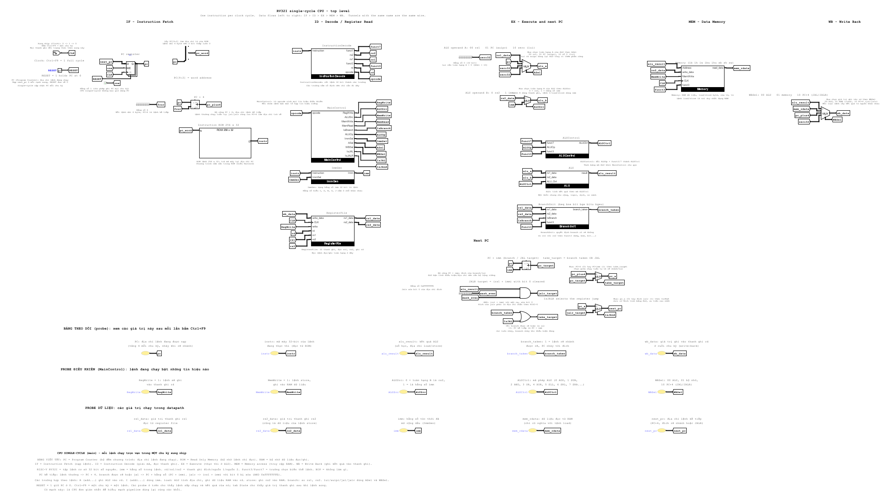
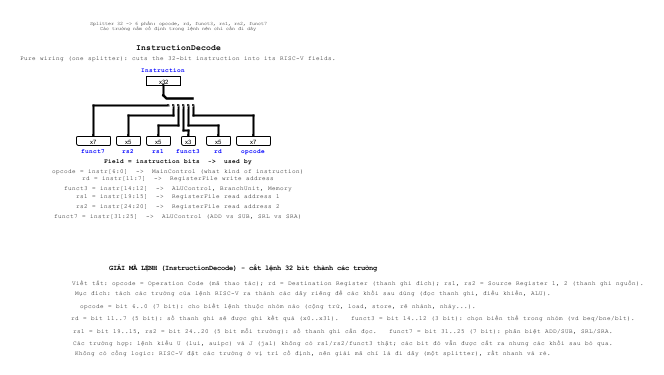
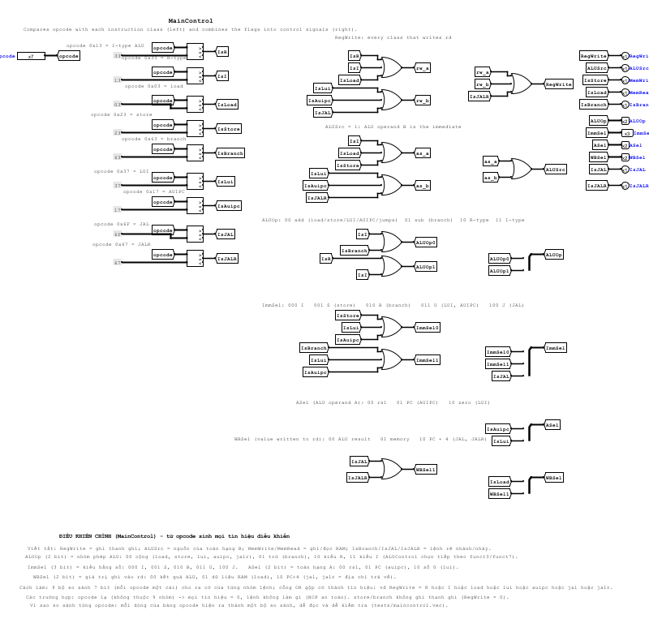
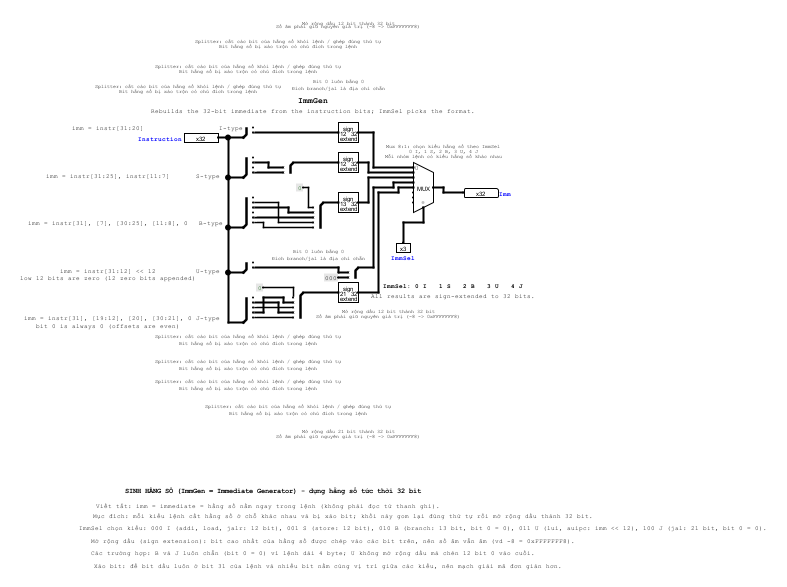
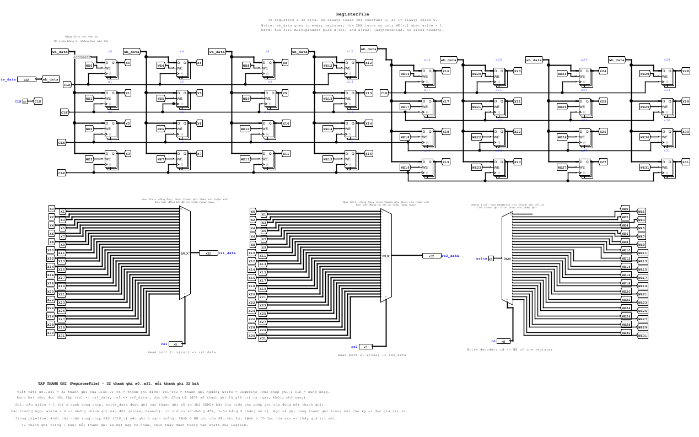
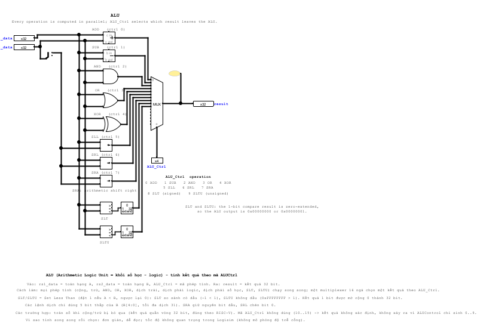
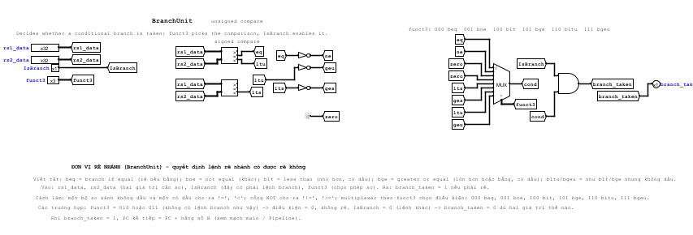
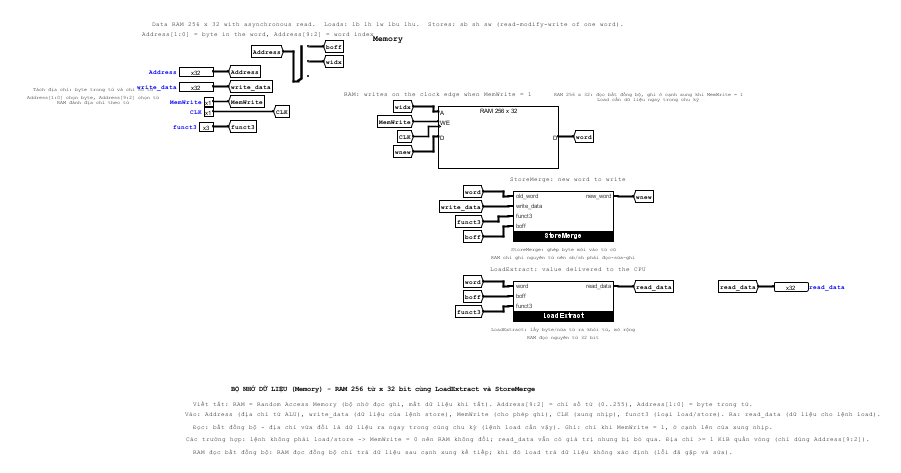
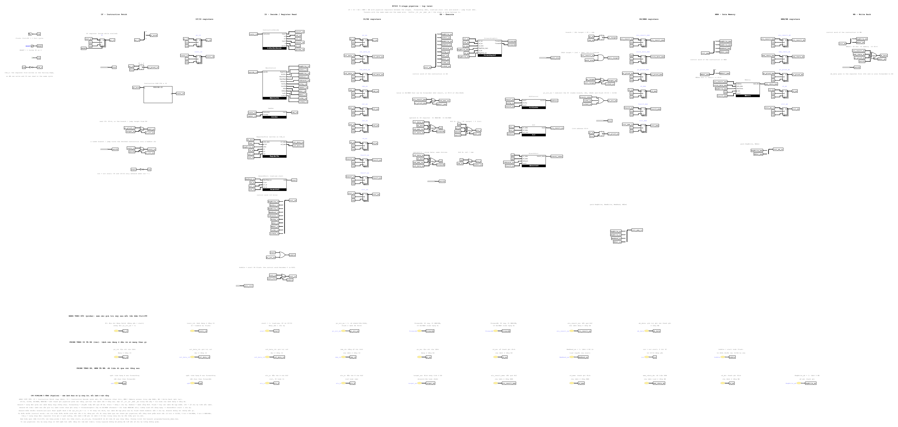

# Báo cáo kỹ thuật - máy tính RISC-V 32-bit (RV32I) trên Logisim Evolution

> Bản tiếng Việt của docs/REPORT.md.

Bài tập lớn "Thiết kế máy tính RISC-V 32-bit".  Công cụ: Logisim Evolution 4.1.0.  Báo cáo theo cấu trúc mà đề bài yêu cầu: kiến trúc, thiết kế từng module, pipeline, xử lý hazard, kiểm thử, kết quả và phần mở rộng.  Mọi số liệu trong báo cáo đều được đo trên chính project trong repo này.

Nội dung: 1 Mục tiêu - 2 Kiến trúc - 3 Các khối cơ bản - 4 CPU single-cycle - 5 CPU pipeline - 6 Chương trình và công cụ - 7 Kiểm chứng - 8 Kết quả - 9 Lỗi đã tìm thấy và sửa - 10 Mở rộng và hướng phát triển - A Mã hóa lệnh

---

## 1. Mục tiêu và kết quả

Đề bài: thiết kế, mô phỏng và kiểm thử một máy tính 32-bit với tập lệnh RISC-V RV32I, gồm CPU, bộ nhớ lệnh, bộ nhớ dữ liệu và khối điều khiển; một phiên bản single-cycle và một phiên bản pipeline 5 tầng (IF, ID, EX, MEM, WB) xử lý được các hazard dữ liệu và điều khiển cơ bản; chạy chương trình nạp vào bộ nhớ lệnh; có kiểm thử cho từng module và cho toàn bộ CPU.

| Yêu cầu | Trạng thái |
|---|---|
| Dữ liệu 32-bit, lệnh 32-bit, 32 thanh ghi x 32-bit, PC 32-bit, RV32I | đã xong |
| Số học / logic: ADD SUB AND OR XOR SLT SLTU SLL SRL SRA | đã xong |
| Lệnh hằng số: ADDI ANDI ORI XORI SLTI SLTIU SLLI SRLI SRAI | đã xong |
| Bộ nhớ: LW SW (+ tùy chọn LB LH LBU LHU SB SH) | đã xong, gồm cả các lệnh tùy chọn |
| Rẽ nhánh: BEQ BNE JAL JALR (+ tùy chọn BLT BGE BLTU BGEU) | đã xong, gồm cả các lệnh tùy chọn |
| LUI, AUIPC (phần còn lại của RV32I) | đã xong |
| CPU single-cycle | đã xong (`main`) |
| Pipeline 5 tầng, hazard dữ liệu và điều khiển | đã xong (`Pipeline`): forwarding, stall load-use, flush khi rẽ nhánh / nhảy |
| Chương trình nạp qua bộ nhớ lệnh | đã xong: ảnh ROM tạo từ assembler, không bao giờ gán trực tiếp thanh ghi |
| Assembler (nên có) | đã xong: `tools/rv.py` |
| Kiểm thử từng module và toàn CPU | đã xong: 9 file test module, 7 chương trình, bộ fuzz ngẫu nhiên |
| Tính năng nâng cao tùy chọn (dự đoán rẽ nhánh, cache, mở rộng M, ngắt, GPIO / UART, số thực) | chưa làm |

## 2. Kiến trúc

### 2.1 Tổng quan

Tổ chức Harvard: bộ nhớ lệnh chỉ đọc (ROM, 256 từ) và bộ nhớ dữ liệu riêng (RAM, 256 từ).  Địa chỉ từ bằng `địa chỉ byte / 4`; 2 bit thấp chọn byte.  PC là thanh ghi 32-bit; chỉ `PC[9:2]` đánh địa chỉ cho ROM.  Địa chỉ dữ liệu được quấn vòng theo modulo 1 KiB (`Address[9:2]`).



Mọi tín hiệu đi giữa các khối đều có tên, và **các tunnel cùng tên là cùng một dây**.  Tên theo đặc tả RISC-V (`rs1`, `rs2`, `rd`, `funct3`, `imm`, ...) và các tên tín hiệu điều khiển thông dụng trong giáo trình.

### 2.2 Định dạng lệnh

```
R  funct7[31:25] rs2[24:20] rs1[19:15] funct3[14:12] rd[11:7]  opcode[6:0]
I  imm[11:0][31:20]         rs1        funct3        rd        opcode
S  imm[11:5][31:25] rs2     rs1        funct3        imm[4:0][11:7] opcode
B  imm[12|10:5][31:25] rs2  rs1        funct3        imm[4:1|11][11:7] opcode
U  imm[31:12]                                         rd        opcode
J  imm[20|10:1|11|19:12][31:12]                       rd        opcode
```

Các opcode được dùng: `0x33` R, `0x13` I-ALU, `0x03` load, `0x23` store, `0x63` branch, `0x37` LUI, `0x17` AUIPC, `0x6F` JAL, `0x67` JALR.

### 2.3 Tín hiệu điều khiển

| Tín hiệu | Ý nghĩa |
|---|---|
| `RegWrite` | ghi `rd` trong register file |
| `ALUSrc` | toán hạng B của ALU: 0 = `rs2`, 1 = hằng số tức thời |
| `ASel` (2 bit) | toán hạng A của ALU: 00 = `rs1`, 01 = PC (AUIPC), 10 = 0 (LUI) |
| `ALUOp` (2 bit) | 00 cộng, 01 trừ, 10 kiểu R (dùng funct3 / funct7), 11 kiểu I (dùng funct3 / funct7) |
| `ImmSel` (3 bit) | 0 I, 1 S, 2 B, 3 U, 4 J |
| `MemWrite`, `MemRead` | store, load |
| `WBSel` (2 bit) | giá trị ghi vào `rd`: 00 kết quả ALU, 01 bộ nhớ, 10 PC + 4 |
| `IsBranch`, `IsJAL`, `IsJALR` | chuyển điều khiển |

## 3. Các khối cơ bản

Mỗi khối là một circuit của project; hình nằm trong `docs/img/`.  "Test" là tên file trong `tests/` kiểm tra khối đó.

### 3.1 InstructionDecode
Chỉ là đi dây: một splitter cắt `instr` thành `opcode = [6:0]`, `rd = [11:7]`, `funct3 = [14:12]`, `rs1 = [19:15]`, `rs2 = [24:20]`, `funct7 = [31:25]`.  

### 3.2 MainControl
Chín bộ so sánh 7-bit so `opcode` với chín hằng số ở mục 2.2.  Các cờ kết quả được gộp bằng cổng OR thành các tín hiệu điều khiển; các tín hiệu nhiều bit (`ALUOp`, `ImmSel`, `ASel`, `WBSel`) được ghép bằng splitter:
`ALUOp = {IsR|IsI, IsI|IsBranch}`, `ImmSel = {IsJAL, IsBranch|IsLui|IsAuipc, IsStore|IsLui|IsAuipc}`, `ASel = {IsLui, IsAuipc}`,
`WBSel = {IsJAL|IsJALR, IsLoad}`.  Test: `maincontrol.vec` (mọi opcode cộng một opcode không hợp lệ).  

### 3.3 ImmGen
Mỗi định dạng có một splitter dựng lại hằng số, một bit extender mở rộng dấu (kiểu U thì thay bằng nối thêm 12 bit 0), một bộ multiplexer 8 ngõ vào (dùng 5) chọn theo `ImmSel`.  Test: `immgen.vec` (các ví dụ trong ghi chú thiết kế: `addi`, `sw`, `beq`, `lui`, `jal`).  

### 3.4 RegisterFile
32 thanh ghi 32-bit (`x0` luôn nạp hằng số 0), một bộ demultiplexer 1-ra-32 đưa `RegWrite` tới chân cho phép ghi của thanh ghi `rd`, hai multiplexer 32-vào-1 là hai cổng đọc (bất đồng bộ).  Các thanh ghi được gán nhãn `x0..x31`.  

### 3.5 ALU và ALUControl
ALU tính song song ADD, SUB, AND, OR, XOR, SLL, SRL, SRA, SLT, SLTU và một multiplexer 16-vào-1 chọn theo `ALUCtrl` 4 bit
(0 ADD, 1 SUB, 2 AND, 3 OR, 4 XOR, 5 SLL, 6 SRL, 7 SRA, 8 SLT, 9 SLTU).  Các lệnh dịch dùng `B[4:0]`.  `ALUControl` ánh xạ
`ALUOp / funct3 / funct7` thành `ALUCtrl`: với kiểu R, `funct7[5]` phân biệt ADD / SUB và SRL / SRA; với kiểu I chỉ các lệnh dịch mới xét bit này.  Test: `alu.vec`, `alucontrol.vec` (đủ 10 phép kiểu R và 9 phép kiểu I).  

### 3.6 BranchUnit
Một bộ so sánh không dấu và một bộ so sánh có dấu cho ra `==`, `<u`, `<s`; các cổng NOT cho ra `!=`, `>=u`, `>=s`; một multiplexer 1-bit 8-vào-1 chọn theo
`funct3` để lấy điều kiện (000 beq, 001 bne, 100 blt, 101 bge, 110 bltu, 111 bgeu; 010 / 011 cho 0); `branch_taken = IsBranch AND
điều kiện`.  Test: `branchunit.vec`.  

### 3.7 Memory (RAM + LoadExtract + StoreMerge)
RAM là RAM Logisim 256 x 32 với *đọc bất đồng bộ* và một chân cho phép ghi (ghi ở sườn lên của xung nhịp).  RAM chỉ ghi được nguyên từ, nên store dưới một từ là thao tác đọc-sửa-ghi trên một từ:

* `LoadExtract` lấy byte (`Address[1:0]`) hoặc nửa từ (`Address[1]`) ra khỏi từ rồi mở rộng dấu hoặc mở rộng 0; một multiplexer
  chọn theo `funct3` trả về `lb / lh / lw / lbu / lhu`.  Test: `loadextract.vec`.
* `StoreMerge` dựng từ mới từ từ cũ và `write_data`: một ROM nhỏ 16 hàng biến `{size, Address[1:0]}` thành bốn
  tín hiệu cho phép byte (byte `0001 0010 0100 1000`, half `0011 0011 1100 1100`, word `1111`) và bốn multiplexer 8-bit chọn, theo từng làn byte,
  byte mới hay byte cũ.  Test: `storemerge.vec`.



### 3.8 ForwardingUnit và HazardUnit (pipeline)
Xem mục 5.  Test: `forwardingunit.vec`, `hazardunit.vec`.

## 4. CPU single-cycle (`main`)

### 4.1 Datapath
* **IF**: thanh ghi `pc`, bộ cộng `PC + 4`, ROM lệnh được đánh địa chỉ bằng `PC[9:2]`.
* **ID**: `InstructionDecode`, `MainControl`, `ImmGen`, đọc `RegisterFile`.
* **EX**: toán hạng A của ALU = `mux(ASel: rs1, PC, 0)`, toán hạng B = `mux(ALUSrc: rs2, imm)`; `ALUControl` và `ALU`; `BranchUnit`.
* **MEM**: `Memory` với địa chỉ = kết quả ALU, dữ liệu = `rs2`.
* **WB**: `mux(WBSel: ALU, bộ nhớ, PC+4)` đưa vào register file.

### 4.2 PC kế tiếp
```
pc_target   = PC + imm                          (bộ cộng)
jalr_target = (rs1 + imm) & 0xFFFFFFFE          (kết quả ALU với bit 0 bị xóa)
take_target = branch_taken OR IsJAL
next_pc     = IsJALR ? jalr_target : take_target ? pc_target : PC + 4
```

### 4.3 Mỗi nhóm lệnh dùng datapath như thế nào

| Nhóm | A | B | Phép ALU | Bộ nhớ | Write-back | PC kế tiếp |
|---|---|---|---|---|---|---|
| kiểu R | rs1 | rs2 | theo funct | - | ALU | PC+4 |
| ALU kiểu I | rs1 | imm | theo funct | - | ALU | PC+4 |
| load | rs1 | imm | cộng | đọc | bộ nhớ | PC+4 |
| store | rs1 | imm | cộng | ghi rs2 | - | PC+4 |
| branch | - | - | - | - | - | `PC+imm` nếu rẽ |
| LUI | 0 | imm | cộng | - | ALU | PC+4 |
| AUIPC | PC | imm | cộng | - | ALU | PC+4 |
| JAL | - | - | - | - | PC+4 | `PC+imm` |
| JALR | rs1 | imm | cộng | - | PC+4 | `(rs1+imm)&~1` |

Xung nhịp: PC, register file và RAM đều cập nhật ở sườn lên; mọi thứ còn lại là tổ hợp.  Ngõ vào `RESET` giữ PC ở 0.

## 5. CPU pipeline (`Pipeline`)



### 5.1 Các tầng và thanh ghi pipeline
Dùng các khối giống CPU single-cycle, được cắt thành năm tầng bởi bốn thanh ghi pipeline.  Giá trị mang hậu tố của tầng (`_id`, `_ex`, `_mem`, `_wb`).

| Thanh ghi | Chứa |
|---|---|
| IF/ID | `pc_id`, `instr_id` |
| ID/EX | `pc_ex`, `rs1_data_ex`, `rs2_data_ex`, `imm_ex`, `rs1_ex`, `rs2_ex`, `rd_ex`, `funct3_ex`, `funct7_ex`, từ điều khiển `ctrl_ex` (13 bit: `RegWrite ALUSrc MemWrite MemRead IsBranch ALUOp ASel WBSel IsJAL IsJALR`) |
| EX/MEM | `alu_result_mem`, `store_data_mem`, `pc_plus4_mem`, `rd_mem`, `funct3_mem`, điều khiển `RegWrite MemWrite MemRead WBSel` |
| MEM/WB | `alu_result_wb`, `mem_rdata_wb`, `pc_plus4_wb`, `rd_wb`, điều khiển `RegWrite WBSel` |

Các tín hiệu điều khiển chỉ được sinh một lần, ở tầng ID, và đi cùng lệnh trong một "từ điều khiển" đóng gói; mỗi tầng chỉ tách ra phần mình dùng.

### 5.2 Thời điểm ghi của register file
Register file ghi ở **sườn xuống** của xung nhịp (xung nhịp của nó là `CLK_n`).  Vì vậy lệnh ở tầng WB ghi trong nửa đầu chu kỳ và lệnh ở tầng ID đọc giá trị mới trong nửa sau: không cần forwarding cho khoảng cách 3 lệnh qua register file.

### 5.3 Hazard dữ liệu: forwarding
`ForwardingUnit` so sánh `rs1_ex` / `rs2_ex` với thanh ghi đích của các lệnh đang ở MEM và WB:

```
forwardA = 10   nếu RegWrite_mem và rd_mem != 0 và rd_mem == rs1_ex          (giá trị từ EX/MEM)
         = 01   nếu không, nếu RegWrite_wb và rd_wb != 0 và rd_wb == rs1_ex   (giá trị từ MEM/WB = wb_data)
         = 00   còn lại                                                       (register file)
```
(`forwardB` tương tự với `rs2_ex`).  EX/MEM được ưu tiên vì nó giữ giá trị mới hơn.  Hai chi tiết dễ bỏ sót:

* giá trị forward từ EX/MEM là kết quả ALU, **trừ JAL / JALR thì là PC + 4** (một multiplexer 2-vào-1 `fwd_mem_val` theo `WBSel[1]`);
* toán hạng B sau forwarding cũng là dữ liệu mà lệnh store ghi (`store_data`), và toán hạng A / B cấp cho `BranchUnit`.

Ví dụ (`add x2,x1,x1` rồi `sub x3,x2,x1`, rồi `or x4,x3,x2`):
```
              1   2   3   4   5   6   7
add x2,x1,x1  IF  ID  EX  ME  WB
sub x3,x2,x1      IF  ID  EX  ME  WB        x2 forward từ EX/MEM
or  x4,x3,x2          IF  ID  EX  ME  WB    x3 từ EX/MEM, x2 từ MEM/WB
```

### 5.4 Hazard dữ liệu mà forwarding không giải quyết được: load-use
Lệnh load chỉ có dữ liệu ở cuối tầng MEM.  Nếu lệnh kế tiếp cần nó ở tầng EX thì phải chèn một bong bóng (bubble).  `HazardUnit` phát hiện
`MemRead_ex and rd_ex != 0 and (rd_ex == rs1_id or rd_ex == rs2_id)` rồi
* dừng PC và IF/ID (`run = 0`: chân cho phép ghi của chúng bằng 0),
* thay từ điều khiển đi vào ID/EX bằng 0 (một bubble).

```
              1   2   3   4   5   6   7
lw  x9,16(x0) IF  ID  EX  ME  WB
add x10,x9,x9     IF  ID  --  EX  ME  WB   stall ở ID, sau đó x9 được forward từ MEM/WB
```

### 5.5 Hazard điều khiển: branch, JAL, JALR
Mọi lệnh chuyển điều khiển đều được quyết định ở tầng EX (phép so sánh branch dùng toán hạng đã forward).  Khi `pc_src_ex = branch_taken or IsJAL or IsJALR`:
PC kế tiếp là địa chỉ đích, lệnh được fetch cùng chu kỳ bị thay bằng bubble (`instr_in = 0`) và từ điều khiển đi vào ID/EX được
xóa về 0, nên hai lệnh sau lệnh rẽ nhánh bị hủy.  Phạt: 2 chu kỳ cho mỗi branch được rẽ / lệnh nhảy; branch không rẽ không tốn gì
(dự đoán tĩnh "không rẽ").

```
              1   2   3   4   5   6
beq (rẽ)      IF  ID  EX  ME  WB
i+1               IF  ID  xx              bị flush
i+2                   IF  xx              bị flush
đích                      IF  ID  EX ...
```
Một từ lệnh toàn số 0 là vô hại: opcode 0 không khớp nhóm nào nên mọi tín hiệu điều khiển đều bằng 0.

### 5.6 Vì sao không còn hazard nào
Khoảng cách đọc-sau-ghi: cách 1 hoặc 2 lệnh - forwarding; cách 3 lệnh - register file ghi trước khi đọc; load rồi dùng ngay -
một stall, sau đó forwarding; store đọc dữ liệu sau forwarding; branch đọc toán hạng đã forward.
Ghi-sau-ghi và ghi-sau-đọc không thể xảy ra vì các lệnh hoàn thành theo thứ tự.

## 6. Chương trình và công cụ

| Công cụ | Mục đích |
|---|---|
| `tools/rv.py asm` | assembler RV32I (nhãn, `.word`, lệnh giả, macro tự kiểm `chk`) tạo ảnh ROM cho Logisim (hex `v2.0 raw`) |
| `tools/rv.py sim` | **bộ mô phỏng tham chiếu** có cùng bộ nhớ dữ liệu 256 từ: chuẩn độc lập cho mọi bài test |
| `tools/java/Run.java` | chạy chương trình trên một circuit không cần GUI: nạp ROM, đảo xung nhịp, đọc `PC`, `x0..x31` và RAM |
| `tools/build/` | sinh các circuit từ netlist và kiểm tra kết quả |
| `logisim-mcp/` | MCP server cho phép trợ lý AI xem và kiểm thử các circuit |

Nạp chương trình: nhấp phải vào ROM > *Load Image...* rồi chọn file `.hex`, hoặc `python tools/rv.py asm prog.s -o prog.hex`.

## 7. Kiểm chứng

Ba mức, tất cả đều tự động:

1. **Test module** (`tests/run_tests.ps1`): 106 hàng test-vector trên 9 module, do chính Logisim chạy (`--test-vector`).
2. **Chương trình** (`tests/run_cpu_tests.py`): 6 chương trình test + chương trình demo, chạy trên cả hai CPU.  Sau khi chạy, cả 32 thanh ghi và mọi từ dữ liệu khác 0 phải bằng kết quả của bộ mô phỏng tham chiếu, và các chương trình tự kiểm phải kết thúc với `x31 = 0x600D`.
   Các chương trình test được viết để mỗi chương trình đánh vào một tính năng: `alu`, `mem`, `branch`, `jump`, `fib`, `hazard` (phụ thuộc liên tiếp, phụ thuộc cách 3 lệnh, load-use, load rồi store giá trị vừa load, load làm địa chỉ, branch trên giá trị vừa load, branch được rẽ nhảy qua lệnh, liên kết `jal` dùng ngay,
   `jalr` qua thanh ghi vừa ghi, `x0` làm đích, cùng một thanh ghi ghi hai lần).
3. **Chương trình ngẫu nhiên** (`tests/fuzz.py`): chương trình ngẫu nhiên 60-80 lệnh chỉ dùng 7 thanh ghi (nên hầu như mọi lệnh đều phụ thuộc một lệnh gần đó), load và
   store đủ mọi kích thước, branch và lệnh nhảy tiến.  30 chương trình (60 lượt chạy trên hai CPU) đã được chạy trên project cuối cùng và 12 chương trình nữa trên một bản dựng trước đó; tất cả đều khớp.

Chính bộ mô phỏng tham chiếu cũng được kiểm tra bằng các mã hóa trong ghi chú thiết kế (`addi x1,x0,5 = 00500093`, `add x3,x1,x2 = 002081B3`, ...) và
bằng các chương trình tự kiểm có giá trị mong đợi được tính tay.

## 8. Kết quả

Số chu kỳ xung nhịp cho đến khi lần ghi thanh ghi cuối cùng hoàn tất (đã tính cả thời gian làm đầy và xả pipeline); số lệnh = số lệnh đã thực thi tới lần ghi đó:

| chương trình | số lệnh | single-cycle | pipeline | CPI pipeline | lý do |
|---|---|---|---|---|---|
| alu | 91 | 91 | 94 | 1.03 | không có branch được rẽ, forwarding che hết các phụ thuộc |
| mem | 69 | 69 | 73 | 1.06 | |
| hazard | 67 | 67 | 82 | 1.22 | stall load-use, 4 branch / lệnh nhảy được rẽ |
| jump | 27 | 27 | 38 | 1.41 | 4 lệnh nhảy |
| branch | 69 | 69 | 104 | 1.51 | nhiều branch được rẽ |
| fib | 123 | 123 | 181 | 1.47 | vòng lặp: 1 branch được rẽ mỗi 4 lệnh |
| demo | 39 | 39 | 64 | 1.64 | vòng lặp 10 lần + một lần gọi hàm |

Mức phạt của pipeline, đo bằng các chương trình rất nhỏ (số chu kỳ thêm so với cùng chương trình không có hazard):

| Tình huống | Chu kỳ thêm |
|---|---|
| lệnh phụ thuộc ngay sau một lệnh ALU (forwarding) | 0 |
| dùng giá trị vừa load ở lệnh kế tiếp (load-use) | 1 |
| load, một lệnh không liên quan, rồi mới dùng | 0 |
| branch không rẽ | 0 |
| branch được rẽ / `jal` / `jalr` | 2 |

Tính theo chu kỳ, pipeline ở đây không nhanh hơn CPU single-cycle - lợi ích của pipeline là chu kỳ xung nhịp ngắn hơn (đường dài nhất
rút từ "fetch + giải mã + ALU + bộ nhớ + write back" xuống còn một tầng), điều mà mô phỏng không độ trễ của Logisim không thể hiện.  Cái giá của pipeline
là mức phạt 2 chu kỳ khi rẽ nhánh; dự đoán rẽ nhánh hoặc quyết định sớm hơn (ở ID) sẽ loại bỏ phần lớn mức phạt này.

Kích thước (các linh kiện không phải tunnel hay văn bản): `main` có 28 (8 khối sub-circuit, thanh ghi PC, 3 multiplexer, 3 bộ cộng / cổng ...); `Pipeline` có 72, trong đó 24 là thanh ghi (PC + 23 thanh ghi pipeline) và 10 là khối sub-circuit.

## 9. Lỗi đã tìm thấy và sửa

Các khối ban đầu lần đầu tiên được kiểm thử bằng test vector và chương trình hoàn chỉnh; việc này đã tìm ra các lỗi thật.

| Ở đâu | Lỗi | Cách sửa |
|---|---|---|
| ALU | `SLTU` trả về `FFFFFFFF` thay vì 1 (kết quả 1-bit bị mở rộng dấu) | mở rộng 0 |
| ALUControl | `SLL` kiểu R chọn mã của `SRL` (hằng `6` thay vì `5`) | sửa hằng số |
| MainControl | JALR so sánh với opcode JAL `0x6F`; LUI chọn hằng số kiểu B; JALR chọn hằng số kiểu J | viết lại phần giải mã |
| ImmGen | kiểu U thiếu `<< 12`; bit 0 của kiểu J bằng 1 | đã sửa |
| Memory | load trả về dữ liệu không xác định (RAM được cấu hình đọc đồng bộ, CPU single-cycle không dùng được) | đọc bất đồng bộ, dựng lại khối |
| Datapath | JAL, JALR, LUI, AUIPC và vài lệnh khác chưa có datapath | đã thêm (`ASel`, `WBSel`, logic PC kế tiếp) |

Bài học về công cụ (đã tốn thời gian nên được ghi lại): Logisim chỉ nối dây ở các đầu mút, không nối ở chỗ giao chữ T, nên các file được sinh ra
phải chia nhỏ dây; mọi vị trí phải nằm trên lưới 10 pixel; `Constant` mặc định là 1 chứ không phải 0; RAM mặc định đọc đồng bộ, CPU
single-cycle không dùng được; circuit có tên bắt đầu bằng dấu gạch dưới bị đổi tên âm thầm.  Bộ sinh hiện kiểm tra tất cả những điều này và kiểm chứng các net của
mỗi circuit sau khi ghi.

## 10. Mở rộng và hướng phát triển

Chưa cài đặt (tùy chọn trong đề bài): dự đoán rẽ nhánh, cache, bộ nhân / chia (mở rộng M), ngắt, GPIO / UART, số thực.
Các bước tiếp theo tự nhiên, rẻ nhất trước: quyết định `JAL` ở ID (phạt 1 chu kỳ thay vì 2); bộ dự đoán nhánh một hoặc hai bit cùng một bộ đệm đích nhánh nhỏ; UART ánh xạ bộ nhớ tại một địa chỉ cố định để chương trình có thể in ra; mở rộng `M` với bộ chia nhiều chu kỳ và tín hiệu stall dùng lại `HazardUnit`.

## A. Mã hóa lệnh

| Lệnh | opcode | funct3 | funct7 / imm |
|---|---|---|---|
| add / sub | 0110011 | 000 | 0000000 / 0100000 |
| sll | 0110011 | 001 | 0000000 |
| slt / sltu | 0110011 | 010 / 011 | 0000000 |
| xor | 0110011 | 100 | 0000000 |
| srl / sra | 0110011 | 101 | 0000000 / 0100000 |
| or / and | 0110011 | 110 / 111 | 0000000 |
| addi slti sltiu xori ori andi | 0010011 | 000 010 011 100 110 111 | imm[11:0] |
| slli / srli / srai | 0010011 | 001 / 101 / 101 | 0000000 / 0000000 / 0100000 |
| lb lh lw lbu lhu | 0000011 | 000 001 010 100 101 | imm[11:0] |
| sb sh sw | 0100011 | 000 001 010 | imm[11:5], imm[4:0] |
| beq bne blt bge bltu bgeu | 1100011 | 000 001 100 101 110 111 | hằng số kiểu B |
| jal | 1101111 | - | hằng số kiểu J |
| jalr | 1100111 | 000 | imm[11:0] |
| lui / auipc | 0110111 / 0010111 | - | imm[31:12] |
